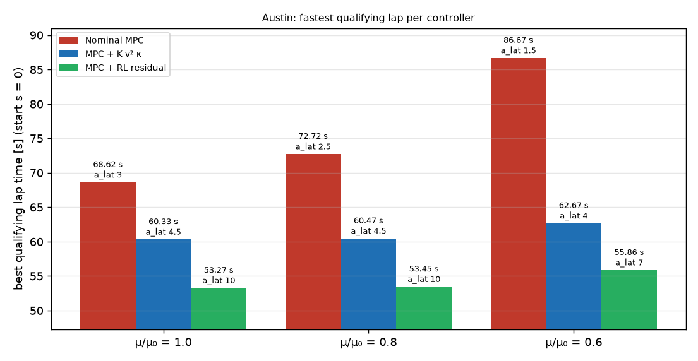
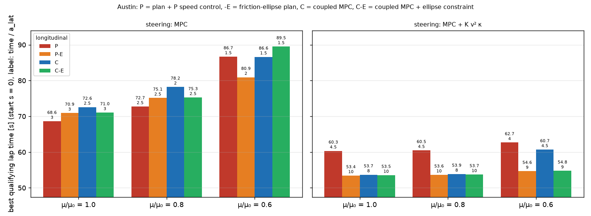

# Residual RL on MPC for Vehicle Racing under Model Mismatch

> **Tire model: simple ST (linear tires).** Every result in this document uses Gym-Khana 1.2.0's single-track (ST) plant. Its tire forces are linear in slip angle and never saturate, so μ only scales cornering stiffness and there is no grip limit (sections 1 and 6). The exploratory Pacejka (STD) runs in the appendix are the only exception.

This is the minimal feasibility pilot for the proposal *Residual RL on MPC for Vehicle Control under Model Mismatch* (v2). It answers one question:

> On a single development track, is there a speed and friction setting where nominal kinematic MPC loses tracking performance, while the same MPC with a one-parameter steering correction `K·v²·κ_ref` completes a qualifying lap at comparable realized speed?

**Plant.** The default plant is Gym-Khana 1.2.0's **ST model** (dynamic single-track, linear tires), the established f1tenth_gym model with identified F1TENTH parameters. In ST, μ scales tire cornering stiffness and never caps grip, so the mismatch studied here is **reduced cornering stiffness**, not driving at the friction limit. An exploratory run on Gym-Khana's newer, unvalidated Pacejka model (STD) is kept as an optional configuration and summarized in the appendix.

**Answer from this pilot (ST plant, raceline reference, four-tire track limits, walls only on straights): yes, at the lowest speed level.** At a_lat = 4 m/s², nominal MPC hits a wall at every friction setting. The same MPC + `K·v²·κ` completes a valid lap at the planned speed. This holds from both start poses, and in the a_lat = 4, μ/μ₀ = 0.6 cell it also holds for every wall margin and both K values tested. At the higher speed levels, both controllers fail. The caveats below matter.

**Lap-time comparison.** Each controller can also run at the fastest speed level where it still produces a qualifying lap. Nominal MPC then needs a much slower plan. The correction gains 8.3 s per lap at μ₀ (12%), 12.3 s at 0.8 μ₀ (17%), and 24.0 s at 0.6 μ₀ (28%).


*Above: μ/μ₀ = 0.6. Nominal MPC at its fastest qualifying level (a_lat 1.5, 86.67 s) against MPC + K·v²·κ (a_lat 4.0, 62.67 s). Each panel shows a running timer that freezes at the lap time.*


*Above: the same speed level for both (a_lat 4, μ/μ₀ = 0.8). Nominal MPC hits the wall at the turn-1 exit.*

## Setup and run

```bash
uv sync                                  # .venv with Python 3.11, gymkhana==1.2.0 (PyPI), osqp, shapely, ...
uv run python -m pilot.run_pilot         # whole pilot + plots + both GIFs, about 3 min (8 parallel workers)
uv run python -m pilot.sensitivity       # optional: wall margin x K sensitivity, about 1 min
uv run python -m pilot.reference_lap     # optional: dynamic-model reference lap + 3-car GIF, about 3 min (after run_pilot)
```

Every command takes `--config` (default `configs/pilot.yaml`, the ST plant) and `--out` (default: the config's `out` key, `results/`). The optional STD plant uses the same commands with its own config, and writes to `results_std/`. It needs a 1 ms physics step, so it is about 10× slower (about 50 min for all three):

```bash
uv run python -m pilot.run_pilot --config configs/pilot_std.yaml
```

The two configs differ only in `model`, `dt`, `out`, the MPC weights and the delay compensation. `workers` sets the number of parallel lap simulations. On first use, Gym-Khana downloads the Austin map from its own map release (`TeoIlie/F1TENTH_Racetracks` v1.4.0) into `~/.gymkhana/maps/`.

### Outputs (`results/` for ST; `results_std/` has the same layout for STD)

| File | Contents |
| --- | --- |
| `summary.csv` | One row per run: conservative lap, the 9 × 2 sweep, and rechecks. Includes status, progress, wall-collision location, off-track steps, lap time, speed adherence, RMS/max e_y, common-progress metrics, saturation, solver failures and solve-time percentiles |
| `comparison.png` | Both controllers in the most informative cell: e_y, speed and steering against track progress, plus a map with collision and off-track markers |
| `lap.gif` | Both controllers side by side in the same cell, follow camera, 4× real time. Tire patches turn red when off the legal surface. The body is drawn to scale, and a banner shows wall collision, off-track, or lap complete |
| `lap_time_comparison.csv/.png` | Fastest qualifying lap per controller and friction, with the speed level and the gap to nominal |
| `lap_time_grid.csv` | Every run of the lap-time search: controller × μ × a_lat × start pose |
| `lap_time.gif` | Both controllers at their own fastest qualifying levels, with lap timer and final gap (μ/μ₀ = 0.6) |
| `reference/` | Dynamic-model reference (section 6): `reference_lap_time.csv/.png` (3 controllers), `reference_grid.csv`, `reference_lap.gif` (3 cars, μ/μ₀ = 0.6), traces |
| `sensitivity.csv` | Outcome for wall margin ∈ {0.10, 0.15, 0.20} m × K ∈ {0, 0.02, 0.03} × a_lat ∈ {3, 4, 6, 8} × μ/μ₀ ∈ {1.0, 0.6} |
| `k_tuning.csv` | Development rollouts used to choose K |
| `sim_checks/` | Steering and acceleration step tests, μ replay, grip test |
| `trace_*.csv`, `report.json`, `run.log` | 20 Hz traces of the plotted cell. The report holds the config, frozen K, reference and geometry diagnostics, and GIF info |

### Code

| File | Purpose |
| --- | --- |
| `pilot/sim.py` | Env construction, plant switch (ST/STD), friction scaling, state reset, delay-aware steering servo |
| `pilot/sim_checks.py` | Step tests, μ replay, grip test |
| `pilot/geometry.py` | Legal track region, walls (with curve walls removed), four-tire off-track check, body–wall check |
| `pilot/reference.py` | Reference line, wall-safe raceline clipping, speed plan, Frenet projection |
| `pilot/mpc.py` | Linearized kinematic-bicycle MPC (OSQP) |
| `pilot/closedloop.py` | One lap: shared controllers, per-step validity checks, metrics, qualifying rule; parallel runners |
| `pilot/run_pilot.py` | Whole pipeline |
| `pilot/lap_time.py` | Fastest-qualifying-lap search, bar chart |
| `pilot/reference_lap.py` | Privileged dynamic-model MPC (true μ) and its reference lap time, chart, 3-car GIF |
| `pilot/animate.py` | GIF renderer (lap timer, collision and off-track banners, final gap) |
| `pilot/drawing.py` | Shared track drawing |
| `pilot/sensitivity.py` | Margin × K sensitivity |
| `pilot/tune_weights.py` | MPC weight selection for a plant (used for STD) |
| `pilot/residual_env.py` | Residual-RL Gymnasium env (one step = one MPC interval), observation, evaluation-time policy wrapper |
| `pilot/train_residual.py` | PPO training (Stable-Baselines3), checkpoints, training log |
| `pilot/eval_residual.py` | Checkpoint selection, three-controller sweep, fastest-lap search, plots, GIF |
| `pilot/longitudinal.py` | MPC speed control stage 1: P / ellipse plan / coupled MPC comparison (sweep, fastest-lap search, chart) |
| `pilot/cli.py` | Shared `--config` / `--out` handling |
| `configs/pilot.yaml` | Scenario config (ST, default). Every shared setting, rule and tolerance is defined here |
| `configs/pilot_std.yaml` | Optional STD plant config |

### Residual RL on MPC (`results/residual/`)

The fixed `K·v²·κ` term is replaced by a learned, state-dependent steering residual on top of nominal MPC:

δ = clip(δ_MPC + r_max · π(obs), ±s_max), with r_max = 0.2 rad and the same 3.2 rad/s rate limit in the servo.

```bash
uv run python -m pilot.train_residual    # PPO, 3M steps, 8 workers: about 55 min
uv run python -m pilot.eval_residual     # checkpoint selection + sweep + fastest-lap search + GIF: about 9 min
```

- **Shared loop.** `run_lap` is now a thin loop over `closedloop.LapSim`, which runs one control interval at a time. The RL env and the evaluation use this same code, so servo, limits, speed controller, validity checks and the qualifying rule are identical. The refactor reproduces the original `run_lap` exactly: summaries and traces match on 6 scenarios, including the dynamic-model planner.
- **Observation** (`residual_env.residual_obs`): e_y, e_ψ, v, v − v_plan, yaw rate, sideslip, yaw-rate error r − vκ, current δ, δ_MPC, previous residual, and a 0–1 s preview of κ and planned v²κ. It contains no arc length s and no true μ, so the policy can't memorize the track position or read the friction.
- **Training distribution:** μ/μ₀ ~ U(0.5, 1.05), a_lat on a 0.5 grid over [3, 9], random start anywhere on the lap with a small pose offset, 30 s episodes. Each step's reward is progress − 4·e_y² − 2·res² − 20·Δres², minus 1 for an off-track interval. A wall collision or |e_y| > 0.5 m costs −50 and ends the episode.
- **Checkpoint selection** uses validation laps at a_lat ∈ {5, 7}, μ/μ₀ ∈ {1.0, 0.7} from s = 100 m. None of these speed levels or start poses is used in the benchmark.
- **Benchmark:** the pilot sweep cells from both start poses, plus the fastest-qualifying-lap search with the grid extended to a_lat 10. Nominal, MPC + K·v²·κ (K read from `results/report.json`) and MPC + RL residual all run through the same rule.
- **Outputs:** `checkpoint_selection.csv`, `sweep.csv`, `lap_time_grid.csv`, `lap_time_comparison.csv/.png`, `residual_trace.png`, `lap_time.gif` (3 cars, μ/μ₀ = 0.6), `report.json`, `train_log.csv`.
- **Caveat:** training and evaluation use the same track (Austin), with random start poses during training. The policy never sees s, but a held-out track is still needed to show that it generalizes.

All settings are in the `residual:` section of `configs/pilot.yaml`.

**Results (one training seed, 3M steps; selected checkpoint `ckpt_1750000`):**



| μ/μ₀ | Nominal MPC | MPC + Kv²κ | MPC + RL residual | Residual gain vs Kv²κ |
| --- | --- | --- | --- | --- |
| 1.0 | 68.62 s (a_lat 3.0) | 60.33 s (4.5) | **53.27 s (10.0, grid top)** | 7.06 s |
| 0.8 | 72.72 s (2.5) | 60.47 s (4.5) | **53.45 s (10.0, grid top)** | 7.02 s |
| 0.6 | 86.67 s (1.5) | 62.67 s (4.0) | **55.86 s (7.0)** | 6.81 s |

- **Sweep (18 cells × 2 start poses):** the residual qualifies in 16 of 18 laps. MPC + Kv²κ qualifies in 6 (a_lat 4 only), and nominal in 0. The residual qualifies at every a_lat 6 cell and at a_lat 8 for μ/μ₀ ≥ 0.8, where no single K worked. It fails only at a_lat 8, μ/μ₀ 0.6, from both start poses (wall at 98% and 49% of the lap). The `K·v²·κ` controller also fails that cell.
- **Tracking:** at a_lat 4, max |e_y| is 0.08–0.11 m against Kv²κ's 0.21–0.22 m. Lap times are 1.000–1.008 × plan, so the gains don't come from slowing down.
- **What it learned** (`residual_trace.png`): a curvature-shaped feedforward like `K·v²·κ`, but smaller in long corners (about 0.1 rad vs 0.2–0.25), plus fast feedback around corner exits. It still has a 0.01–0.04 rad bias on straights. Mean |residual| is 0.05–0.06 rad.
- **At μ/μ₀ = 1.0 and 0.8, the search hits the top of its grid (a_lat 10).** At that level, laps run at the 8 m/s straight cap in most places. a_lat 10 is also above the training range (≤ 9). The residual comes within about 2.5 s of the privileged dynamic-model reference (50.79 s, section 6).
- **Caveats:**
  - One seed.
  - Training uses one track; see the held-out results below.
  - The checkpoint rule (most qualifying laps, then mean progress, then RMS e_y) found 12 of 13 checkpoints tied at 4/4 qualifying. The tie was broken by sub-millimetre progress overshoot rather than RMS e_y, which would have favoured the later checkpoints (0.049 vs 0.054 m).
  - The ST plant has no grip limit (section 6), so this is stiffness mismatch, not low-grip driving.

**Held-out tracks** (`results/heldout/`, `summary.csv`). The tracks (Spielberg, Catalunya, Silverstone) were fixed before any results. All three use the Austin-trained `ckpt_1750000`, Austin's K = 0.03, and unchanged MPC weights, wall margin and qualifying rule. Nothing was retuned per track.

```bash
uv run python -m pilot.eval_residual --track Spielberg --model results/residual/ckpt_1750000.zip --no-gif   # 3–5 min per track
```

| Track | Sweep qualifying laps (of 18): nominal / Kv²κ / residual | Best lap μ/μ₀ = 1.0: nominal / Kv²κ / residual | Best lap μ/μ₀ = 0.6: nominal / Kv²κ / residual |
| --- | --- | --- | --- |
| Austin (training) | 0 / 6 / **16** | 68.62 / 60.33 / **53.27** s | 86.67 / 62.67 / **55.86** s |
| Spielberg | 0 / **16** / 14 | 55.24 / 42.94 / **42.87** s | 68.48 / **46.88** / 49.81 s |
| Catalunya | 6 / 16 / **18** | 53.57 / 52.47 / **51.39** s | 64.41 / 54.12 / **51.85** s |
| Silverstone | 0 / 10 / **13** | 71.60 / 58.13 / **57.07** s | 99.68 / 76.58 / **65.47** s |

- **The policy transfers.** On every held-out track it reaches the top of the speed grid (a_lat 10) at μ/μ₀ ≥ 0.8. Among its qualifying laps, RMS e_y is 31–41% lower than Kv²κ's. It has the best lap time in 8 of the 9 held-out track × friction combinations. On Spielberg at μ/μ₀ ≥ 0.8 the margin is only 0.07 s, because both controllers run close to the 8 m/s cap.
- **Weak spot: low friction in long, gentle corners.** At μ/μ₀ = 0.6 it fails on Spielberg (wall at s ≈ 305 m) and on Silverstone (s ≈ 176 m) from both start poses, so each failure is one location. In those corners (κ ≈ −0.06 to −0.1 1/m) the residual's correction is −0.05 to −0.09 rad, against the Kv²κ term's −0.12 rad. The car settles 0.08–0.12 m wide, and the reference line there clears the wall by only 0.11 m. Kv²κ holds |e_y| ≲ 0.04 m in the same corners. The Austin trace shows the same under-correction, but Austin's walls tolerated it. Spielberg is the one combination where Kv²κ wins (μ/μ₀ = 0.6: 46.88 vs 49.81 s), and the only held-out track where it qualifies in more sweep laps (16 vs 14).
- **Failures are not monotonic in speed.** On Spielberg at μ/μ₀ = 0.6, the residual fails at a_lat 3.5 and 4 but qualifies at 6. The fastest-lap rule needs every slower level to qualify, so it stops at 3.0.
- **Caveat:** μ/μ₀ = 0.6 is inside the training range (0.5–1.05), so this is a generalization gap across tracks, not friction extrapolation. Only one checkpoint and one seed were tested.

### MPC + K·v²·κ + RL residual (`configs/pilot_ff_residual.yaml`, `results/ff_residual/`)

The same residual setup, trained on top of the feedforward: δ = clip(δ_MPC + K·v²·κ + r_max·π(obs)), with K = 0.03 (the pilot's frozen K). Observation, reward, PPO settings, training distribution, checkpoint-selection rule and benchmark are unchanged. The config differs from `pilot.yaml` only in `residual.base_K` and `residual.out`. It was trained on Austin only, and the selected checkpoint was then evaluated unchanged on the three held-out tracks.

```bash
uv run python -m pilot.train_residual --config configs/pilot_ff_residual.yaml     # about 45 min
uv run python -m pilot.eval_residual  --config configs/pilot_ff_residual.yaml     # about 7 min
uv run python -m pilot.eval_residual  --config configs/pilot_ff_residual.yaml --track Spielberg \
    --model results/ff_residual/ckpt_1250000.zip --out results/ff_residual/heldout/Spielberg --no-gif
```

**All four controllers, all four tracks** (`results/ff_residual/all_tracks_summary.csv`). Sweep cells show qualifying laps out of 18. Lap cells show the fastest qualifying lap with its a_lat level in brackets.

| Track | Controller | Sweep | RMS e_y (qualifying laps) | μ/μ₀ = 1.0 | μ/μ₀ = 0.8 | μ/μ₀ = 0.6 |
| --- | --- | --- | --- | --- | --- | --- |
| Austin (training) | Nominal MPC | 0 | – | 68.62 (3.0) | 72.72 (2.5) | 86.67 (1.5) |
| | MPC + Kv²κ | 6 | 0.058 | 60.33 (4.5) | 60.47 (4.5) | 62.67 (4.0) |
| | MPC + RL | 16 | 0.053 | 53.27 (10) | 53.45 (10) | 55.86 (7.0) |
| | **MPC + Kv²κ + RL** | **18** | **0.039** | **52.60 (10)** | **52.74 (10)** | **53.55 (9.0)** |
| Spielberg | Nominal MPC | 0 | – | 55.24 (2.0) | 60.03 (1.5) | 68.48 (1.0) |
| | MPC + Kv²κ | 16 | 0.075 | 42.94 (8.0) | 43.03 (8.0) | 46.88 (4.0) |
| | MPC + RL | 14 | 0.044 | 42.87 (10) | 42.96 (10) | 49.81 (3.0) |
| | **MPC + Kv²κ + RL** | **18** | **0.032** | **42.63 (10)** | **42.70 (10)** | **42.80 (10)** |
| Catalunya | Nominal MPC | 6 | 0.109 | 53.57 (7.0) | 57.93 (4.5) | 64.41 (3.0) |
| | MPC + Kv²κ | 16 | 0.089 | 52.47 (7.0) | 53.86 (6.0) | 54.12 (6.0) |
| | MPC + RL | 18 | 0.056 | 51.39 (10) | 51.55 (10) | 51.85 (10) |
| | **MPC + Kv²κ + RL** | **18** | **0.037** | **50.98 (10)** | **51.09 (10)** | **51.28 (10)** |
| Silverstone | Nominal MPC | 0 | – | 71.60 (2.5) | 99.61 (1.0) | 99.68 (1.0) |
| | MPC + Kv²κ | 10 | 0.067 | 58.13 (7.0) | 71.19 (2.5) | 76.58 (2.0) |
| | MPC + RL | 13 | 0.047 | 57.07 (10) | 57.22 (10) | 65.47 (3.5) |
| | **MPC + Kv²κ + RL** | **18** | **0.034** | **56.66 (10)** | **56.77 (10)** | **56.94 (10)** |

- **Best on every track and friction level.** It qualifies in all 72 sweep laps across the four tracks, including a_lat 8 at μ/μ₀ 0.6. On Austin, Spielberg and Silverstone, every other controller fails that cell from at least one start pose. It has the fastest lap in all 12 track × friction combinations, and its RMS e_y is 26–34% below the RL-only residual's.
- **It fixes the RL-only residual's held-out failures.** On Spielberg and Silverstone at μ/μ₀ 0.6, the RL-only residual ran wide in long, gentle corners. With the feedforward underneath, the policy only has to learn corrections around it.
- **Friction barely costs lap time.** From μ₀ to 0.6 μ₀ it loses 0.2–1.0 s per lap, against 1.7–18 s for MPC + Kv²κ. At a_lat 10 it reaches the top of the grid in 11 of 12 combinations; on Austin at 0.6 it stops at a_lat 9.
- **Caveat: checkpoint selection decides the result.** Only `ckpt_1250000` passed all 4 validation laps. Later checkpoints passed 1–2 of 4 and `final.zip` 1 of 4, even though the training crash rate kept falling to 0% with policy std 0.026. Training on half-lap episodes keeps improving the training objective while getting worse on full validation laps. Without the validation step, this run would have looked much worse. The selected checkpoint was chosen on Austin validation laps only, before any benchmark or held-out run.
- **Other caveats:** one seed; the ST plant has no grip limit (section 6), so this is stiffness mismatch; a_lat 10 is above the training range.

### MPC speed control, stage 1: coupled steering + speed MPC (`pilot/longitudinal.py`, `results/longitudinal/`)

So far every controller shared the same longitudinal law: plan feedforward plus P speed control on a speed plan that caps cornering and braking separately. That plan never checks combined acceleration. On Austin it asks for up to 1.41× the friction ellipse (a_x/4)² + (v²κ/a_lat)² ≤ 1, and brakes while turning on 12–21% of the lap. Stage 1 lets an MPC command the acceleration too.

- **Coupled MPC** (`pilot.mpc.CoupledMPC`, `longitudinal.mode: mpc`):
  - The steering half is the pilot's kinematic MPC unchanged (model, cost, delay compensation, indexing).
  - Speed and acceleration are added as states, with acceleration change as a second input. Speed tracks the plan (q_v = 2, q_a = 0.1, r_da = 1, chosen on the a_lat 5 development setting with the pilot's selection rule).
  - Hard limits: the simulator's −9.51 … 9.51·min(1, 7.3/v) m/s² and 40 m/s³ jerk.
  - Optional soft friction ellipse, as an 8-facet polygon linearised in v.
  - OSQP; solve time p99 ≤ 3.4 ms without the ellipse and ≤ 14 ms with it.
- **Friction-ellipse speed plan** (`speed_plan.friction_ellipse: true`): the accel/brake passes only use what the ellipse leaves. Peak ellipse use drops from 1.41 to 1.01, at a cost of 1.3–2.2 s of plan lap time.
- Defaults are unchanged (`mode: pfb`, `friction_ellipse: false`). The published results are reproduced exactly.

```bash
uv run python -m pilot.longitudinal                    # Austin: 8 controllers, sweep + fastest-lap search, about 12 min
uv run python -m pilot.longitudinal --from-grid        # rebuild tables and chart from the saved CSVs
```

Four longitudinal controllers, each with steering MPC and with MPC + K·v²·κ: **P** (pilot), **P-E** (pilot speed control on the ellipse plan), **C** (coupled MPC, standard plan) and **C-E** (coupled MPC with the ellipse constraint, on the ellipse plan). The qualifying rule is unchanged, with the lap-time ratio taken against each controller's own plan.



**Austin, steering MPC + K·v²·κ** (sweep: qualifying laps of 18; best lap in seconds with its a_lat level):

| Longitudinal | Sweep | μ/μ₀ = 1.0 | μ/μ₀ = 0.8 | μ/μ₀ = 0.6 |
| --- | --- | --- | --- | --- |
| P (pilot) | 6 | 60.33 (4.5) | 60.47 (4.5) | 62.67 (4.0) |
| P-E | **18** | **53.43 (10)** | **53.63 (10)** | **54.65 (9)** |
| C | 16 | 53.67 (8) | 53.86 (8) | 60.70 (4.5) |
| C-E | **18** | 53.53 (10) | 53.73 (10) | 54.75 (9) |
| *for reference: MPC + RL residual / MPC + Kv²κ + RL* | *16 / 18* | *53.27 / 52.60* | *53.45 / 52.74* | *55.86 / 53.55* |

- **The friction-ellipse speed plan is the main lever.** With only the pilot's P speed control, it turns 6 qualifying sweep laps into 18 and cuts 6.8–8.0 s per lap. On Austin that matches the RL-only residual (better at μ/μ₀ 0.6) without any learning. MPC + Kv²κ + RL is still fastest.
- **MPC speed control helps on an infeasible plan, and adds little on a feasible one.** On the standard plan, C reaches a_lat 8 where P stops at 4.5. On the ellipse plan, C-E is within 0.1 s of P-E, with slightly lower max |e_y| (0.22–0.35 vs 0.24–0.38 m) and ellipse use.
- **Mechanism: load transfer.** In the ST plant, braking moves load to the front axle (×1.42 front, ×0.55 rear at full braking), so braking while turning makes the car oversteer, and the kinematic steering MPC cannot anticipate that. Diagnostic (scratch run, plant CG height h set to 0, no code change): P + Kv²κ on the standard plan then qualifies at a_lat 6 for μ/μ₀ 1.0 and 0.6, where with the real h it hits a wall. At a_lat 8, μ/μ₀ 0.8 it still fails with h = 0, so load transfer is not the only factor at the highest level. The RL residuals were trained on the standard plan, so part of what they learned is probably compensation for this oversteer.
- **With steering MPC alone (K = 0)** no longitudinal variant fixes the steering lag: best levels stay at a_lat 1.5–3 for all four.
- **Caveats:**
  - Austin only.
  - The ST plant has no grip limit, so the ellipse is a design limit, not the tires'.
  - Measured ellipse use (`ellipse_max`, from dv/dt and v(r + β̇) at 100 Hz) includes transients and stays above 1 for every controller, so read it comparatively.
  - a_lat 10 is the top of the search grid.

## 1. Simulator verification (Gym-Khana 1.2.0, ST model)

Results are in `results/sim_checks/`.

- **Action:** order is `[steer, longitudinal]`, physical units with `normalize_act=False`.
- **Longitudinal command:** `accl` mode is exact (±3.00 m/s² measured).
- **Steering command:** native `steering_angle` mode never settles at the target; it oscillates ±0.016 rad. The pilot therefore drives `steering_speed` through a servo that accounts for the 20 ms command delay (2-step FIFO in `RaceCar.update_pose`, first motion 30 ms after the command).
- **Reference point:** state (x, y) is the CG, and the MPC, metrics and body footprint all use it.
- **Friction:** `mu` scales the linear tire forces. Same state and steering at 6 m/s gives a steady yaw rate of 1.115 vs 0.965 rad/s at μ/μ₀ = 1.0 vs 0.6, and sideslip of −5.0° vs −8.3°. **The simulator responds to μ.**
- **No grip limit (grip test).** Speed is held at 5 m/s while steering ramps to 0.4 rad. Lateral acceleration keeps rising to 24.7 m/s² (2.5 g) at μ₀ and 22.1 m/s² (2.3 g) at 0.6 μ₀, with no saturation. Friction changes how much steering a corner needs, not how fast a corner can be taken.
- **Why ST as the default.** It is the long-used CommonRoad single-track model from f1tenth_gym, with identified F1TENTH parameters, Gym-Khana's default, and numerically well behaved at 10 ms. The STD model is newer: its tire coefficients are scaled full-size values flagged in the source as possibly unrealistic for a 1/10 car, it ignores `params["mu"]`, and it needs 1 ms steps. Neither model has been validated against a real car at reduced friction, but ST's limitation is known and easy to state.

## 2. Track geometry and lap validity

**Legal track region.** All points within w_tr = 1.1 m of the raw `Austin_centerline.csv` polyline, built as the union of round-capped segment buffers. The CSV width is taken as the outer edge of the white line, so the white lines are legal surface. The CSV does not say where the paint is, so this is an assumption.

**Physical walls.** Occupied cells (0.081 m squares) of the simulator's own occupancy map. As in a real circuit, **walls on curves are removed:** a wall cell is deleted when its nearest centerline point lies where the smoothed centerline has |κ| > 0.05 1/m, extended 3 m before and after. That keeps 12,895 of 29,078 wall cells, along the straights only, and 56% of the centerline counts as curve with open run-off. In this map the walls sit 0.97–1.06 m from the centerline, slightly inside the 1.1 m legal edge.

**Checks every physics step (100 Hz), identical for both controllers.** These replace Gym-Khana's CG Frenet boundary termination, which is disabled on the env instance.
- **`off_track`:** none of the four tire contact patches intersects the legal region. Patches are 0.04 × 0.045 m, centred at x = +lf/−lr and y = ±0.12 m from the body axis, and the front patches turn with δ. Patch size and track width are assumed F1TENTH-like values. The lap is invalidated and the run continues.
- **`wall_collision`:** the body rectangle intersects any wall cell, regardless of tires. The body is 0.58 × 0.31 m, centred on the CG, matching Gym-Khana's `get_vertices`. The lap is invalidated and the run ends.

**Qualifying lap.** Completed, zero off-track steps, no wall collision, max |e_y| ≤ 0.5 m, lap time ≤ 1.05 × plan, zero solver failures, and no timeout at 1.5 × plan.

## 3. Reference line (racing line)

The reference is `Austin_raceline.csv` from the map package. **Followed exactly, the supplied raceline puts the body into the original walls at 48 of 2,034 points**: it sits 0.82–0.95 m off the centerline, and the body half-width is 0.155 m. With the curve walls removed, the raceline is used **unchanged through every curve**. Its lateral offset is clipped only where a remaining wall is within 1.5 m:

|n| ≤ d_wall − width/2 − margin

Here d_wall is taken over ±2 m along the track, so the line moves in before a wall starts. The clipped stretches are smoothed. The result moves 49% of points, by at most 0.107 m, all on straights. Perfect tracking of the final line has no wall contact and no off-track, with minimum body–wall clearance 0.096 m.

`wall_margin_m = 0.10` is the smallest of {0.10, 0.15, 0.20} for which the nominal conservative lap is valid. Section 5 shows the outcome for all three.

## 4. Controllers (shared everything except the correction)

- **Speed plan:** `v(s) = min(8, √(a_lat/|κ_ref|))` with ±4 m/s² passes. Longitudinal control is `a = v·dv/ds + 3(v_plan − v)` in direct-acceleration mode.
- **MPC:** steering-only kinematic bicycle in path coordinates, linearized along the reference. 20 Hz, N = 20 (1 s horizon). Cost `10 e_y² + 3 (e_ψ − e_ψ,ref)² + 10 Δδ²`, terminal ×5. Hard constraints |δ| ≤ 0.4189 rad and |Δδ| ≤ 3.2 rad/s·Ts, with 0.03 s delay compensation. **Pilot solver: linearized MPC with OSQP 1.1.3** (acados is not installed). Weights are unchanged from the first pilot, where they were chosen at μ₀ on the centerline.
- **Correction:** `δ = clip(δ_MPC + K v² κ_ref(s), ±0.4189)`, followed by the 3.2 rad/s rate limit in the servo.
- **K:** chosen from `K_grid` on development rollouts at a_lat = 5, which is not a sweep level, with μ/μ₀ ∈ {1.0, 0.6}. The rule: all laps valid, then most mean progress, then lowest RMS e_y. No development rollout was fully valid, and the rule picked **K = 0.030, the upper edge of the grid**, because larger K survived longer.
- **Start poses:** raceline s = 0 m, recheck s = 200 m. Both are on straights; the car starts at plan speed with δ = 0.

## 5. Results

Conservative lap (a_lat = 3, μ₀): nominal qualifies with max |e_y| 0.16 m and lap time 1.007 × plan.

Paired sweep from s = 0 with K = 0.030. "prog" is the fraction of the lap completed, and "@" gives where the car hit the wall.

| a_lat | μ/μ₀ | Nominal MPC | MPC + Kv²κ |
| --- | --- | --- | --- |
| **4** | **1.0** | wall @ s = 55 (prog 0.14) | **qualifying**, max\|e_y\| 0.22, lap 0.995 × plan |
| **4** | **0.8** | wall @ 55 (0.14) | **qualifying**, 0.22, 0.997 × |
| **4** | **0.6** | wall @ 55 (0.14) | **qualifying**, 0.22, 1.000 × |
| 6 | 1.0 | wall @ 55 (0.14) | wall @ 385 (0.95) |
| 6 | 0.8 | wall @ 55 (0.14) | wall @ 386 (0.95) |
| 6 | 0.6 | wall @ 55 (0.14) | wall @ 151 (0.37) |
| 8 | 1.0 | wall @ 55 (0.14) | completed, invalid: max\|e_y\| 0.55 > 0.5 |
| 8 | 0.8 | wall @ 55 (0.14) | completed, invalid: max\|e_y\| 0.52 > 0.5 |
| 8 | 0.6 | wall @ 55 (0.14) | wall @ 286 (0.70) |

- **Recheck from s = 200 m** (all three a_lat = 4 cells): nominal hits walls at **different** places (s = 379, 323, 286 m), and the correction qualifies every time. So the nominal failure isn't one unlucky wall end.
- **What fails:** nominal runs wide at corner exits, where walls start again along the straights (e.g. turn 1 exit, s ≈ 55 m), with only 0.12–0.22 m of lateral error. `off_track` never triggered in any run, because at least one tire always stayed on the legal surface through the open corners. Every failure is a wall collision or the |e_y| tolerance.
- **Speed:** qualifying corrected laps run at 0.995–1.000 × plan lap time, so no failure or success comes from slowing down.
- **Solver:** 0 failures. Solve time median 0.1 ms, p99 < 0.19 ms, max < 0.9 ms.

**Sensitivity** (`results/sensitivity.csv`, start s = 0):

| a_lat, μ/μ₀ | K = 0 (nominal) | K = 0.02 | K = 0.03 |
| --- | --- | --- | --- |
| 3, 1.0 | qualifying at all margins | qualifying | qualifying |
| 3, 0.6 | wall at 0.10/0.15, qualifying at 0.20 | qualifying | qualifying |
| 4, 1.0 | wall at 0.10, **qualifying at 0.15/0.20** | qualifying | qualifying |
| **4, 0.6** | **wall at all margins** | **qualifying at all margins** | **qualifying at all margins** |
| 6, 1.0 | wall at 0.10/0.15, qualifying at 0.20 | qualifying at all margins | wall at 0.10, qualifying at 0.15/0.20 |
| 6, 0.6 | wall at all margins | wall at all margins | wall at 0.10, qualifying at 0.15/0.20 |
| 8, 1.0 | wall at all margins | qualifying at all margins | invalid: e_y > 0.5 at all margins |
| 8, 0.6 | wall at all margins | wall at all margins | wall at all margins |

**Fastest qualifying lap per controller** (`results/lap_time_comparison.*`). The speed level a_lat ∈ {1.0, 1.5, …, 8.0} is raised with the 8 m/s straight cap unchanged. A level counts only if the lap qualifies from **both** start poses, and the best level is the highest one with every slower level also qualifying. That rule excludes an isolated pass of the corrected controller at a_lat 7.0, which sits above failures at 5.0–6.0. Settings otherwise match the sweep, including K = 0.030 and the 0.10 m wall margin.

| μ/μ₀ | Nominal MPC: level / lap time | MPC + Kv²κ: level / lap time | Gain |
| --- | --- | --- | --- |
| 1.0 | a_lat 3.0 / 68.62 s | a_lat 4.5 / 60.33 s | 8.29 s (12.1%) |
| 0.8 | a_lat 2.5 / 72.72 s | a_lat 4.5 / 60.47 s | 12.25 s (16.8%) |
| 0.6 | a_lat 1.5 / 86.67 s | a_lat 4.0 / 62.67 s | 24.00 s (27.7%) |

All six laps run at 0.994–1.007 × their own plan lap time with max |e_y| ≤ 0.25 m. The nominal controller's usable speed falls steeply with friction, while the corrected controller loses only 2.3 s from μ₀ to 0.6 μ₀. The lap time is identical from both start poses because the circuit and simulation are deterministic. The gains depend on the wall margin, as section 5's sensitivity table shows.

With margins of 0.15 or 0.20 m, a_lat = 4 is the cleanest case of **friction-induced** degradation: nominal qualifies at μ₀ and hits a wall at 0.6 μ₀, while the correction qualifies at both.

## 6. Dynamic-model reference lap (`pilot/reference_lap.py`)


This is the proposal's privileged **ground-truth-model reference**. It is an MPC whose prediction model is the simulator's own dynamic single-track equations (`vehicle_dynamics_st`, F1TENTH parameters) with the **true μ**. It measures the plant's sideslip and yaw rate. With speed and acceleration taken from the speed plan, those equations are linear in (β, r, δ), so the time-varying linear model matches the plant up to small-angle terms.

Everything else is shared with the other two controllers: reference line, speed plans, longitudinal controller, horizon, rate, weights (on course error e_ψ + β instead of heading error), steering limits, servo, start poses, and validity checks. It uses a condensed QP in OSQP, with solve time median 0.75 ms and p99 ≤ 1.4 ms.

It uses the same "raise a_lat until it stops qualifying from both start poses" search, extended past a_lat 8 up to 30:

| μ/μ₀ | Nominal MPC | MPC + Kv²κ | Dynamic-model MPC (true μ) |
| --- | --- | --- | --- |
| 1.0 | 68.62 s (a_lat 3.0) | 60.33 s (4.5) | **50.79 s** (30, the grid top) |
| 0.8 | 72.72 s (2.5) | 60.47 s (4.5) | **50.79 s** (30) |
| 0.6 | 86.67 s (1.5) | 62.67 s (4.0) | **50.81 s** (30) |

**What happens.** The reference qualifies at **every** level and friction, with max |e_y| ≤ 0.09 m. At a_lat 30 the plan is the 8 m/s cap almost everywhere, so its 50.8 s equals the plan's own lap time. Its lap is limited by the shared speed cap, not by the car. Against this reference, MPC + Kv²κ is 9.5–11.9 s slower and nominal MPC is 17.8–35.9 s slower.

**Why: the plant has no grip limit.** At μ/μ₀ = 0.6 the friction limit μ·g is about 6.2 m/s². The reference lap peaks at **33 m/s² (3.4 g) with 0.77 rad (44°) of sideslip**. MPC + Kv²κ peaks at 16 m/s², and nominal MPC at 8.9 m/s². In Gym-Khana 1.2.0's ST model, μ multiplies linear tire forces that never saturate, so any lateral acceleration is reachable if the model is known and the steering range (0.42 rad) allows. The reference used at most 0.31 rad.

The reference lap shows what perfect model knowledge buys in this simulator, not a physical lap time. It also means the low-μ results above sit beyond any real friction limit, so they should be read as **cornering-stiffness mismatch**, not low-grip driving. The appendix shows how differently the same pipeline behaves on a plant whose tires saturate.

## 7. Conclusions and caveats

1. **The simulator responds to μ:** yes, as a change in cornering stiffness, without a grip limit.
2. **Nominal MPC degrades:** yes. On the raceline with walls on straights it collides even at a_lat = 4 when the wall margin is 0.10 m. At margins of 0.15–0.20 m, it collides at a_lat = 4 only when μ is lowered.
3. **Lap time:** each controller at its own fastest qualifying speed, the correction is 8–24 s per lap faster (12–28%), and the gap grows as friction drops.
4. **The correction gives a qualifying lap at comparable speed:** yes, at a_lat = 4 for all μ, from two start poses, and robust to margin and K in the a_lat = 4, μ/μ₀ = 0.6 cell. At a_lat ≥ 6 no single K works across μ, and at a_lat = 8, μ/μ₀ = 0.6 nothing tested qualifies. That leaves room for a state-dependent (learned) residual.

Caveats:
- **μ acts as cornering stiffness, not grip.** The 1.2.0 ST tires are linear with no saturation. The dynamic-model reference (section 6) corners at 3.4 g at μ/μ₀ = 0.6, so lap times here are not physically meaningful at low μ. Claims should be limited to stiffness mismatch on this simulator.
- **Results are simulator-dependent.** On the STD plant the comparison reverses (appendix). Which model is closer to a real F1TENTH car at reduced friction is unknown without real-car tests.
- **The geometry is pilot-made.** Wall removal on curves, the white-line convention, tire patch size and track width are assumptions recorded in the config. Removing curve walls keeps the original wall ends at curve boundaries, and nominal often crashes into those ends at corner exits.
- **The supplied raceline is not wall-safe for a 0.31 m-wide body.** It is used unchanged in curves and clipped by at most 0.107 m on straights. Clearance under perfect tracking is about 0.1 m, which is smaller than typical tracking error, so wall margin is a strong lever (see the sensitivity table).
- **K is at the grid edge (0.030), and the development rollouts never produced a valid lap.** K is about 6–10× the steady-state understeer gradient, so it mostly acts as a curvature/lag feedforward.
- **MPC weights** were tuned in the first pilot (centerline, μ₀) and not retuned for the raceline.
- **Tuning used the reported track**, and the two start poses are on the same deterministic circuit.

## Appendix: exploratory STD plant (`configs/pilot_std.yaml`, `results_std/`)

Gym-Khana 1.2.0 also ships an STD model with PAC2002 (Pacejka) tires that saturate. The same pipeline was run on it. Its validity for a 1/10-scale car is **not verified**: the tire coefficients are scaled full-size values (small-slip cornering stiffness about 13× ST's), so these results are not claims about the real car.

**Plant differences:**
- **Friction:** STD ignores `params["mu"]`. Friction is varied by scaling the peak coefficients `tire_p_dy1` and `tire_p_dx1`.
- **Physics step:** it needs `dt = 0.001` s. At 10 ms its wheel-spin states are numerically unstable: front slip chatters between −0.29 and +0.04 instead of +0.003.
- **Real grip limit:** peak lateral acceleration is 10.6 m/s² at μ₀ and 6.6 m/s² at 0.6 μ₀.
- **Braking while cornering spins the car.**
- **MPC weights reselected:** the ST weights spin the STD car on corner entry, so `pilot.tune_weights` chose 10 / 1 / 100 on μ₀ only. K tuning found no valid development lap, so K = 0.008.

**Fastest qualifying laps on STD:**

| μ/μ₀ | Nominal MPC | MPC + Kv²κ | Dynamic-model MPC (true STD model, true μ) |
| --- | --- | --- | --- |
| 1.0 | a_lat 6.0 → 56.97 s | 5.0 → 58.74 s (+1.77) | 6.0 → 56.91 s |
| 0.8 | 5.0 → 59.26 s | 4.5 → 60.35 s (+1.09) | 5.0 → 59.20 s |
| 0.6 | 4.0 → 62.76 s | 3.5 → 64.76 s (+2.00) | 4.0 → 62.71 s |

On STD:
- **Nominal MPC tracks within 0.03–0.05 m** and matches the true-model reference to within 0.06 s per lap.
- **The steering correction never rescues a failed cell,** and spins in cells nominal MPC completes.
- **Every failure is a spin on braking corner entry,** once √(a_lat² + braking²) exceeds the grip limit. The friction-blind speed plan is the binding constraint, not steering.

**Takeaway for the study:** the benefit of a steering correction depends strongly on the tire model. On ST it compensates a stiffness mismatch; on STD there is almost no steering headroom, and the friction problem moves into the speed plan, which is the proposal's two-channel extension. Settling which picture matches a real car needs real-car data.
