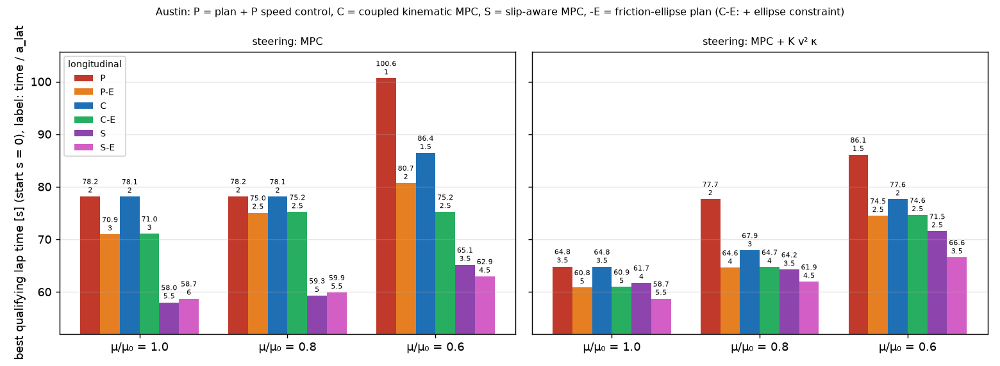
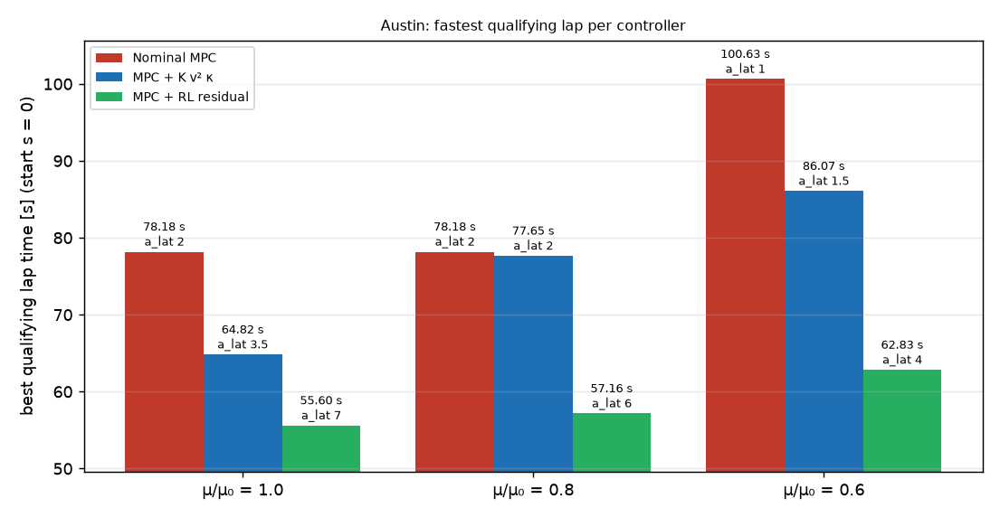

# Residual RL on MPC for Vehicle Racing under Model Mismatch: saturating tires

> **Tire model: ST with saturating Pacejka tires** (`configs/pilot_st_pacejka.yaml`). This document covers results on Gym-Khana's single-track (ST) plant with saturating tires and a friction circle (`pilot/tires.py`). The earlier work on the original linear-tire ST plant has its own document: [README-simple-st-tire.md](README-simple-st-tire.md). That covers the feasibility pilot, residual RL, held-out tracks and stage 1 of MPC speed control. With linear tires μ only scales cornering stiffness and there is no grip limit; here the tires saturate and the car can spin.

## Setup and run

```bash
uv sync                                                                  # Python 3.11, gymkhana==1.2.0, osqp, torch, stable-baselines3, ...
uv run python -m pilot.sim_checks --config configs/pilot_st_pacejka.yaml  # step tests, grip test, linear-law regression
uv run python -m pilot.longitudinal --config configs/pilot_st_pacejka.yaml  # 12 controllers on Austin, about 15 min (8 workers)
uv run python -m pilot.longitudinal --config configs/pilot_st_pacejka.yaml --from-grid   # rebuild tables/chart from the CSVs
```

Outputs go to `results_st_pacejka/longitudinal/Austin/`: `sweep.csv`, `lap_time_grid.csv`, `lap_time_comparison.csv/.png` and `report.json`. On first use, Gym-Khana downloads the Austin map into `~/.gymkhana/maps/`.

**Rust core (optional).** `uv sync` also builds the Rust core `pilot_core/` (PyO3 extension, uv dependency group `rust`, installed by default). That needs a Rust toolchain and `cmake` on `PATH`; with Homebrew's keg-only rustup, run `export PATH="/opt/homebrew/opt/rustup/bin:$PATH"` first. Set `kernel: rust` in a config to run laps on it; see [Speed](#speed-rust-core-kernel-rust).

Without Rust, use `uv sync --no-group rust`. A `kernel: rust` config then prints a warning and runs on the Python loop, with identical results (about 5× slower).

**Checks.** `.github/workflows/checks.yml` runs on every push and PR:
- `python -m pilot.kernel_check` and `cargo test` on macOS arm64, the platform the Python/Rust bit-identity was verified on;
- an install without Rust on Linux.

**License:** MIT (`LICENSE`).

**Lap GIFs (GitHub release, not in the repository).** The evaluation scripts write a GIF next to the other outputs (`*.gif` is git-ignored, so clones stay small). The published GIFs are assets of the release [`results-v1`](https://github.com/brian-xue/residual-rl-mpc-racing/releases/tag/results-v1); each asset is named after its output path with `/` replaced by `-`:

- [`results-ff_residual-lap_time.gif`](https://github.com/brian-xue/residual-rl-mpc-racing/releases/download/results-v1/results-ff_residual-lap_time.gif): linear ST: MPC + K·v²·κ + RL residual (ckpt_1500000) vs baselines (μ/μ₀ 0.6)
- [`results-lap.gif`](https://github.com/brian-xue/residual-rl-mpc-racing/releases/download/results-v1/results-lap.gif): linear ST pilot: nominal MPC vs MPC + K·v²·κ, same speed level (a_lat 4, μ/μ₀ 0.8)
- [`results-lap_time.gif`](https://github.com/brian-xue/residual-rl-mpc-racing/releases/download/results-v1/results-lap_time.gif): linear ST pilot: both controllers at their own fastest qualifying level (μ/μ₀ 0.6)
- [`results-reference-reference_lap.gif`](https://github.com/brian-xue/residual-rl-mpc-racing/releases/download/results-v1/results-reference-reference_lap.gif): linear ST: nominal, K·v²·κ and the dynamic-model reference (μ/μ₀ 0.6)
- [`results-residual-lap_time.gif`](https://github.com/brian-xue/residual-rl-mpc-racing/releases/download/results-v1/results-residual-lap_time.gif): linear ST: MPC + RL residual vs baselines (μ/μ₀ 0.6)
- [`results_st_pacejka-residual-lap_time.gif`](https://github.com/brian-xue/residual-rl-mpc-racing/releases/download/results-v1/results_st_pacejka-residual-lap_time.gif): Pacejka plant: MPC + RL (δ) vs baselines (μ/μ₀ 0.6)
- [`results_st_pacejka-residual_dual-grid_from3-Austin-lap_time.gif`](https://github.com/brian-xue/residual-rl-mpc-racing/releases/download/results-v1/results_st_pacejka-residual_dual-grid_from3-Austin-lap_time.gif): Pacejka plant: MPC + RL (δ, a), search from a_lat 3 (μ/μ₀ 0.6)
- [`results_st_pacejka-residual_dual_wall-grid_from3-Austin-lap_time.gif`](https://github.com/brian-xue/residual-rl-mpc-racing/releases/download/results-v1/results_st_pacejka-residual_dual_wall-grid_from3-Austin-lap_time.gif): Pacejka plant: MPC + RL (δ, a) + wall obs, search from a_lat 3 (μ/μ₀ 0.6)
- [`results_std-lap.gif`](https://github.com/brian-xue/residual-rl-mpc-racing/releases/download/results-v1/results_std-lap.gif): STD plant (appendix): same speed level
- [`results_std-lap_time.gif`](https://github.com/brian-xue/residual-rl-mpc-racing/releases/download/results-v1/results_std-lap_time.gif): STD plant (appendix): fastest qualifying levels
- [`results_std-reference-reference_lap.gif`](https://github.com/brian-xue/residual-rl-mpc-racing/releases/download/results-v1/results_std-reference-reference_lap.gif): STD plant (appendix): with the dynamic-model reference

## Plant: ST with saturating tires (`pilot/tires.py`)

- **Equations:** the ST equations rewritten in axle-force form. The ST state, inputs, steering and acceleration limits and longitudinal load transfer `Fz = m(g·l ∓ a·h)/L` are all unchanged.
- **Lateral force:** simplified Pacejka, `Fy = D sin(C atan(B α))`, with C = 1.3 and peak `D = μ Fz`. The small-slip stiffness is ST's identified `μ₀ C_S Fz`, so at small slip angles the tire matches linear ST.
- **Friction:** friction changes only the peak force. With μ₀ ≈ 1.05 the grip limit is about 10.3 m/s² at μ/μ₀ = 1.0 and 6.2 m/s² at 0.6.
- **Combined slip:** driving and braking forces are split by axle load and capped at `μ Fz`. Each axle's lateral peak is derated by `√(1 − (Fx/μFz)²)`, i.e. a friction circle.
- **Linear law:** it calls Gym-Khana's own `vehicle_dynamics_st`. The force form agrees with it to 1.7e-13 (`pilot.sim_checks`), so linear-tire results are unchanged.
- **New lap outcome, `spin`:** the lap ends when |sideslip| exceeds 1 rad (`geometry.spin_beta_max_rad`).

All other settings match the linear-tire study:
- reference line, track geometry and validity checks;
- the qualifying rule;
- steering MPC weights, frozen on linear ST and not retuned;
- K = 0.03 for the K·v²·κ term, carried over from linear ST.

## Controllers

Six longitudinal (speed) controllers. Each runs with steering MPC and with MPC + K·v²·κ (the "+ff" rows).

| | Speed control | Speed plan | Prediction model |
| --- | --- | --- | --- |
| **P** | plan feedforward + P (pilot) | standard | kinematic steering MPC |
| **P-E** | plan feedforward + P | friction ellipse | kinematic steering MPC |
| **C** | coupled steering + speed MPC (`CoupledMPC`) | standard | kinematic + speed |
| **C-E** | `CoupledMPC` + ellipse constraint | friction ellipse | kinematic + speed |
| **S** | slip-aware coupled MPC (`SlipMPC`) | standard | dynamic, nominal μ₀ |
| **S-E** | `SlipMPC` | friction ellipse | dynamic, nominal μ₀ |

- **Standard plan:** `v = min(8, √(a_lat/κ))` with separate ±4 m/s² accel/brake passes. It asks for up to 1.41× the friction ellipse when braking into corners.
- **Friction-ellipse plan:** the passes use only the acceleration that `(a_x/4)² + (v²κ/a_lat)² ≤ 1` leaves.

### Slip-aware MPC (`pilot.mpc.SlipMPC`, `longitudinal.mode: slip`)

**Model and state.**
- It predicts with a dynamic single-track error model, x = [e_y, e_ψ, β, r, v], with held inputs [δ, a], linear tires and longitudinal load transfer.
- **Not privileged:** it uses the nominal μ₀ and linear stiffness, and never sees the true friction or the Pacejka curve.
- It measures sideslip β and yaw rate r, and compensates the 30 ms actuator delay by propagating the model.
- The model matches the plant's linear ST derivatives exactly.

**Speed coupling.** Speed is a state and acceleration change is an input. In this model `e_ψ' = r − vκ`, so slowing down lowers the yaw rate a corner needs, and the MPC can trade speed for grip.

**Slip-angle limits.** Soft limits |α_f| ≤ 0.25 rad and |α_r| ≤ 0.12 rad keep the tires where the linear model holds. At μ₀ the Pacejka force at 0.12 rad is 87% of the linear one. The rear limit is the stable-handling-envelope idea of Beal & Gerdes (2013).

**Cost.**
- Tracking: course error (e_ψ + β), lateral error, and speed tracking.
- Smoothness: steering-rate and jerk penalties.
- Slack penalty on the slip limits.

**Solver.** It linearizes along its own previous prediction (finite-difference Jacobians, exact zero-order hold) and solves a sparse QP with OSQP at 20 Hz over a 1 s horizon.

**Tuning.** The slip limits and speed weight were chosen on the a_lat 5 development setting (μ/μ₀ 1.0 and 0.6, both plans, K = 0), using the pilot's selection rule (most qualifying laps, then progress, then RMS e_y). a_lat 5 is not a sweep level.

## Results (Austin)



**Fastest qualifying lap** (seconds, with its a_lat level; a level counts only if the lap qualifies from both start poses and every slower level does too):

| Controller | μ/μ₀ = 1.0 | μ/μ₀ = 0.8 | μ/μ₀ = 0.6 | Sweep: qualifying / spin / wall (of 18) |
| --- | --- | --- | --- | --- |
| P (pilot) | 78.18 (2.0) | 78.18 (2.0) | 100.63 (1.0) | 0 / 17 / 1 |
| P+ff | 64.82 (3.5) | 77.65 (2.0) | 86.07 (1.5) | 0 / 17 / 1 |
| P-E+ff | 60.83 (5.0) | 64.58 (4.0) | 74.46 (2.5) | 4 / 13 / 1 |
| C+ff | 64.77 (3.5) | 67.89 (3.0) | 77.61 (2.0) | 0 / 18 / 0 |
| C-E+ff | 60.94 (5.0) | 64.70 (4.0) | 74.60 (2.5) | 4 / 13 / 1 |
| **S** | **58.00 (5.5)** | **59.27 (5.0)** | 65.13 (3.5) | 4 / 6 / 8 |
| **S-E** | 58.71 (6.0) | 59.88 (5.5) | **62.94 (4.5)** | **8 / 3 / 7** |
| S+ff | 61.72 (4.0) | 64.22 (3.5) | 71.53 (2.5) | 2 / 16 / 0 |
| S-E+ff | 58.69 (5.5) | 61.90 (4.5) | 66.56 (3.5) | 4 / 11 / 1 (+2 other) |

Rows without ff for P-E, C and C-E are in `lap_time_comparison.csv`. They are slower than their +ff versions (70.9–86.4 s).

**Findings**

1. **The slip-aware MPC is the best controller with saturating tires.**
   - Against the previous best (P-E+ff and C-E+ff), its best lap is 2.8 s faster at μ/μ₀ 1.0, 5.3 s at 0.8 and 11.5 s at 0.6.
   - It doubles the qualifying sweep laps, 8 vs 4 for S-E.
   - It is the only controller to qualify at a_lat 6, μ/μ₀ 1.0 and at a_lat 4, μ/μ₀ 0.6.
   - On qualifying laps, RMS e_y is 0.011–0.013 m against 0.047–0.050 m, a 4× improvement, at 1.001× plan lap time.
2. **The diagnosed failure was a spin, and the slip limit fixes it.**
   - Every other controller spins at the entry to turn 1 under trail braking, at only about 4.5 m/s² lateral and 2.7 m/s² braking. Braking moves load forward (rear axle at 0.81–0.87 of static), and at turn-in the rear slip angle climbs to its peak and saturates while the front still has 15–25% in reserve: snap oversteer.
   - The kinematic MPCs cannot see this. The rear slip-angle limit removes it: sweep spins fall from 10–18 to 3 (S-E).
3. **The remaining failure is understeer into the wall.**
   - At a_lat ≥ 6 the slip-limited car stays stable but runs wide at the turn-1 exit, where the walls start again.
   - Holding the line within the slip limit needs more braking before the corner than a 1 s horizon sees.
4. **Low friction is the model-mismatch gap.**
   - At μ/μ₀ 0.6 the Pacejka rear peaks at a smaller slip angle, but the MPC still assumes μ₀. Its 0.12 rad limit then sits close to the real peak, and S on the standard plan spins there (sweep at μ/μ₀ 0.6: S-E qualifies only at a_lat 4).
   - This is the mismatch a learned residual, or friction estimation, would target.
5. **K·v²·κ does not combine with the slip-aware MPC.** The term is added after the MPC, so it bypasses the slip limits and double-counts the feedforward the dynamic model already has. S+ff and S-E+ff spin far more than S and S-E.
6. **The friction-ellipse plan still helps every controller.**
   - For the kinematic controllers it is the main improvement, as on linear ST (P+ff → P-E+ff: 4.0–13.1 s per lap).
   - For S it matters mostly at low friction (μ/μ₀ 0.6: 65.13 → 62.94 s).
   - The coupled kinematic MPC on the ellipse plan stays within 0.15 s of the P controller.

**Caveats**
- Austin only; one tire parameter set (C = 1.3, peak at α ≈ 0.63 rad at μ₀).
- **Steering weights were not retuned:** they are frozen from linear ST, and K = 0.03 is carried over.
- **Solve time:** S/S-E solves (OSQP, Python) take about 1 ms typically, but p99 reaches 18 / 39 ms and the maximum 82 ms (one S-E lap). That exceeds the 50 ms period. The simulation does not model computation time, so results are unaffected, but a real-time implementation needs a faster solver or warm-started real-time iterations.
- **The ellipse metric is noisy:** `ellipse_max` (measured at 100 Hz) includes transients.

## MPC + RL residual (`configs/pilot_st_pacejka_residual.yaml`)

This is the residual-RL setup of the linear-tire study, retrained on the Pacejka plant:
- a PPO policy adds a steering correction to the kinematic MPC, `δ = clip(δ_MPC + 0.2·π(obs))`;
- the observation contains no arc length and no true μ;
- unchanged from the linear-tire study: reward, PPO settings, training distribution (a_lat 3–9, μ/μ₀ 0.5–1.05, random starts), standard speed plan, checkpoint-selection rule and evaluation protocol.

The config differs from `pilot_st_pacejka.yaml` only in `kernel: rust` and `residual.out`. The selected checkpoint (`ckpt_1250000`) was chosen on Austin validation laps and evaluated unchanged on three held-out tracks.

```bash
C=configs/pilot_st_pacejka_residual.yaml
uv run python -m pilot.train_residual --config $C                     # 3M steps: 5.5 min with kernel: rust (8 workers, M4)
uv run python -m pilot.eval_residual  --config $C                     # Austin: selection, sweep, fastest laps, GIF: 2 min
uv run python -m pilot.eval_residual  --config $C --track Spielberg \
    --model results_st_pacejka/residual/ckpt_1250000.zip --out results_st_pacejka/residual/heldout/Spielberg --no-gif
```

The whole chain (training, Austin and three held-out tracks) took 10 minutes. On linear ST and the old Python loop, training alone took 55 minutes.



**Fastest qualifying lap** (seconds, with its a_lat level; nominal = kinematic MPC, ff = MPC + K·v²·κ with K = 0.03):

| Track | Controller | μ/μ₀ = 1.0 | μ/μ₀ = 0.8 | μ/μ₀ = 0.6 | Sweep qualifying (of 18) |
| --- | --- | --- | --- | --- | --- |
| Austin (training) | Nominal MPC | 78.18 (2.0) | 78.18 (2.0) | 100.63 (1.0) | 0 |
| | MPC + Kv²κ | 64.82 (3.5) | 77.65 (2.0) | 86.07 (1.5) | 0 |
| | **MPC + RL** | **55.60 (7.0)** | **57.16 (6.0)** | **62.83 (4.0)** | **10** |
| | *Slip-aware MPC S / S-E (above)* | *58.00 / 58.71* | *59.27 / 59.88* | *65.13 / 62.94* | *4 / 8* |
| Spielberg | Nominal / Kv²κ | 55.24 / 47.94 | 55.24 / 49.58 | 60.00 / 59.80 | 0 / 0 |
| | **MPC + RL** | **45.99 (4.5)** | **46.92 (4.0)** | **49.72 (3.0)** | **4** |
| Catalunya | Nominal / Kv²κ | 67.78 / 63.56 | 72.95 / 67.27 | 80.94 / 72.53 | 0 / 0 |
| | **MPC + RL** | **53.12 (7.0)** | **54.37 (6.0)** | **59.07 (4.0)** | **10** |
| Silverstone | Nominal / Kv²κ | 76.83 / 71.13 | 85.05 / 76.43 | 99.57 / 84.72 | 0 / 0 |
| | **MPC + RL** | **61.01 (5.0)** | **62.08 (4.5)** | **65.34 (3.5)** | **4** |

**Findings**

- **MPC + RL is the best controller on every track and friction level.**
  - Nominal MPC and MPC + Kv²κ qualify none of the 72 sweep laps across the four tracks; MPC + RL qualifies 28.
  - Against the faster of the two baselines, its best lap is 9.2–23.2 s faster per lap on the training track and 2.0–19.4 s on held-out tracks.
  - The largest gains are at μ/μ₀ 0.6, where the baselines fall back to a_lat 1–2.
- **It also beats the slip-aware MPC on Austin**, with no model of slip or grip:
  - faster at μ/μ₀ 1.0 and 0.8 (55.60 vs 58.00 s; 57.16 vs 59.27 s);
  - level at 0.6 (62.83 vs 62.94 s);
  - more qualifying sweep laps (10 vs 8).

  The slip-aware MPC was not run on the held-out tracks.
- **It learns to prevent the turn-in spin.** On Austin the residual cuts sweep spins from 17 to 6. Mean |residual| is 0.046 rad, and max |e_y| on qualifying laps is ≤ 0.23 m. The rest of its failures are at grip-limited cells (a_lat 6–8 at low μ).
- **Held-out failures are mostly walls, not spins.** Spielberg has 11 wall collisions and 3 spins; Silverstone 9 and 5. This is the same "runs wide" pattern seen with linear tires on these two tracks.

**Caveats**

- One training seed.
- **Checkpoint selection was close:** `ckpt_1250000` and `ckpt_2250000` tied on qualifying validation laps (3 of 4), and the tie was broken by a 0.0003 difference in mean progress.
- **The training crash rate stays at 40–65%,** because many randomised cells (high a_lat, low μ) ask for more grip than the tires have, and no steering correction can save them.
- **Same K and MPC weights as linear ST:** K = 0.03 and the steering MPC weights were not retuned for this plant.
- **Different speed plans:** the slip-aware MPC comparison mixes speed plans. MPC + RL runs on the standard plan; S-E on the friction-ellipse plan.

## Dual-channel MPC + RL residual (`configs/pilot_st_pacejka_residual_dual.yaml`)

The PPO policy now outputs two residuals on top of the Rust kinematic MPC and the **friction-ellipse speed plan**:
- **steering:** `δ = clip(δ_MPC + 0.2·π_δ)`;
- **acceleration:** `a = clip(a_speed + 2.0·π_a)` m/s², added to the speed controller's command at every physics step. Through the P speed gain (kv = 3), a constant ±2 m/s² shifts the speed by about ±0.67 m/s.

**How it differs from the single-channel setup:**
- **Observation:** adds the previous acceleration residual and a 1 s preview of the planned acceleration.
- **Reward:** adds gentle penalties on the acceleration residual's size (0.01·a²) and change (0.05·Δa²), and a sideslip penalty above 0.15 rad (20·(|β| − 0.15)²). Walls and spins still cost −50, off-track intervals −1.
- **Friction range:** μ/μ₀ 0.6–1.0.
- **Everything else is unchanged:** PPO settings, a_lat 3–9, checkpoint-selection rule, `kernel: rust`.

**Implementation.** The acceleration residual is mirrored in the Python loop and `pilot_core` and applied only when nonzero. Existing results are unchanged: `kernel_check` passes, the committed single-channel laps reproduce exactly, and Python and Rust rollouts with a nonzero residual are identical.

```bash
C=configs/pilot_st_pacejka_residual_dual.yaml
uv run python -m pilot.train_residual --config $C                       # 3M steps: 6.2 min
uv run python -m pilot.eval_residual  --config $C                       # Austin: 1.5 min
uv run python -m pilot.eval_residual  --config $C --track Spielberg --model results_st_pacejka/residual_dual/ckpt_1250000.zip \
    --out results_st_pacejka/residual_dual/heldout/Spielberg --no-gif
uv run python -m pilot.eval_residual  --config $C --track Austin --model results_st_pacejka/residual_dual/ckpt_1250000.zip \
    --grid-min 3.0 --out results_st_pacejka/residual_dual/grid_from3/Austin --no-gif   # supplementary search (below)
uv run python -m pilot.longitudinal   --config configs/pilot_st_pacejka.yaml --track Spielberg --controllers S-E
```

**Comparison on all four tracks** (`results_st_pacejka/residual_dual/comparison_all_tracks.csv`).
- Sweep columns: qualifying / spin / wall laps out of 18.
- Lap columns: fastest qualifying lap in seconds, with its a_lat level.
- Dual-channel lap times marked † come from a supplementary search that starts at a_lat 3 (explained below).

| Track | Controller | Sweep q / spin / wall | μ/μ₀ = 1.0 | μ/μ₀ = 0.8 | μ/μ₀ = 0.6 |
| --- | --- | --- | --- | --- | --- |
| Austin (training) | Slip-aware MPC + ellipse (S-E) | 8 / 3 / 7 | 58.71 (6) | 59.88 (5.5) | 62.94 (4.5) |
| | MPC + RL (δ), standard plan | 10 / 6 / 2 | **55.60** (7) | **57.16** (6) | **62.83** (4) |
| | **MPC + RL (δ, a), ellipse plan** | **14 / 1 / 3** | 56.18† (10) | 57.91† (8) | 63.68† (5) |
| Spielberg | S-E | **10 / 1 / 7** | **45.07** (6) | **45.11** (6) | **46.32** (5) |
| | MPC + RL (δ) | 4 / 3 / 11 | 45.99 (4.5) | 46.92 (4) | 49.72 (3) |
| | MPC + RL (δ, a) | 0 / 1 / 17 | 52.72 (3) | 52.72 (3) | 52.73 (3) |
| Catalunya | S-E | 11 / 2 / 4 | 54.65 (7) | 55.67 (6) | 57.78 (5) |
| | MPC + RL (δ) | 10 / 7 / 1 | **53.12** (7) | **54.37** (6) | 59.07 (4) |
| | **MPC + RL (δ, a)** | **16 / 2 / 0** | 53.73† (10) | 55.07† (8) | **57.74**† (6) |
| Silverstone | S-E | **10 / 2 / 6** | **60.06** (7) | **60.78** (6) | **62.39** (5) |
| | MPC + RL (δ) | 4 / 5 / 9 | 61.01 (5) | 62.08 (4.5) | 65.34 (3.5) |
| | MPC + RL (δ, a) | 0 / 0 / 18 | 81.79 (2) | 81.79 (2) | 81.79 (2) |
| **All four tracks** | S-E | **39 / 8 / 24** | | | |
| | MPC + RL (δ) | 28 / 21 / 23 | | | |
| | MPC + RL (δ, a) | 30 / **4** / 38 | | | |

**Findings**

1. **The dual-channel policy is the best controller on the two tracks where it works, and almost never spins.**
   - On Austin and Catalunya it qualifies 14 and 16 of 18 sweep laps, the most of any controller.
   - Spins across all four tracks fall to 4, against 21 for the single-channel policy. The sideslip penalty and the acceleration channel make it cautious.
   - It also reaches the highest speed levels: a_lat 8–10 at μ/μ₀ ≥ 0.8, and 5–6 at 0.6.
2. **It learned to run about 4% slower than the plan.**
   - Mean |a_res| is about 0.58 m/s², with lap times at 1.038–1.042 × plan in the Austin sweep. Within the 5% tolerance that qualifies.
   - But at a_lat 1.0, below the training range of 3–9, it slows by 5.8%. The standard fastest-lap search starts there, so it gets **no qualifying fastest lap on Austin or Catalunya** (speed tolerance at the first level).
   - The † values start the same search at a_lat 3, the bottom of the training range. The single-channel policy and S-E qualified every level below a_lat 3 on all four tracks (24 laps each), so their best laps are identical under either rule; only the dual-channel numbers are affected.
3. **It fails to generalise to Spielberg and Silverstone** (0 of 18 each, 17 and 18 wall collisions).
   - Every failure is at one of two places per track (Spielberg s ≈ 23 / 283 m, Silverstone s ≈ 18 / 218 m). These are straights where the reference line is only about 0.105 m from a wall.
   - There the steering residual (+0.043 to +0.05 rad) nearly cancels the MPC's correction (−0.042 to −0.055 rad). The car holds a steady 0.08–0.10 m offset and drifts into the wall. No spin and no curvature are involved.
   - It is a learned steering bias on straights: harmless on Austin and Catalunya, fatal on tight straights. The single-channel policy has a smaller version of it (11 and 9 wall collisions there).
4. **The slip-aware MPC + ellipse plan is the most robust controller overall.**
   - It qualifies 39 of 72 sweep laps, with 10–11 on every held-out track.
   - It is the fastest on Spielberg and Silverstone, with no learning and no per-track tuning.
   - The learned residuals are faster on the training track and on Catalunya, but not reliably elsewhere.

**Caveats**

- One training seed per policy.
- **Checkpoint selection was close:** `ckpt_1250000` and `ckpt_1750000` both passed 4 of 4 validation laps, and the tie was broken by a 7e-5 difference in mean progress.
- **The plans differ:** the single-channel policy runs on the standard plan, while S-E and the dual policy run on the ellipse plan.
- **Untuned:** the reward weights for the new terms were not tuned.

## Wall-clearance observation (`configs/pilot_st_pacejka_residual_dual_wall.yaml`)

The dual-channel policy failed on Spielberg and Silverstone at straights where the reference line runs about 0.105 m from a wall, because it could not see the walls. This run adds that information to its observation and changes nothing else (same reward, PPO settings, training distribution and selection rule; `kernel: rust`).

- **Per track, precomputed:** `Track.wall_side_clearance` gives the distance from every reference point to the first wall along the left and right normals of the reference line.
  - It is computed from that track's own walls, so it works on any map without per-track tuning.
  - It uses sphere tracing (`TrackGeometry.ray_wall_distance`), takes about 0.1 s per track, and agrees with a 1 mm brute-force march to 1–5 mm.
  - It is capped at 1.5 m (no wall in range, e.g. on curves with open run-off).
- **Observed** (`residual.obs_wall_clearance: true`, `pilot.residual_env.wall_gaps`): 8 values, the gap between each side of the body and the wall now and 0.25 / 0.5 / 1 s ahead, assuming the current offset persists: `clearance(s) ∓ e_y − width/2`.
- **Checks:** Python and Rust rollouts with it are identical, and the committed dual-channel laps reproduce exactly with it off.
- **Checkpoint selection:** `ckpt_1250000` was the only checkpoint to pass all 4 validation laps; no tie this time.

```bash
C=configs/pilot_st_pacejka_residual_dual_wall.yaml
uv run python -m pilot.train_residual --config $C
uv run python -m pilot.eval_residual  --config $C          # then --track <held-out> and --grid-min 3.0, as above
```

**All four controllers on all four tracks** (`results_st_pacejka/residual_dual_wall/comparison_all_tracks.csv`):
- sweep columns are qualifying / spin / wall laps out of 18;
- lap columns are the best lap in seconds, with its a_lat level;
- † marks the search from a_lat 3, as above.

| Track | S-E (slip-aware MPC + ellipse) | MPC + RL (δ) | MPC + RL (δ, a) | **MPC + RL (δ, a) + wall obs** |
| --- | --- | --- | --- | --- |
| Austin: sweep | 8 / 3 / 7 | 10 / 6 / 2 | 14 / 1 / 3 | 14 / 1 / 3 |
| Austin: μ/μ₀ 1.0 / 0.8 / 0.6 | 58.71 / 59.88 / 62.94 | **55.60** / **57.16** / 62.83 | 56.18† / 57.91† / 63.68† | 56.71† / 57.81† / **62.22**† |
| Spielberg: sweep | **10 / 1 / 7** | 4 / 3 / 11 | 0 / 1 / 17 | 6 / 1 / 11 |
| Spielberg: laps | **45.07 / 45.11 / 46.32** | 45.99 / 46.92 / 49.72 | 52.72 / 52.72 / 52.73 | 49.72† / 49.73† / 51.12† |
| Catalunya: sweep | 11 / 2 / 4 | 10 / 7 / 1 | **16 / 2 / 0** | 12 / 2 / 0 |
| Catalunya: laps | 54.65 / 55.67 / 57.78 | **53.12** / **54.37** / 59.07 | 53.73† / 55.07† / **57.74**† | 53.68† / 55.98† / 58.66† |
| Silverstone: sweep | **10 / 2 / 6** | 4 / 5 / 9 | 0 / 0 / 18 | 8 / 1 / 9 |
| Silverstone: laps | **60.06 / 60.78 / 62.39** | 61.01 / 62.08 / 65.34 | 81.79 (a_lat 2) | 62.62† / 63.43† / 64.47† |
| **Total sweep (of 72)** | 39 / 8 / 24 | 28 / 21 / 23 | 30 / **4** / 38 | **40** / 5 / **23** |

**Findings**

1. **The wall input fixes most of the generalisation failure.**
   - Spielberg goes from 0 to 6 qualifying sweep laps and Silverstone from 0 to 8.
   - Wall collisions across the four tracks fall from 38 to 23.
   - Total qualifying rises from 30 to 40 of 72, the most of any controller (S-E 39).
   - The spin count stays low (5).
2. **It is not a free win.**
   - Catalunya drops from 16 to 12 qualifying laps, though it still has no wall collisions.
   - On Austin the sweep is unchanged. Lap times move by 0.1–0.5 s at μ/μ₀ ≥ 0.8 and improve by 1.5 s at 0.6, where its 62.22 s is the fastest of all four controllers.
3. **The slip-aware MPC is still faster and more consistent on the held-out tracks.**
   - It is 4.6–4.8 s per lap ahead on Spielberg and 2.1–2.7 s on Silverstone.
   - It qualifies at least 10 sweep laps on every track; the wall-aware policy ranges from 6 to 14.
   - The learned policy now matches its robustness in total, but not per track.
4. **The remaining wall failures moved.**
   - The two tight straights are mostly solved.
   - The remaining collisions cluster at new spots (Spielberg s ≈ 303 m, Silverstone s ≈ 176 m). The single-channel policy also failed at Silverstone's s ≈ 176 m.

**Caveats**

- One seed per policy.
- **Validation regressed after 1.25M steps:** later checkpoints passed 0 of 4 laps, while the training crash rate kept falling.
- **The wall input adds about 18% per lap** (0.33 vs 0.28 s, measured in isolation). This run's 80-minute total was mostly machine contention: load average about 31 on 10 cores, from macOS background processes.

## Speed: Rust core (`kernel: rust`)

With `kernel: rust` in a config, the per-physics-step loop of `LapSim` and the kinematic steering MPC run in Rust (`pilot_core/`). That covers:
- the ST plant with linear, Pacejka or Fiala tires, RK4 and Gym-Khana's step;
- servo and speed controller;
- track-limit and wall checks, the Frenet projection and the lap metrics;
- the MPC's delay compensation, previews, discretisation, QP assembly and OSQP.

The coupled, slip-aware and reference MPCs, the residual policy, logging and summaries stay in Python. Only the ST plant with `steer_mode: steering_speed` is supported (other settings raise); the configs default to `kernel: python`.

**Results are bit-identical to the Python loop.** `uv run python -m pilot.kernel_check` compares both kernels on laps (linear and Pacejka; kinematic and coupled MPC; completed, crash and spin outcomes) and on a residual-RL rollout. [pilot_core/README.md](pilot_core/README.md) lists what exact equality needs: libm `pow` for scalar `x**2`, FMA for `np.interp`, no fused sin/cos, and the same OSQP C version and calls.

**Measured** on an Apple M4, Austin, linear ST, a_lat 3, a 68.6 s lap:

| | Before optimisation | Python loop (now) | `kernel: rust` |
| --- | --- | --- | --- |
| Full lap (`run_lap`) | 3.04 s | 0.74 s | **0.13 s** |
| Residual-RL env step | 2.11 ms | 0.64 ms | **0.19 ms** |
| PPO rollout, 8 workers | 1,235 steps/s | 3,899 steps/s | **10,160 steps/s** |

The Python-loop gains apply to both kernels:
- the loop steps Gym-Khana's `Simulator` directly instead of calling `env.step`, skipping a Frenet-progress reward and an observation it never read;
- the geometry polygons and speed-plan lookups are vectorised;
- the MPC discretisation is the exact closed form (below);
- laps reuse an idle simulator env from the same process (`Track.acquire_env`; `make_env` cost about 0.3 s per lap).

A 3M-step residual training run is estimated to take about 6 min with the Rust kernel, against 43–55 min before; this was not timed end to end.

**MPC discretisation.** `KinematicMPC` now uses `I + M·Ts + (M·Ts)²/2` instead of scipy's `expm`. This is exact only while M³ = 0, i.e. while the error model (`KinematicMPC._f`) has e_y′ and e_ψ′ independent of e_y and e_ψ′ independent of e_ψ.
- **Guard:** both implementations evaluate those three derivatives on every solve and fail loudly (`ValueError` in Python, a panic in Rust) if any is nonzero. A changed model then needs a general `expm`.
- **Checks:** `kernel_check` compares the closed form with scipy `expm` of the full M on 500 random horizons (4e-16), confirms M³ = 0 exactly, and confirms the guard fires on a model with e_ψ-dependent e_ψ′. `cargo test` in `pilot_core` covers the same on the Rust side.

The two methods agree to 6e-16 relative. Rerunning the results above therefore matches to rounding, not bit for bit: on the checked laps, outcomes and lap times are identical and traces differ by ≤ 1e-11. `SlipMPC` is unchanged.

## Code

| File | Purpose |
| --- | --- |
| `pilot/tires.py` | Saturating tires for the ST plant (Pacejka, Fiala, friction circle, axle-force ST) |
| `pilot/sim.py` | Env construction, plant and tire switch, friction scaling, steering servo |
| `pilot/mpc.py` | `KinematicMPC` (steering), `CoupledMPC` (steering + speed), `SlipMPC` (slip-aware, steering + speed) |
| `pilot/closedloop.py` | One lap (`LapSim`): controllers, validity checks (incl. spin), metrics, qualifying rule; per-process env pool on `Track` |
| `pilot/kernel.py`, `pilot/kernel_check.py` | `kernel: rust` wiring (`pilot_core.LapKernel` from a `LapSim`) and the Python-vs-Rust equivalence check |
| `pilot_core/` | Rust core (PyO3 + maturin): plant, geometry, projection, lap loop, kinematic MPC with OSQP; see its README |
| `pilot/reference.py` | Reference line, standard and friction-ellipse speed plans, Frenet projection |
| `pilot/longitudinal.py` | Controller comparison: sweep, fastest-lap search, chart |
| `configs/pilot_st_pacejka.yaml` | This plant's config; `longitudinal.slip_mpc` holds the slip-aware MPC settings |
| `configs/pilot_st_pacejka_residual.yaml` | MPC + RL residual on this plant (`kernel: rust`, output `results_st_pacejka/residual/`) |
| `configs/pilot_st_pacejka_residual_dual.yaml` | Dual-channel (steering + acceleration) residual on the ellipse plan (output `results_st_pacejka/residual_dual/`) |
| `configs/pilot_st_pacejka_residual_dual_wall.yaml` | Dual-channel residual with the wall-clearance observation (output `results_st_pacejka/residual_dual_wall/`) |

The remaining modules (pilot pipeline, residual RL, held-out evaluation, dynamic-model reference) are described in [README-simple-st-tire.md](README-simple-st-tire.md). `pilot.reference_lap` is not available for this plant, because its privileged model is linear ST.
