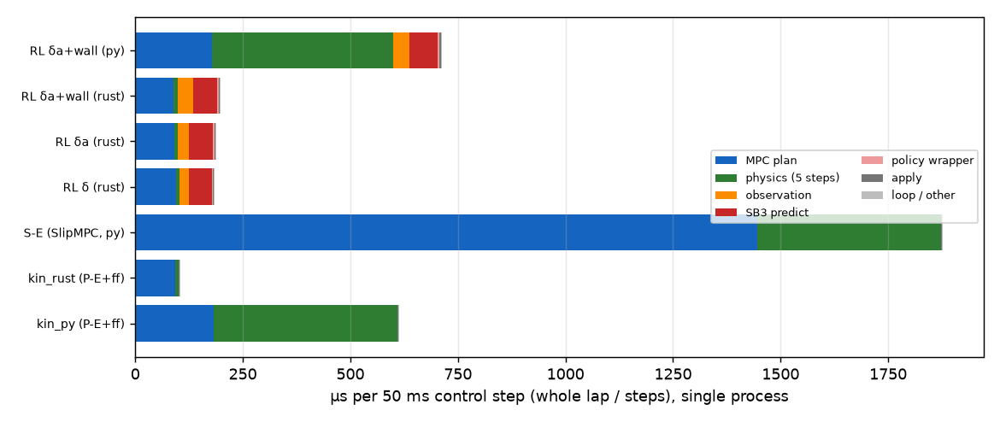
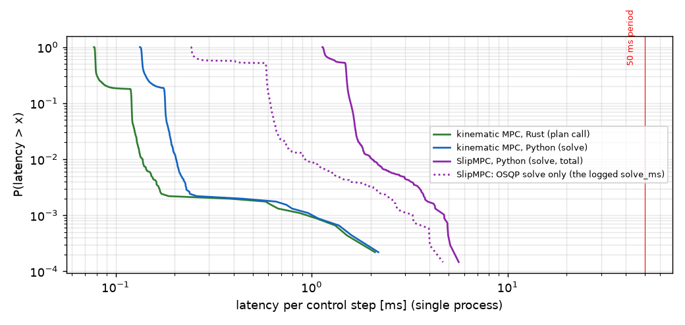
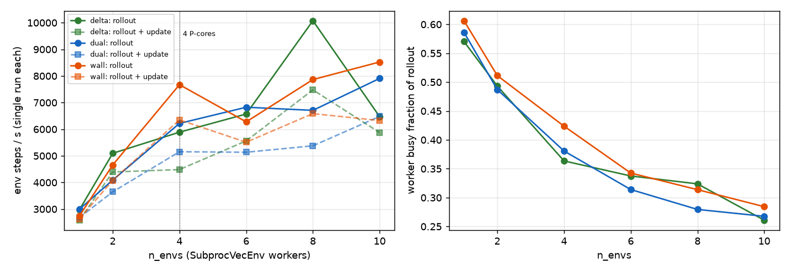

# Performance profile: residual RL + MPC racing stack

All numbers in this report were measured with [`results/analysis/profiling/bench.py`](../results/analysis/profiling/bench.py). Raw results are in [`results/analysis/profiling/out/`](../results/analysis/profiling/out/). No repository code was changed: timers are monkeypatched wrappers inside the benchmark script, and the native profiles come from `/usr/bin/sample`.

## 1. Environment and method

| | |
| --- | --- |
| Machine | Apple M4, 10 cores (**4 performance + 6 efficiency**), 16 GB, macOS 27.0.1 |
| Software | Python 3.11.18, numpy 2.4.6, torch 2.15.0, Stable-Baselines3 2.9.2, osqp 1.1.3, `pilot_core` built from `10cc97c` |
| Background load | The machine was not idle. Other processes (WindowServer, Weather/WeatherWidget, VS Code helpers, a Chrome renderer, Claude helpers) used **2.2–2.9 cores** throughout (`other_cpu_pct` in every snapshot). Before single-process runs the 1-min load average was 4.6–7.3 and the CPU 63–73% idle. Every benchmark JSON stores `uptime`, `top` and `vm_stat` snapshots before and after the run. |
| Memory | 3.6–4.3 GB free+inactive; no swapping was observed |

**Method:**
- **Single-process latency:** warm-up (2 laps, or 500 calls), then ≥ 7 repeats. Reported as median with IQR, plus p95/p99 for per-call distributions.
- **Cold start:** measured in 3 fresh interpreter processes.
- **Multi-process runs** report wall time and CPU time separately:
  - per-worker `process_time` inside the env;
  - main-process CPU;
  - `RUSAGE_CHILDREN`.
- **Reference lap:** Austin, a_lat 4, μ/μ₀ 1.0, start s = 0. Every benchmarked controller completes it, in 62.7–67.5 s of simulated time and 1,250–1,350 control steps.

**Uncertainty:**
- Repeat-to-repeat IQR is 1–12% of the median for single-process laps.
- Multi-process throughput varies by ±15–20% between repeats (§5.1), because the benchmark's own workers share 10 heterogeneous cores with 2–3 cores of background work.
- Differences below about 10% in single-process numbers, or 30% in multi-process numbers, are therefore not treated as findings.

## 2. End-to-end lap cost

Single process, reference lap ([`out/laps.csv`](../results/analysis/profiling/out/laps.csv)):

| Workload | Lap wall time (median, IQR) | µs per control step | Faster than real time |
| --- | --- | --- | --- |
| Kinematic MPC (P-E+ff), Python loop | 0.793 s (0.058) | 614 | 81× |
| Kinematic MPC (P-E+ff), `kernel: rust` | **0.128 s** (0.001) | **99** | 505× |
| S-E (SlipMPC, Python) | 2.569 s (0.114) | 1,980 | 25× |
| RL δ, Rust kernel | 0.248 s (0.028) | 198 | 253× |
| RL δa, Rust kernel | 0.275 s (0.032) | 204 | 245× |
| RL δa+wall, Rust kernel | 0.260 s (0.018) | 193 | 259× |
| RL δa+wall, Python loop | 1.129 s (0.043) | 837 | 60× |

- **The Rust kernel speeds up a kinematic lap 6.2×.** This matches the README's 0.13 s.
- **Adding the PPO policy doubles the Rust lap cost** (99 → ~200 µs per step).
- **SlipMPC is 20× a Rust kinematic lap and 13× an RL lap.**
- **The wall observation shows no measurable lap-level cost** (δa vs δa+wall within the IQR). The README's "+18% per lap" was measured under heavy contention (load ≈ 31) and does not reproduce. The micro-benchmark puts it at +9 µs per step (§3.3).

### 2.1 Cold start (3 fresh processes, [`out/cold.json`](../results/analysis/profiling/out/cold.json))

| Step | Time |
| --- | --- |
| `import pilot.closedloop, pilot.residual_env` | 1.08–1.48 s |
| `import torch, stable_baselines3` (after pilot) | 1.08–1.36 s |
| `Track(cfg)` (map, raceline, geometry, perfect-tracking check) | 0.52–0.56 s, **not cached**: the second construction costs the same |
| `make_env` (Gym-Khana env) | 0.30–0.35 s |
| speed plan, per (a_lat, plan) | 19 ms (cached per Track) |
| `wall_side_clearance` precompute | 89–104 ms per track (cached per Track) |
| first `PPO.load` | ~1.6 s (torch initialisation) in one run; 5–72 ms otherwise |
| first RL lap vs steady state | 1.37 s vs 0.25–0.30 s |

A fresh worker therefore needs about 3–4 s before its first useful lap. In the evaluation pipeline this is paid once per worker process per `ProcessPoolExecutor` (§6).

## 3. Per-step breakdown

### 3.1 Inside a lap (`run_lap`), µs per control step, median of per-call times ([`out/steps.json`](../results/analysis/profiling/out/steps.json))

| Workload | total | MPC `plan` | physics (`advance_interval`, 5 steps) | `residual_obs` | SB3 `predict` | other policy | share of policy |
| --- | --- | --- | --- | --- | --- | --- | --- |
| Kinematic, Python | 614 | 168 | **413** | — | — | — | — |
| Kinematic, Rust | 105 | **81** | 7.7 | — | — | — | — |
| S-E (SlipMPC) | 1,877 | **1,507** | 416 | — | — | — | — |
| RL δ, Rust | 185 | 80 | 7.8 | 21 | 53 | 3 | 43% |
| RL δa, Rust | 188 | 80 | 7.8 | 25 | 54 | 4 | 46% |
| RL δa+wall, Rust | 198 | 80 | 7.8 | 35 (incl. 3.2 `wall_gaps`) | 55 | 4 | 49% |

- **With the Rust kernel, physics is no longer a cost:** 7.8 µs for 5 RK4 steps, the checks and the projection, 4% of an RL step.
- **An RL step is now about half MPC and half policy.**
- **The kinematic MPC step in Rust is 96% OSQP** (`plan` 79 µs, of which the OSQP solve is 76 µs; §4).
- **The policy half is mostly framework overhead.** SB3 `predict` takes 49–51 µs per call for a 2×128 tanh MLP. The same forward pass costs 28 µs in torch (`no_grad`, `_predict`) and **6.4 µs in plain numpy** ([`out/infer.json`](../results/analysis/profiling/out/infer.json)); the numpy version reproduces SB3's action to 5e-8. Observation assembly (`residual_obs`: ~20 small numpy calls, two `np.interp` lookups, clip) adds 21–35 µs.

### 3.2 Inside training (`ResidualRacingEnv.step`, random actions, 4,000 steps)

| Policy | step median | step p99 | reset median | MPC `plan` per step | obs per step |
| --- | --- | --- | --- | --- | --- |
| δ | 154 µs | 320 µs | 850 µs | 121 µs | 20 µs |
| δa | 159 µs | 530 µs | 1,069 µs | 121 µs | 24 µs |
| δa+wall | 169 µs | 232 µs | 919 µs | 121 µs | 33 µs |

- **The env step is cheaper than a lap step** because the policy runs in the PPO main process, not in the env.
- **The MPC solve costs more here** (121 µs against 80 µs): random-action states are far from the reference, and OSQP needs more iterations.
- **A reset costs 0.85–1.07 ms,** mostly `LapSim.__init__` (0.66–0.84 ms: MPC object, Rust kernel and QP construction).
  - With random actions, resets were 22–30% of env time because the episodes are short.
  - In real training the mean episode is 330–520 steps (train logs), so resets are about **1–2%** of env time.

### 3.3 Wall-clearance observation overhead ([`out/wallobs.json`](../results/analysis/profiling/out/wallobs.json))

| | median |
| --- | --- |
| precompute `wall_side_clearance` (once per track and process) | 93–101 ms |
| `wall_gaps` (2 × `np.interp` over the precomputed table) | 2.4 µs |
| `residual_obs` dual, without / with the wall features | 22.5 / 31.7 µs |
| net cost per env step | **+9 µs (+6% of `env.step`)**; within noise at lap level |

The lookup itself is negligible. The extra 9 µs comes mostly from building and clipping 8 more numpy elements in many small calls, i.e. Python overhead, not geometry.

## 4. MPC latency

The table below is from [`out/mpc.json`](../results/analysis/profiling/out/mpc.json) and [`out/mpc_solves.csv.gz`](../results/analysis/profiling/out/mpc_solves.csv.gz). It covers 8 laps per MPC (Austin and Spielberg × a_lat 4/6 × μ/μ₀ 1.0/0.6), single process, excluding the first (setup) solve.

| MPC | n | median | p95 | p99 | max | first solve (setup) |
| --- | --- | --- | --- | --- | --- | --- |
| Kinematic, Rust (whole plan call) | 4,556 | 0.079 ms | 0.122 | 0.137 | 2.11 | 0.12 ms |
| Kinematic, Python (`solve`) | 4,556 | 0.137 ms | 0.181 | 0.203 | 2.19 | 0.57 ms |
| SlipMPC, Python (`solve`, everything) | 6,837 | **1.49 ms** | 1.65 | 2.02 | 5.63 | 2.54 ms |

**SlipMPC phase breakdown** (share of total solve time; medians per solve):

| Phase | median | share |
| --- | --- | --- |
| `_disc`: 21 linearisations, each a finite-difference Jacobian (8 model evaluations in Python) + `expm` of an 8×8 matrix | 0.61 ms | **45%** |
| of which `scipy.linalg.expm` | 0.11 ms | 8% |
| `_build`: dense A matrix in Python loops | 0.08 ms | 6% |
| OSQP `update` (q, l, u, A values) | 0.07 ms | 5% |
| OSQP `solve` (ADMM, median 75 iterations, + polishing 16%) | 0.58 ms | 33% |
| rest of `solve` (previews, guesses, vector assembly) | ~0.15 ms | ~11% |

**The logged `solve_ms` is only part of the cost.** It is the time OSQP `update` + `solve` take: 0.65 ms median, against 1.49 ms for the whole control step.

**Tail latency:**
- **Algorithmic tails are small and explained by iteration count.**
  - Single process, the SlipMPC p99 is 2.0 ms and the max 5.6 ms, against a 50 ms period.
  - The p99 tail solves need a median of 175 OSQP iterations against 75 overall; the correlation of total time with iterations is 0.86.
  - For the kinematic MPC the correlation is 0.99. Its 2 ms maximum is a 1,225-iteration solve during a spin.
- **The large tails in the saved results come from contention, not the algorithm.**
  - The original `longitudinal/Austin` run (12 controllers, 8 workers) logged a per-lap p99 of up to 39 ms (S-E) and a maximum of 82 ms.
  - Today's R1 replay (8 workers, alongside RL laps) logged per-lap p99 values up to 36 ms and a maximum of 54 ms.
  - The same laps single-process give p99 ≤ 4 ms per lap.
  - §5.3 measures this directly by running the same lap on 1–10 concurrent workers.

## 5. PPO training: rollout vs update, multi-worker scaling

**Setup:** the training configs with 4 PPO iterations of `n_steps` 1024 × n_envs, with the first rollout discarded as warm-up ([`out/ppo_scaling.csv`](../results/analysis/profiling/out/ppo_scaling.csv), repeats in [`out/ppo_repeat.csv`](../results/analysis/profiling/out/ppo_repeat.csv)). Workers wrap `ResidualRacingEnv` with wall and CPU timers; phases are timed by an SB3 callback.

### 5.1 Throughput vs n_envs (wall config; δ and δa are similar)

| n_envs | rollout steps/s | rollout + update steps/s | worker env-step CPU (µs) | worker busy fraction | main-process CPU per vectorised step (µs) |
| --- | --- | --- | --- | --- | --- |
| 1 | 2,740 | 2,630 | 181 | 0.61 | 123 |
| 2 | 4,660 | 4,080 | 185 | 0.51 | 148 |
| 4 | 6,810–8,200 (3 runs) | 5,980–6,540 | 198–211 | 0.42–0.43 | 200 |
| 6 | 6,280 | 5,510 | 271 | 0.34 | 278 |
| 8 | 6,360–8,050 (4 runs) | 4,540–6,620 | 277–375 | 0.30–0.32 | 314 |
| 10 | 7,760–9,100 (3 runs) | 6,060–6,680 | 309–332 | 0.28–0.29 | 385 |

**Observed:**
- **Scaling stops at about 4 workers.** Throughput at 8 envs is not reliably higher than at 4: the ranges overlap across repeats.
- **One iteration at n_envs = 8 (~1.3 s) breaks down as:**
  - **PPO update: 0.18–0.25 s (~17%).** 8,192 samples × 10 epochs at about 22 µs per sample-epoch. torch with 4 intra-op threads vs 1 thread: 0.21 vs 0.25 s, within noise.
  - **Rollout: ~1.0–1.3 s (~83%).** Of this:
    - **main-process serial work ≈ 0.32 s:** SB3 batched policy forward ≈ 72 µs (`policy.forward`, batch 8), rollout-buffer bookkeeping, `VecMonitor`/`VecNormalize`, and pickling of 8 observations and actions per vectorised step;
    - **worker compute ≈ 0.29–0.38 s** on the average worker;
    - **the rest, ≈ 0.35–0.45 s,** is lockstep synchronisation: waiting for the slowest of 8 workers, pipe round trips and process wake-ups.
  - **Workers are busy only 30–32% of the rollout.**
- **Each worker's per-step CPU time rises from 181 µs (1 env) to 277–375 µs (8 envs).**
  - The CPU time rises with the wall time, so the work itself executes more slowly; the workers are not waiting.
  - This is consistent with 8 workers spilling onto the 6 efficiency cores, plus the 2–3 cores of background load.
  - No thermal or performance warning was recorded (`pmset -g therm`).
  - *[plausible: E-core placement was not measured directly]*
- **Run-to-run variability at 8 envs is ±15–20%,** with the same code. The train-log throughput of the original runs (~9,100–10,240 steps/s in the logged intervals, 5.5–6.2 min per 3M steps when the machine was quiet) is at the top of this range. The 14-minute wall-obs training coincided with load ≈ 31.

### 5.2 Startup

Spawning 8 workers takes 7.5–12.2 s: Python and torch imports, Gym-Khana numba compilation (~2.7 s of `compile` in cProfile), `Track` and `make_env` per worker. That is ≈ 3% of a 5.5-minute training run.

### 5.3 Concurrency and per-lap latency (evaluation pools; [`out/pool_scaling.csv`](../results/analysis/profiling/out/pool_scaling.csv))

The same lap is run by n concurrent worker processes:

| workers | S-E lap (median) | S-E laps/s | S-E OSQP p99 (median over laps) | RL δa+wall lap | RL laps/s | kinematic OSQP p99 (RL laps) |
| --- | --- | --- | --- | --- | --- | --- |
| 1 | 2.33 s | 0.43 | 0.72 ms | 0.26 s | 3.9 | 0.12 ms |
| 2 | 2.78 s | 0.72 | 1.01 ms | 0.33 s | 6.1 | 0.16 ms |
| 4 | 4.40 s | 0.92 | 1.58 ms | 0.51 s | 7.6 | 0.27 ms |
| 6 | 5.89 s | 1.02 | 2.68 ms | 0.65 s | **9.1** | 0.35 ms |
| 8 | 7.02 s | **1.17** | 3.57 ms | 0.90 s | 8.7 | 1.16 ms |
| 10 | 9.41 s | 1.10 | 7.16 ms | 1.14 s | 8.3 | 2.41 ms (max 13 ms) |

- **Parallel speed-up saturates at 2.3–2.7×** on this machine with background load. RL laps peak at 6 workers and S-E at 8.
- **Each lap runs 3–4× slower at 8 workers.**
- **Solver tail latency grows 5–20× with concurrency.** This is the mechanism behind the 39–82 ms SlipMPC tails in the saved results: they are a property of the evaluation setup (8–12 Python processes on 4 performance cores with background load), not of the solver. In a real-time deployment with a dedicated core, the measured single-process p99 of 2 ms (whole SlipMPC step) is far below the 50 ms period.

## 6. Evaluation pipeline

One `eval_residual` run for the δa+wall config was timed with `--model` and output to a scratch folder ([`out/eval.json`](../results/analysis/profiling/out/eval.json)), together with the checkpoint selection:

| Phase | laps | wall time | lap compute if perfectly parallel (8 × ~0.3 s/lap single-process) |
| --- | --- | --- | --- |
| checkpoint selection (13 ckpts × 4 laps) | 52 | 22.8 s | ~2 s |
| sweep (3 controllers × 18 cells) | 54 | 19.7 s | ~2 s |
| fastest-lap chains (9 chains) | 82 | 20.5 s | ~3 s, but sequential chains: the longest is 22 laps ≈ 6 s |
| plots, CSV, report | — | < 1 s | |
| empty 8-worker pool + `Track` init | — | 6.3 s | |

Each phase creates its own `ProcessPoolExecutor`. Every worker imports torch and pilot, compiles Gym-Khana's numba code and builds a `Track` (≈ 5–6 s), then loads each checkpoint once. That fixed cost, plus load imbalance in the chains (9 chains on 8 workers, chain lengths 2–22 laps), dominates. Actual lap computation is ≲ 25% of an evaluation's wall time.

## 7. Native and Python-level profiles

These are `/usr/bin/sample` profiles, 1 ms interval, 8 s steady state after warm-up, of a process running RL δa+wall laps (Rust kernel) and of one running S-E laps ([`out/native/`](../results/analysis/profiling/out/native/), top-of-stack in [`out/native_top_of_stack.txt`](../results/analysis/profiling/out/native_top_of_stack.txt)):

| RL rollout (4,779 samples) | | S-E laps (5,754 samples) | |
| --- | --- | --- | --- |
| `QDLDL_solve` (OSQP linear solves, in `pilot_core`) | **22.6%** | `QDLDL_solve` (OSQP, Python bindings) | **21.3%** |
| CPython interpreter loop | 15.5% | CPython interpreter loop | 16.1% |
| `QDLDL_factor` + `amd_l2` + `solve_linsys` + norms (OSQP setup/update) | 7.6% | `fetestexcept` (libm, scipy/numpy FP-flag checks) | 6.7% |
| `gc_collect_main` | 1.4% | `QDLDL_factor` | 2.4% |
| `Geometry::check` (Rust) | 1.2% | numpy small-array creation / boolean indexing | ~4% |
| malloc / free / memmove / memset | ~4.6% | malloc / free / memmove / memset | ~5% |

**cProfile, steady-state RL laps:**
- **SB3 predict:** `stable_baselines3 ... predict` is 1.52 s cumulative over 12,141 calls (125 µs each under the profiler), most of it `torch.nn.Module` attribute machinery.
- **Observation assembly:** `residual_obs` is 0.94 s cumulative, with `np.r_` alone 0.51 s over 66,882 calls.
- **Rust:** `plan_kinematic` is 1.08 s and the physics `advance` 0.086 s.

**cProfile, S-E:**
- `_disc` is 3.53 s of 7.28 s in `solve`;
- the Python model function `f` is called 654,192 times (1.48 s);
- `expm` is 0.82 s.

**Interpretation:**
- **In the RL path, a third of native time is OSQP's linear algebra on a tiny QP.** The rest is spread over Python and numpy dispatch, with no other single hotspot.
- **The `amd_l2` (2.1%) and `QDLDL_factor` samples** suggest that OSQP's ordering and factorisation run more often than once per lap. *[hypothesis: worth checking in `pilot_core/src/mpc.rs`, e.g. whether `update_data_mat` triggers a refactorisation on every solve; not verified]*

## 8. Bottlenecks, ranked

Shares refer to the workflow in which each bottleneck occurs. The training run is the dominant workflow in an experiment cycle: about 5.5–6 min, against about 1–2 min for an evaluation chain.

| # | Bottleneck | Measured contribution | Type |
| --- | --- | --- | --- |
| 1 | **Lockstep `SubprocVecEnv` rollout:** waiting for the slowest worker, pipe round trips, wake-ups | ≈ 30–35% of each PPO iteration at n_envs 8; workers idle 68–70% | multiprocessing overhead |
| 2 | **Main-process serial rollout work:** SB3 policy forward, buffer, VecNormalize, (un)pickling, ≈ 314 µs per vectorised step, growing ~30 µs per extra env | ≈ 25% of each iteration | Python/framework overhead |
| 3 | **Kinematic MPC QP (OSQP)** in every env step: 76–121 µs per step, 96% of the Rust `plan`; `QDLDL_solve` is the top native frame | 50–72% of worker env-step time; ≈ 40% of an RL lap | native numerics (algorithmic: iterations + polishing 24%) |
| 4 | **Per-core slowdown under concurrency** (8–10 processes on 4P+6E with 2–3 busy background cores) | per-step CPU +50–100% at 8 workers; throughput saturates at 4–6 workers; MPC p99 ×5–20 | hardware topology / scheduling |
| 5 | **Policy inference via SB3 `predict` in evaluation laps:** 50 µs, against 6.4 µs for the same MLP in numpy | 28% of an RL evaluation lap step (+ `residual_obs` 11–18%) | Python/framework overhead |
| 6 | **SlipMPC linearisation:** finite-difference Jacobians in Python | 45% of a 1.49 ms solve; S-E laps 10–20× RL laps | Python overhead + redundant work |
| 7 | **Evaluation pool startup** (imports, numba compile, Track) per pool and phase; chain load imbalance | ≈ 6 s × 3 pools, ≳ 75% of evaluation wall time is not lap compute | redundant work |
| 8 | PPO update | ≈ 17% of each iteration | native numerics (torch) |

**Not bottlenecks:**
- Rust physics: 8 µs per step, 4%.
- The wall-clearance observation: 9 µs per step, +6% of the env step.
- Speed-plan and wall-table precompute: cached, ≤ 0.1 s per track.
- Resets: 1–2% in real training.
- Checkpoint saving and logging: not visible in any profile.

## 9. Optimisation opportunities (not implemented)

All gains are estimates from the measurements above. **None was implemented or measured as an optimisation.** "Amdahl" applies each estimate to the measured share of its workflow.

| Opportunity | Change size | Estimated effect | Trade-offs |
| --- | --- | --- | --- |
| **Use 4–6 workers instead of 8** (`workers`, `ppo.n_envs`) | config only | Same or better throughput; lower variance and solver tails. 8 envs give no measurable gain over 4 (§5.1). | n_envs changes PPO's batch composition and hence training; keep 8 for training reproducibility, use 4–6 for evaluation pools. |
| **One persistent process pool per evaluation run** (selection, sweep and chains share workers); split chains to balance | small (`eval_residual`, `closedloop.run_many`) | ≈ 12 s of a ~63 s evaluation (2 of 3 pool start-ups), plus up to ~10 s from balancing: **~1.3–1.6× per evaluation** | Laps stay bit-identical (they already reuse envs per process). |
| **Numpy forward pass for evaluation-time inference** (weights from the SB3 policy, checked to 5e-8) | small (`_LapResidual`) | 50 → ~7 µs per step: **RL evaluation laps ~1.3× faster** (Amdahl: 28% of a step) | Results equal to float rounding, not bit-identical (torch float32 vs numpy). Re-verify with `kernel_check`-style replays. |
| **Preallocated observation vector** instead of `np.r_` chains | small (`residual_obs`) | 21–35 → ~8–10 µs per step: ~10% per RL lap step, ~10% per env step | Must stay bit-identical; easy to test against the R1 replays. |
| **Analytic or batched Jacobians in `SlipMPC._disc`** (vectorise the 21 × 8 model evaluations) | moderate (Python only) | `_disc` 0.61 → ~0.15 ms; SlipMPC step 1.49 → ~1.0 ms: **S-E laps ~1.4×** | Changes numerics slightly (FD → analytic); S-E results must be re-validated. |
| **Reduce OSQP work in the kinematic MPC:** polishing is 24% of the solve; iterations dominate | small config change, but **changes results** | up to ~1.3× on `plan`; ~1.1–1.15× per RL step (Amdahl: OSQP ≈ 40–50% of a step) | Not allowed without re-running all experiments (solution accuracy changes laps). An exact alternative, a dense condensed QP solver for the 20-variable problem, is a larger change. |
| **Batch several envs per worker process** (fewer, fatter workers; or a shared-memory vec env) | architectural (training loop) | Attacks bottlenecks 1–2: if workers were ≥ 70% busy, rollout throughput could rise **~1.5–2×**, i.e. training ~1.4–1.7× (Amdahl with update 17%) | Changes the env/worker layout and seeding; needs a reproducibility check. Highest potential, highest effort. |
| **Port SlipMPC to Rust** (snapshot open item) | architectural | S-E laps likely 5–10× *[hypothesis: unmeasured]*. Only matters for S-E evaluations and real-time use. | Large effort; the real-time concern is already addressed: single-process p99 is 2 ms. |
| **Investigate repeated OSQP ordering/factorisation** (`amd_l2`, `QDLDL_factor` 4.5% of RL rollout samples) | small, if confirmed | ≤ 5% of RL step time | Needs confirmation first. |

**Where optimisation is unlikely to be worth it:**
- **Rust physics:** 8 µs per step, 4%; it is done.
- **The wall observation:** 9 µs; its "18%" cost was a contention artefact.
- **Speed-plan, Track and wall-table construction:** cached per process; < 1 s per worker.
- **PPO update:** 17%; a GPU would not help a 2×128 MLP.
- **Training startup:** ≈ 3%.
- **More cores beyond 6 on this machine:** measured flat or negative.

**The overall ceiling** comes from bottlenecks 1+2+4, i.e. how rollouts are parallelised, not from any numerical kernel. With the current architecture, removing *all* per-step compute in the workers (MPC, observation, physics) would still leave ≈ 55–60% of a training iteration: main-process work, synchronisation and update.
