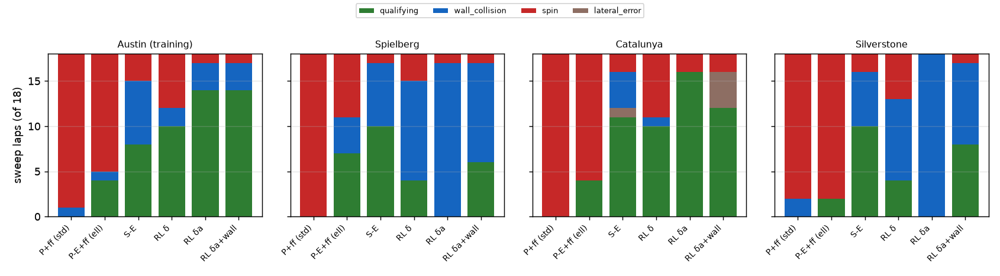
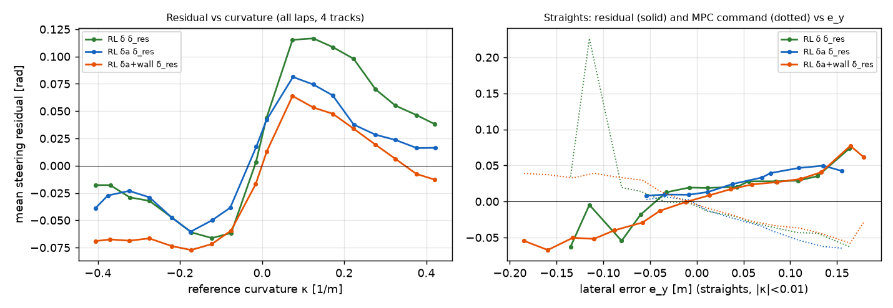
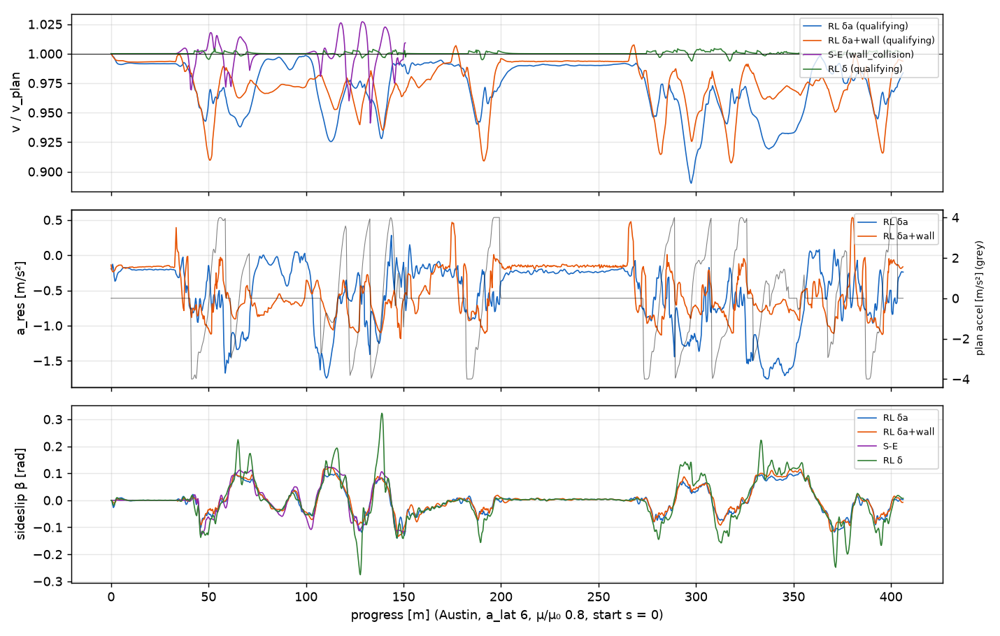
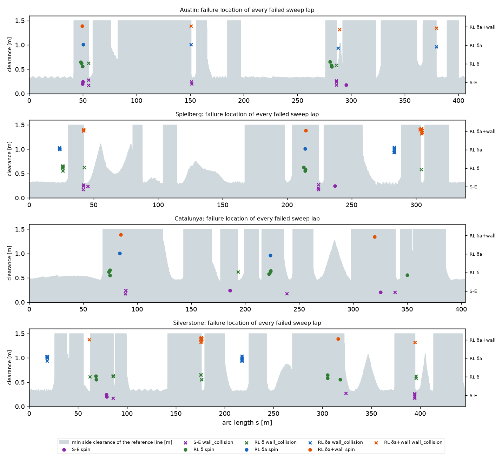
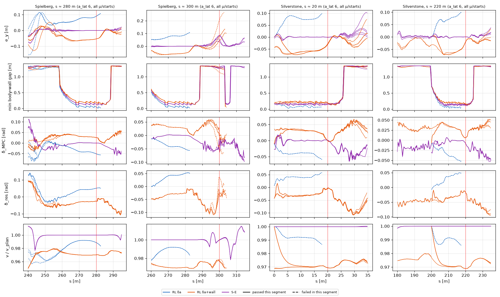
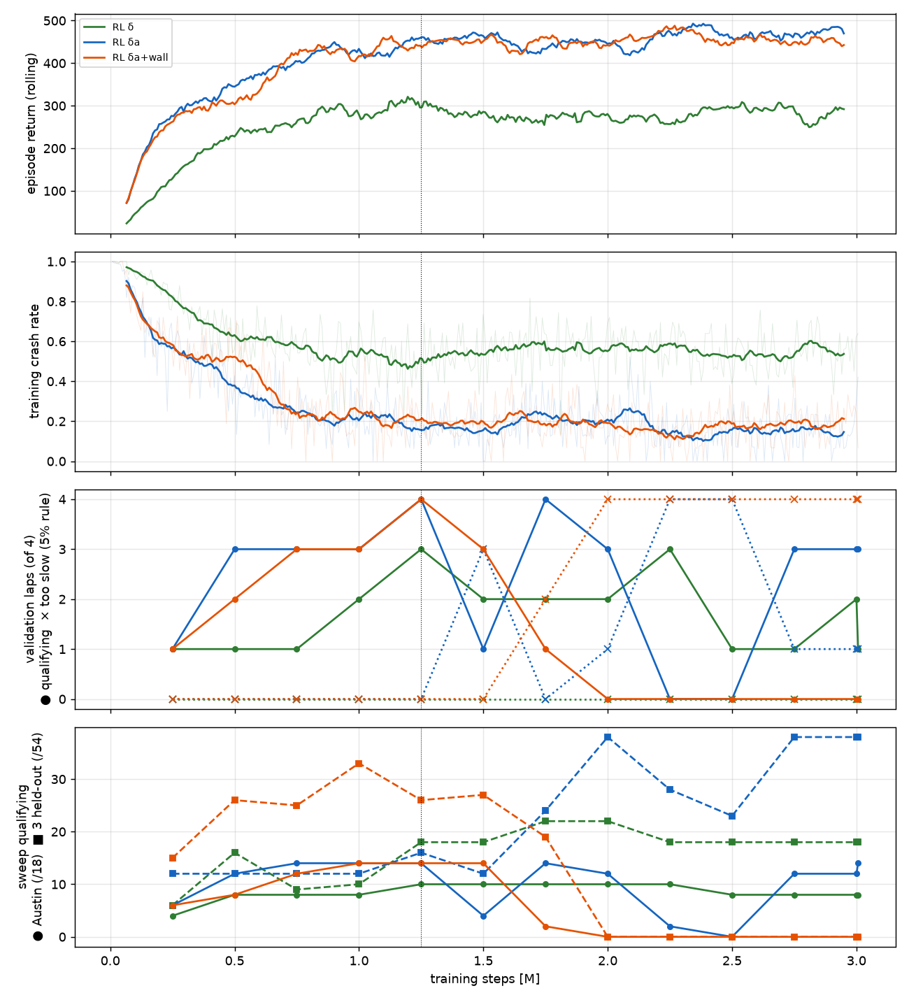

# Residual RL + MPC on the Pacejka plant: what the policies learned, why they fail, and how far the conclusions hold

Analysis of the existing experiments as of commit `10cc97c`. No controller, reward, hyperparameter or evaluation rule was changed. Every number below comes from the CSVs written by the scripts in [`results/analysis/`](../results/analysis/README.md), which only import the repository code. New laps were only re-runs of saved evaluation cells, plus clearly labelled counterfactual ablations.

**Evidence labels:**
- **[observed]**: measured directly in the saved or replayed data.
- **[causal]**: shown by an intervention on the same laps (ablation), on the policies as trained. It does not mean the training would turn out the same way.
- **[plausible]**: consistent with the data, but not isolated.
- **[hypothesis]**: not tested; a proposed experiment is listed in §9.

---

## 1. Setup and what was audited

| Key | Controller | Config | Speed plan | Checkpoint |
| --- | --- | --- | --- | --- |
| P / P+ff (std) | kinematic MPC (+ K·v²·κ, K = 0.03), plan FF + P speed control | `pilot_st_pacejka_residual.yaml` (baselines) | standard | — |
| P-E / P-E+ff (ell) | same, on the friction-ellipse plan | `pilot_st_pacejka_residual_dual.yaml` (baselines) | ellipse | — |
| S-E | slip-aware MPC (`SlipMPC`), nominal μ₀ | `pilot_st_pacejka.yaml` + `longitudinal S-E` | ellipse | — |
| RL δ | kinematic MPC + PPO steering residual | `pilot_st_pacejka_residual.yaml` | standard | `residual/ckpt_1250000` |
| RL δa | + acceleration residual, β/ares reward terms, μ range 0.6–1.0 | `pilot_st_pacejka_residual_dual.yaml` | ellipse | `residual_dual/ckpt_1250000` |
| RL δa+wall | + 8 wall-gap observations | `pilot_st_pacejka_residual_dual_wall.yaml` | ellipse | `residual_dual_wall/ckpt_1250000` |

**Evaluation protocol (unchanged):**
- **Sweep:** a_lat ∈ {4, 6, 8} × μ/μ₀ ∈ {1.0, 0.8, 0.6} × start s ∈ {0, 200} m, giving 18 laps per track.
- **Fastest-lap search:** raise a_lat along the grid until a level fails from either start pose.
- **Qualifying rule:** completed, no off-track step, no solver failure, max |e_y| ≤ 0.5 m, and lap time ≤ 1.05 × plan lap time.
- **Tracks:** Austin is the training and selection track; Spielberg, Catalunya and Silverstone are held out.

### 1.1 Consistency checks ([`audit/consistency.txt`](../results/analysis/audit/consistency.txt), [`data/reproduction.csv`](../results/analysis/data/reproduction.csv))

- **Configs and checkpoints:**
  - Each run's `train_config.yaml` is identical to its `configs/*.yaml`.
  - Each `report.json` names the checkpoint that was evaluated.
  - All three selected checkpoints are tracked in git; all 13 checkpoints per run are on disk.
- **Bit-level reproduction:** all 576 sweep laps were replayed with traces: 8 controllers × 4 tracks × 18 cells. Every lap matches its saved `sweep.csv` row: outcome, status, lap time, RMS e_y and progress.
- **Tables:**
  - `comparison_all_tracks.csv` (16 rows) matches the underlying sweep counts.
  - Every published fastest-lap level is reproduced from `lap_time_grid.csv` under the chain rule.
  - The baselines in the δa and δa+wall runs are identical laps; P-E in `longitudinal/Austin` is identical to the δa run's nominal baseline.
- **Every outcome is accounted for.** For every track × controller, the status counts sum to 18 ([`audit/status_counts.csv`](../results/analysis/audit/status_counts.csv)). Non-qualifying laps are listed as `speed_tolerance`, `lateral_error`, `wall_collision`, `spin`, etc., never merged.
- **One apparent mismatch is a rounding artefact.** Re-applying the selection rule to the saved δa `checkpoint_selection.csv` picks `ckpt_1750000`, not `ckpt_1250000`. The CSV rounds progress to 4 decimals, which hides the 7.2e-5 tie-break. With unrounded values (re-run in R2) the rule picks `ckpt_1250000`, as published.
- **The `base_K` checkpoint-selection bug does not affect the Pacejka experiments:**
  - Before `c69287b`, `select_checkpoint` ran validation laps with K = 0 instead of `residual.base_K`.
  - All three Pacejka configs have `base_K: 0.0`, so they are unaffected whether or not the fix is present.
  - The only affected run, linear `results/ff_residual`, was re-selected after the fix in commit `f4d99e4`.
  - The R2 re-run, with the current code, reproduces every saved `n_qualifying` for all 39 Pacejka checkpoints.

## 2. Cross-controller and cross-track results

**Sweep outcomes:** qualifying / speed-tolerance / lateral-error / wall / spin, out of 72 laps over 4 tracks. From [`audit/status_counts.csv`](../results/analysis/audit/status_counts.csv).

| Controller | qual | slow | lat | wall | spin | Austin | Spielberg | Catalunya | Silverstone |
| --- | --- | --- | --- | --- | --- | --- | --- | --- | --- |
| P+ff (std) | 0 | 0 | 0 | 3 | 69 | 0 | 0 | 0 | 0 |
| P-E+ff (ell) | 17 | 0 | 0 | 5 | 50 | 4 | 7 | 4 | 2 |
| S-E | 39 | 0 | 1 | 24 | 8 | 8 | 10 | 11 | 10 |
| RL δ | 28 | 0 | 0 | 23 | 21 | 10 | 4 | 10 | 4 |
| RL δa | 30 | 0 | 0 | 38 | 4 | 14 | 0 | 16 | 0 |
| RL δa+wall | 40 | 0 | 4 | 23 | 5 | 14 | 6 | 12 | 8 |

**Qualifying by friction** (all tracks, of 24 each):

| | μ/μ₀ 1.0 | 0.8 | 0.6 |
| --- | --- | --- | --- |
| S-E | 17 | 14 | 8 |
| RL δ | 12 | 12 | 4 |
| RL δa | 12 | 12 | 6 |
| RL δa+wall | 20 | 14 | 6 |
| P-E+ff | 10 | 6 | 1 |

**Fastest qualifying lap** in seconds (a_lat), from [`audit/fastest_laps.csv`](../results/analysis/audit/fastest_laps.csv). † marks the supplementary search starting at a_lat 3. Under the published search the δa and δa+wall rows have **no** qualifying lap on Austin or Catalunya, and δa+wall has none on any track.

| Track | Controller | μ/μ₀ 1.0 | 0.8 | 0.6 |
| --- | --- | --- | --- | --- |
| Austin | S-E | 58.71 (6) | 59.88 (5.5) | 62.94 (4.5) |
| | RL δ | **55.60** (7) | **57.16** (6) | 62.83 (4) |
| | RL δa † | 56.18 (10) | 57.91 (8) | 63.68 (5) |
| | RL δa+wall † | 56.71 (9) | 57.81 (8) | **62.22** (5.5) |
| Spielberg | S-E | 45.07 (6) | **45.11** (6) | **46.32** (5) |
| | P-E+ff | **44.07** (7) | 46.91 (4.5) | 50.93 (3) |
| | RL δ | 45.99 (4.5) | 46.92 (4) | 49.72 (3) |
| | RL δa+wall † | 49.72 (4) | 49.73 (4) | 51.12 (3.5) |
| Catalunya | S-E | 54.65 (7) | 55.67 (6) | 57.78 (5) |
| | RL δ | **53.12** (7) | **54.37** (6) | 59.07 (4) |
| | RL δa † | 53.73 (10) | 55.07 (8) | **57.74** (6) |
| | RL δa+wall † | 53.68 (10) | 55.98 (7) | 58.66 (5.5) |
| Silverstone | S-E | **60.06** (7) | **60.78** (6) | **62.39** (5) |
| | RL δ | 61.01 (5) | 62.08 (4.5) | 65.34 (3.5) |
| | RL δa+wall † | 62.62 (6) | 63.43 (5.5) | 64.47 (5) |

**Observed:**
- **A new fact: P-E+ff's fastest lap on Spielberg at μ/μ₀ 1.0 (44.07 s, a_lat 7) beats S-E (45.07 s).** The published tables never show the P-E+ff baseline on held-out tracks.
- **The rankings depend on very few laps:**
  - RL δa+wall (40) vs S-E (39) differ by one lap out of 72.
  - S-E's advantage at μ/μ₀ 0.6 (8 vs 6) is two laps.
  - With one seed and 18 laps per track, a difference of ≤ 3 laps per track should not be read as a ranking.
- **RL δa+wall's "40 of 72" includes no lateral-error laps,** but its 4 Catalunya `lateral_error` laps (max |e_y| > 0.5 m) are not crashes. They are counted as non-qualifying, not as collisions.

### 2.1 Standard vs friction-ellipse plan: controlled and confounded comparisons

From [`audit/plan_comparison.csv`](../results/analysis/audit/plan_comparison.csv), on every track and a_lat:
- **The standard plan** asks for up to 1.414× the friction ellipse, and lies outside it on 11–48% of the lap.
- **The ellipse plan** stays within 1.03, and is 1–4% slower (plan lap time). At Austin, a_lat 4: 62.66 s against 64.84 s.

Because the qualifying rule uses each controller's own plan, a lap on the ellipse plan has 1–4% more time budget in absolute seconds, but the same 5% relative tolerance.

| Comparison | What differs | Status |
| --- | --- | --- |
| P+ff vs P-E+ff, S vs S-E | speed plan only | controlled |
| RL δa vs RL δa+wall | wall observation only (same seed, reward, plan, selection rule) | controlled *for training config*; different trained networks, one seed each |
| RL δ vs RL δa | plan, action space, μ range (0.5–1.05 → 0.6–1.0), 3 reward terms | **confounded** (4 changes) |
| RL δ vs S-E | plan **and** controller | **confounded** |
| RL δa(+wall) vs S-E | controller (same ellipse plan) | controlled for plan; one seed |

The README's "MPC + RL beats slip-aware MPC on Austin" compares δ on the standard plan against S-E on the ellipse plan. Part of the lap-time gap is the plan itself: the standard plan's lap is 1–4% shorter at equal a_lat.

### 2.2 Audit of the search rules

- **The speed tolerance is binding only for the dual-channel policies.**
  - Re-scored at 3/5/7/10% tolerance and with no limit ([`audit/tolerance_sensitivity.csv`](../results/analysis/audit/tolerance_sensitivity.csv)), every controller's sweep count is unchanged between 5% and no limit.
  - At 3%, RL δa drops from 30 to **0** and RL δa+wall from 40 to **0**: every one of their qualifying sweep laps has a lap-time ratio in 1.032–1.042 ([`behavior/lap_time_ratio_by_alat.csv`](../results/analysis/behavior/lap_time_ratio_by_alat.csv)).
  - So the dual policies' qualifying counts sit 0.8–1.8 percentage points from a rule edge.
- **The low-speed failures are slowness, not crashes [observed + causal].**
  - In the full-grid search, the dual policies fail at a_lat 1.0: ratio 1.051–1.058 for δa and 1.056–1.070 for δa+wall, which fails at a_lat 1 on all four tracks.
  - Replaying a_lat 1–3 on Austin with the acceleration residual zeroed ([`behavior/low_alat_slowdown.csv`](../results/analysis/behavior/low_alat_slowdown.csv)) gives ratios of 1.003–1.006, all qualifying.
  - The policy applies a nearly constant a_res ≈ −0.46 to −0.55 m/s² at every a_lat. At low plan speed that is a larger fraction of v: v/v_plan is 0.937 at a_lat 1 against 0.962 at a_lat 3.
- **`--grid-min 3` changes only the dual rows.**
  - S-E and RL δ pass every level below a_lat 3 on every track and μ, so their best laps are identical under either rule (verified).
  - For the dual policies, *all* published lap times except Silverstone/Spielberg-δa come from the supplementary search. Starting at a_lat 3 begins the search at the bottom of the training distribution. That is a reasonable *capability* measure, but it is not the pre-registered protocol, and the gap is caused by the policy's own behaviour (above).
  - **Caveat:** on Spielberg and Silverstone, the full-grid δa result (52.72 s at a_lat 3 and 81.79 s at a_lat 2) is *better* than the from-3 result (Silverstone from 3 has no qualifying level at all). Neither search is uniformly favourable.
- **The chain rule only sees the first failing level.** Levels above it are not run, so the rule cannot show whether a controller would pass higher levels. Its result can also flip on a single unlucky start pose. For example, S-E on Catalunya at μ/μ₀ 1.0 stops at a_lat 8 on a `lateral_error` lap with ratio 1.026.

## 3. Learned steering behaviour

### 3.1 A persistent steering offset is learned by every policy, not only δa [observed]

The table below covers straights (|κ| < 0.01), all sweep laps, from [`behavior/steering_bias.csv`](../results/analysis/behavior/steering_bias.csv).

| Policy | mean δ_res [rad] | mean δ_MPC [rad] | mean e_y [m] | corr(δ_res, δ_MPC) |
| --- | --- | --- | --- | --- |
| RL δ | +0.023 to +0.028 | −0.023 to −0.029 | +0.047 to +0.054 | −0.38 to −0.84 |
| RL δa | +0.031 to +0.041 | −0.031 to −0.042 | +0.063 to +0.077 | −0.70 to −0.87 |
| RL δa+wall, Austin | +0.016 | −0.017 | +0.036 | −0.73 |
| RL δa+wall, held-out | −0.003 to −0.016 | +0.003 to +0.015 | −0.008 to −0.033 | −0.95 to −0.97 |
| baselines and S-E | — | — | −0.003 to +0.004 | — |

- **The policies hold the car to the left of the line.** All baselines track the reference with zero mean offset; the δ and δa policies hold the car 5–8 cm left of it on every track, including the training track.
- **The residual and the MPC cancel each other.** The MPC answers with an equal and opposite command, and the net steering is near zero. The residual is a constant bias that the MPC's integral-free tracking cannot remove; the offset is the equilibrium where the MPC's restoring command equals the bias.
- **The bias is in the policy itself.** In a linear model of δ_res on standardised state ([`behavior/residual_regression.csv`](../results/analysis/behavior/residual_regression.csv)), the intercept is +0.017 rad for δ and δa, but −0.010 for δa+wall.

### 3.2 The bias is fitted to Austin's geometry [causal for the policies as trained; plausible as a mechanism]

- **On Austin's tight straights the closer wall is on the right** (only 2–4% of tight-straight samples have the residual steering toward the closer wall). There, a left offset *adds* clearance. On Spielberg and Silverstone the closer wall on the critical straights is on the left: 96–100% of δa's tight-straight samples steer toward it.
- **Ablation (`debias`):** subtracting the policy's mean straight-line residual (0.033 rad) on straights only ([`behavior/ablations_by_track.csv`](../results/analysis/behavior/ablations_by_track.csv)):
  - Spielberg 0 → 9 qualifying and Silverstone 0 → 6, with wall collisions 35 → 19 on those two tracks;
  - **Austin 14 → 6** (walls 3 → 11);
  - Catalunya unchanged at 16.
- So the bias is not noise: it is *useful on the training track and harmful on tracks whose tight straights have the wall on the other side*. This is direct evidence of overfitting to the single training track's geometry. RL δ shows the same pattern, weaker: debias moves Spielberg 4 → 6 and Austin is unchanged.
- **The δa failures on Spielberg and Silverstone are all at four spots** (Spielberg s ≈ 23 and 283 m, Silverstone s ≈ 18 and 218 m; [`behavior/failure_locations.csv`](../results/analysis/behavior/failure_locations.csv)). At those spots:
  - reference-to-wall clearance is 0.26–0.27 m, i.e. a body-to-wall gap of ~0.11 m;
  - tire utilisation is below 0.2, so it is not a grip problem;
  - the car arrives at e_y ≈ +0.10 m with the 4–5 cm left offset.

  35 of δa's 38 wall collisions match this "low grip use: clearance / offset" signature ([`behavior/failure_classes.csv`](../results/analysis/behavior/failure_classes.csv)).

### 3.3 What else drives the steering residual [observed]

- **Curvature first.** Curvature and the planned lateral-acceleration preview dominate the steering output: permutation importance 0.26–0.44 for this group against 0.08–0.11 for tracking errors ([`behavior/obs_permutation_groups.csv`](../results/analysis/behavior/obs_permutation_groups.csv)).
- **It tracks the dynamics mismatch.** δ_res correlates with sideslip (−0.57 to −0.90) and with the yaw-rate deficit against the kinematic model (−0.55 to −0.73) whenever tire utilisation is below 0.95 ([`behavior/mismatch_signature.csv`](../results/analysis/behavior/mismatch_signature.csv)). It acts as counter-steer feedforward for the sideslip the kinematic MPC does not model, which is the role the slip-aware MPC fills explicitly.
- **The correlations break down near saturation.** Above 0.95 utilisation they weaken or reverse sign, i.e. the policy has no consistent behaviour at the limit. This regime is under 1% of samples.
- **The steering residual is the essential channel [causal]:**
  - zeroing it collapses δa from 30 to 6 and δa+wall from 40 to 6;
  - RL δ falls to 0, with spins rising to 61 of 72, and its corner rear-tire utilisation p95 rises from 0.84–0.89 to 0.98–1.0.

### 3.4 Does the wall-aware policy use its new observations? Yes, but not in the way that helps [observed + causal]

- **The policy is sensitive to the wall inputs.** The wall-gap group is the most important input of the acceleration output (permutation 0.079) and the fourth most important of the steering output (0.058).
- **The inputs switch the offset off where the closer wall is on the left.** The straight-line offset flips from +0.036 m (Austin) to −0.008 to −0.033 m on the held-out tracks.
- **Ablation (`wall_cap`): setting all 8 wall features to "no wall within 1.2 m":**
  - the offset returns to the Austin pattern (+0.027 to +0.032 m on *every* track);
  - total qualifying **rises** from 40 to **46**: Spielberg 6 → 12, Silverstone 8 → 10, Austin 14 → 12, Catalunya 12 → 12;
  - walls fall from 23 to 18.
  - Caveat: a constant 4.0 is out of distribution on tight straights, so this ablation does not measure "the same policy without wall information".
- **Interpretation:**
  - *[observed]* The δa+wall network, run without wall inputs, generalises *better* than with them.
  - *[plausible]* Most of δa+wall's gain over δa comes from a differently trained network: smaller bias (+0.016 vs +0.031 rad on Austin), lap-time ratio 1.037 against 1.040, and a different selected point in training. It does not come from reacting to walls at run time.
  - *[hypothesis]* The run-time wall reaction causes the new failure spots (§5). This could be confirmed by repeating `wall_cap` with the in-distribution value per straight.

## 4. Learned longitudinal behaviour

These figures are from [`behavior/longitudinal_by_segment.csv`](../results/analysis/behavior/longitudinal_by_segment.csv).
- **Segment definitions:**
  - corner: |κ| > 0.05;
  - braking: plan deceleration > 0.5 m/s²;
  - straight: |κ| < 0.01.

**The ~4% slowdown is mostly selective, with a uniform floor [observed]:**

| Policy | straight v/v_plan | braking | corner | mean a_res straight / corner [m/s²] |
| --- | --- | --- | --- | --- |
| RL δa | 0.988–0.991 | 0.971–0.984 | 0.948–0.963 | −0.26 to −0.29 / −0.65 to −0.95 |
| RL δa+wall | 0.973–0.992 | 0.975–0.979 | 0.951–0.959 | −0.21 to −0.63 / −0.70 to −0.74 |
| S-E | 1.000 | 0.974–0.984 | 0.998–1.004 | — |

- **Corners are where the time goes.** The mean acceleration residual in corners is 1.2–3.5× the one on straights, so most lap time is lost in corners, where S-E runs at plan speed. S-E slows only in braking zones, through its slip limits.
- **The slowdown is the same at every friction level.** a_res does not depend on μ: −0.59 m/s² at a_lat 4 for μ/μ₀ 1.0, 0.8 and 0.6 ([`training/ares_by_condition.csv`](../results/analysis/training/ares_by_condition.csv)). The policy cannot observe μ, so it applies one hedge everywhere.
- **The lap-time ratio is nearly constant (≈1.04) from a_lat 4 to 8,** i.e. roughly proportional slowing, and grows at low a_lat (above).
- **What the acceleration residual buys [causal]** (`zero_a` ablation):
  - spins 4 → 11 (δa) and 5 → 12 (δa+wall);
  - qualifying 30 → 24 and 40 → 34;
  - lap-time ratio 1.040 → 1.007;
  - with the residual, the fraction of samples with rear utilisation > 0.95 is lower in 6 of 7 track × policy combinations (1.6–5.7×) ([`behavior/ablation_detail.csv`](../results/analysis/behavior/ablation_detail.csv)).

  So the slowdown is a real stability measure, bought with lap time.
- **Is the slowdown reward-optimal? [plausible]** Slowing by 3.2% costs ≈0.032 progress reward per step (`reward_terms.csv`). A crash costs −50 plus the remaining discounted episode return. Training draws a_lat up to 9 at μ down to 0.6, which includes cells beyond the grip limit, and the policy cannot observe μ. So hedging uniformly is consistent with maximising expected return, even though it costs qualifying margin in the evaluation.
- **The reward never sees the 5% rule.** It is the one evaluation criterion the training signal does not encode.

## 5. Failure mechanisms

Each failed lap is classified from the last 1.5 s before failure ([`behavior/failure_classification.csv`](../results/analysis/behavior/failure_classification.csv)) by fixed rules, applied in order:
1. **Spin** → "rear saturation (spin)" if the rear axle exceeds 0.95 utilisation.
2. **Wall collision with peak utilisation < 0.5** → "low grip use: clearance / steering offset".
3. **Front > 0.95 only** → front saturation.
4. **Rear > 0.95** → rear saturation.
5. **Otherwise** → "corner: insufficient correction (grip left)".

Utilisation is |Fy|/(ξμFz), computed post hoc from the 20 Hz state. Load transfer uses an acceleration estimated from dv/dt, so it is approximate.

| | spin (rear sat.) | corner, rear sat. | corner, grip left | clearance / offset | front sat. |
| --- | --- | --- | --- | --- | --- |
| P+ff (std) | 69 | 2 | 0 | 0 | 1 |
| P-E+ff (ell) | 50 | 5 | 0 | 0 | 0 |
| S-E | 8 | 7 | 18 | 0 | 0 |
| RL δ | 21 | 3 | 11 | 9 | 0 |
| RL δa | 4 | 2 | 0 | **35** | 1 |
| RL δa+wall | 5 | 4 | **23** | 0 | 0 |

**Observed:**
- **Kinematic baselines fail by snap oversteer.**
- **S-E fails by running wide with grip left (18 of 33).** The slip limits keep the tires below their peak, and the car leaves the line at corner exits where walls resume (e.g., Silverstone s ≈ 390 m, Spielberg s ≈ 40 and 220 m). This is consistent with the README's "understeer into the wall" and the 1 s horizon limitation. *[plausible: not isolated]*
- **RL δ mixes all four mechanisms.** The 9 "clearance" failures are at Spielberg s ≈ 30 m, the same tight straight that δa fails on.
- **RL δa fails almost only by geometric clearance under its steering offset** (§3.2).
- **RL δa+wall moved its failures rather than removing their cause.**
  - The tight-straight failures are gone, but 23 of its 32 non-qualifying laps are new corner-exit failures with grip left: Spielberg s ≈ 300–305 m (8 laps) and Silverstone s ≈ 176 m (7 laps).
  - At both spots a wall-free curve section (clearance capped at 1.5 m) ends abruptly in a tight wall section.
  - The policy applies a strong negative residual (−0.06 to −0.09 rad) and arrives at e_y ≈ +0.13–0.27 m (`fig_hotspots.png`).
  - RL δ also fails at Silverstone s ≈ 180 m (4 laps).
  - *[hypothesis]* The wall preview assumes "the current e_y persists" and samples only 4 points over 1 s. At a curve exit where e_y changes quickly and the wall starts within that second, the preview is misleading: an observation limitation. With the wall inputs masked, these spots are mostly passed (Spielberg 6 → 12).

## 6. Learned control vs the slip-aware MPC

Cell by cell over the 72 sweep laps ([`behavior/rl_vs_se_cells.csv`](../results/analysis/behavior/rl_vs_se_cells.csv)):

| Policy | both qualify | RL only | S-E only | neither |
| --- | --- | --- | --- | --- |
| RL δ | 26 | 2 | 13 | 31 |
| RL δa | 19 | 11 | 20 | 22 |
| RL δa+wall | 31 | 9 | 8 | 24 |

**Where RL has the advantage [observed]:**
- Austin, the training track: δa and δa+wall qualify 14 against S-E's 8 at high a_lat.
- Catalunya, the held-out track most like Austin (no tight straights): 16 and 12 against 11.
- Lap time at μ/μ₀ ≥ 0.8 on Austin and Catalunya, where RL δ is fastest.
- RL holds higher a_lat levels (8–10) at high μ.

**Where S-E has the advantage [observed]:**
- Spielberg and Silverstone, both by qualifying count and by lap time (0.9–4.8 s per lap faster than the RL policies).
- Low friction overall (8 against 4–6 qualifying at μ/μ₀ 0.6).
- Tracking: RMS e_y on qualifying laps is 0.012–0.046 m for S-E against 0.041–0.073 m for RL.
- Consistency across tracks (8–11 qualifying per track).

**What the residual compensates for:**
- **Dynamics mismatch [observed]:** the counter-steer that correlates with β and the yaw-rate deficit (§3.3) is the sideslip feedforward the kinematic MPC lacks.
- **Speed-plan error [causal]:** the acceleration residual cuts spins (§4), i.e. it corrects a plan that is too fast for the true grip at low μ. S-E does the same through its rear slip limit.
- **Training-track geometry (overfitting) [causal, §3.2]:** the straight-line bias that keeps the car off Austin's right-hand walls.

So the residual mixes a transferable dynamics correction with a non-transferable geometric bias. S-E carries only the first, explicitly.

## 7. Training dynamics and checkpoint selection

R2 re-ran all 13 checkpoints × 3 runs on the 4 validation laps and the full 72-lap sweep, 2,964 laps in total ([`training/checkpoint_diagnostics.csv`](../results/analysis/training/checkpoint_diagnostics.csv)).

### 7.1 Why the selected checkpoint is 1.25M, and why later ones look worse [observed]

- **In the dual runs, later checkpoints are slower, not less safe.** The mean lap-time ratio of completed sweep laps rises steadily with training:

  | | 0.25M | 1.25M | ≥ 2M |
  | --- | --- | --- | --- |
  | δa | 1.015 | 1.040 | 1.036–1.051 |
  | δa+wall | 1.015 | 1.037 | 1.055–1.065 |

  - For δa+wall, every checkpoint from 2M on fails **all 4** validation laps on the 5% rule (`val_slow = 4`, no crashes), and **qualifies 0 of 72** sweep laps. Yet those checkpoints *crash less* in training, and fail only 18–42 of the 72 sweep laps by crashes (the selected checkpoint: 32).
  - 1.25M is the last checkpoint whose slowdown stays below 5% on all validation laps. The recurring "1.25M" is the point where a monotone slowdown crosses the rule threshold, not a performance peak.
- **The δ run does not slow down** (ratio 0.998–1.006 throughout). Its validation results fluctuate between 1 and 3 qualifying laps from checkpoint to checkpoint, a noise level comparable to the gaps that decide the selection.
- **Training metrics keep improving, so they cannot guide selection.** Return and crash rate (dual: ≈0.16–0.19 after 1M) plateau or keep improving while validation degrades, because the training reward rewards the slowdown (§4).
- **The training crash rate is a noisy metric.** Late in training each rollout has only ~16 episodes, and the per-rollout crash rate has an SD of 0.09–0.10. Episode length (≈330 steps for δ, ≈510–520 for the dual runs) also biases it.

### 7.2 The selection rule is fragile and can pick badly [observed]

These figures are from [`training/selection_check.csv`](../results/analysis/training/selection_check.csv) and [`training/selection_alternatives.csv`](../results/analysis/training/selection_alternatives.csv).

| Run | selected (sweep q / held-out q) | best checkpoint by total sweep | tie-break margin | Spearman(val q, held-out q) |
| --- | --- | --- | --- | --- |
| RL δ | 1.25M: 28 / 18 | 1.75M: 32 / 22 | progress 2.8e-4 | 0.35 |
| RL δa | 1.25M: 30 / 16 | final: **52** / 38 | progress **7.2e-5** | **0.05** |
| RL δa+wall | 1.25M: 40 / 26 | 1.0M: 47 / 33 | none (unique 4/4) | 0.93 |

- **The δa result is the most consequential finding of this analysis.**
  - Dropping the progress tie-break (n_qualifying, then RMS e_y) would have selected `ckpt_1750000`: 38 of 72 qualifying, 24 on held-out tracks.
  - The **final** δa checkpoint qualifies **52 of 72**, more than every other controller. It has 10 qualifying laps on Spielberg and 12 on Silverstone, where the published checkpoint has 0 on each.
  - The published "δa fails to generalise to Spielberg and Silverstone" is therefore a property of *the selected checkpoint*, not of the dual-channel setup.
- **Four validation laps on the training track cannot separate checkpoints:**
  - δa: 9 of 13 checkpoints score 3 or 4 of 4;
  - the progress tie-break is 7e-5, i.e. millimetres per lap;
  - for δa, validation success does not predict held-out success (Spearman 0.05).
- **The checkpoint-to-checkpoint variance is large.** Total sweep qualifying changes by 14–27 laps between adjacent δa checkpoints. With one seed, "δa+wall > δa" (40 vs 30) is smaller than the spread across checkpoints of one run (16–52).

### 7.3 Overfitting [observed / plausible]

- **Training track geometry:** the straight-line bias (§3.2) [causal].
- **Reward:** a slowdown the 5% rule penalises but the reward does not (§4, §7.1) [observed].
- **Validation setup:** selection on 4 laps on the training track, decided by sub-millimetre progress differences (§7.2) [observed].
- **Episode distribution:** a hypothesis only.
  - Training starts anywhere with ±0.1 m / ±0.05 rad offsets and 30 s episodes; evaluation always starts on the line.
  - No evidence of a mismatch was found: the replayed laps match training-like behaviour (ep_len and crash rates are consistent).

### 7.4 Train/eval consistency [observed in code + replay]

| Aspect | Status |
| --- | --- |
| Lap code | Same `LapSim`, kernel (`rust`), residual application (`apply`: steering clip, a_res added every physics step) and `residual_obs` in both. |
| Observations | VecNormalize normalises rewards only (`norm_obs=False`), so the observation statistics need no transfer. |
| Policy output | Evaluation uses the deterministic mean; training samples from it with std 0.075–0.08 at the end. |
| Episode start | The training episode start (steady-state steering, random offset) differs from evaluation (on the line, δ = r = 0). |
| Speed plan (single channel) | Train and eval use the standard plan; the S-E comparison uses the ellipse plan (confound, §2.1). |
| Bug check | No inconsistency between training and evaluation was found; `base_K` is 0 in all three Pacejka configs. |

## 8. Limitations of this analysis

- **One seed per policy.** Every RL difference in this document is a single-seed observation. Checkpoint-to-checkpoint variance (§7.2) shows that seed variance is likely comparable to the reported differences.
- **The ablations act on fixed trained networks.** `debias` and `wall_cap` tell us what *these* networks need, not what retraining without the feature would produce. `wall_cap` feeds out-of-distribution values.
- **Tire utilisation is reconstructed post hoc** from 20 Hz states, with an estimated acceleration. Short saturation spikes between samples can be missed, and the classification thresholds (0.5, 0.95) are judgement calls.
- **Failure classification uses the 1.5 s before termination.** A cause that started earlier, e.g. an offset built over a whole straight, is attributed to its final symptom.
- **S-E was only evaluated on the ellipse plan and with nominal μ₀.** Its tuning used Austin a_lat 5.

## 9. Recommended follow-up experiments (focused, cheap first)

1. **Selection-rule study, no retraining (minutes).**
   - Report lap-time ratio and status breakdown in `checkpoint_selection.csv`.
   - Evaluate a rule that adds sweep-like cells or a second track to validation.
   - Pre-register the rule before looking at held-out results.
   - The data already in `checkpoint_diagnostics.csv` shows the stakes: δa ranges from 30 to 52 qualifying.
2. **Seeds (3–5 per configuration, about 6 min each with `kernel: rust`).** This is the only way to tell whether δa vs δa+wall vs S-E differences exceed seed noise. Report the median and range over seeds of the selected checkpoint *and* of the final checkpoint.
3. **Single-change ablation of the δ → δa confound.** Train 4 runs that each add one of:
   - ellipse plan;
   - acceleration channel;
   - μ range 0.6–1.0;
   - β/ares penalties.
4. **Mirrored training track.** Train on Austin plus its mirror image (or on two tracks). The prediction from §3.2: the straight-line bias disappears and held-out wall collisions on tight straights drop. This directly tests the geometric-overfitting mechanism.
5. **Reward vs the 5% rule.** Add the plan-relative lap-time margin to the observation, or make the progress term non-linear near 0.95 × plan. Alternatively, just extend `a_lat_range` down to 1. Prediction: no monotone slowdown after 1.25M, and later checkpoints become selectable.
6. **Wall observation.** Re-run `wall_cap` with in-distribution values, i.e. per-track typical gaps, and repeat with a 2–3 s preview that uses the *predicted* e_y from the MPC trajectory instead of a persisting e_y. Prediction: the corner-exit failures at Spielberg s ≈ 300 and Silverstone s ≈ 176 disappear.
7. **Residual on S-E.** The residual's transferable part (sideslip feedforward) is what S-E already models. A residual on S-E would show whether learning adds anything beyond the geometry fit.

## 10. Reproducing

See [`results/analysis/README.md`](../results/analysis/README.md). The replays took 64 s (R1), 21 s (R1-low), 145 s (R2) and 58 s (R3) on 8 workers. The analysis scripts take under 2 min.
