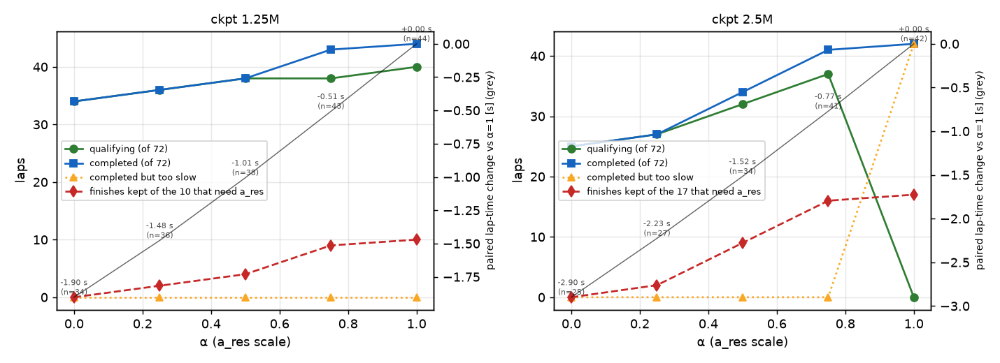

# Acceleration-residual strength sweep (wall-aware dual-channel policy)

## Method

**Question:** can a smaller acceleration residual win back lap time and still keep the finishes the full residual saves?

**Setup:**
- **Policy:** frozen checkpoints `ckpt_1250000` and `ckpt_2500000` from `results_st_pacejka/residual_dual_wall/`.
- **Intervention:** the policy's acceleration residual is replaced by **α · a_res**. This happens where the earlier `a0` ablation zeroes it, i.e. before it is added to the base speed command (plan feedforward + P) and before the actuator limit.
- **Unchanged:** the steering residual, observation (including the previous-action input, which reports the applied residual as in `a0`), speed plan and simulator.
- **Grid:** α ∈ {0, 0.25, 0.5, 0.75, 1} over the same 72 sweep cells (4 tracks × a_lat {4, 6, 8} × μ/μ₀ {1.0, 0.8, 0.6} × 2 start poses) per checkpoint. 720 laps, 57 s on 8 workers.

**Commands:**
```bash
uv run python results/analysis/ares_sweep/ares_sweep.py smoke
uv run python results/analysis/ares_sweep/ares_sweep.py sweep
uv run python results/analysis/ares_sweep/ares_sweep.py analyze
```

**Files:**

| File | Contents |
| --- | --- |
| `per_cell.csv` | Every lap: completion, status (= qualifying or the failure reason), failure location `fail_s`, lap time, lap-time ratio, minimum body-to-wall clearance over the lap and on tight-wall stretches, max \|β\|, mean applied a_res |
| `per_cell_by_alpha.csv` | Each cell's outcome across α |
| `tradeoff_summary.csv` | Totals per checkpoint and α, including the paired comparisons |
| `by_track.csv`, `by_a_lat.csv`, `by_mu_scale.csv`, `by_demand_class.csv` | Breakdowns |
| `reproduction_check.csv` | α = 0 / 1 against the saved `a0` / `orig` laps |
| `fig_tradeoff.png` | The trade-off plot |

**Reproduction checks:**
- **Smoke test:** α ∈ {0, 0.5, 1} on 3 Austin cells per checkpoint:
  - a routine finish: a_lat 4, μ/μ₀ 1.0, s = 0;
  - a finish that needs a_res at 1.25M: a_lat 8, μ/μ₀ 0.8;
  - a too-slow late-checkpoint finish: a_lat 4, μ/μ₀ 1.0, s = 200.

  α = 0 and α = 1 reproduced the saved `a0` / `orig` status, lap time and failure location in **12/12** cases.
- **Full sweep:** **288/288** α ∈ {0, 1} laps match. α = 1 is bit-identical to the evaluated policy.

## Results

| ckpt | α | completed | qualifying | Δ qualifying vs α=1 (gained / lost) | original finishes lost | needs-a_res finishes kept | Δ lap time vs α=1, jointly completed (mean [range], n) | lap-time ratio |
| --- | --- | --- | --- | --- | --- | --- | --- | --- |
| 1.25M | 0 | 34 | 34 | +0 / −6 | 10 | 0 of 10 | −1.90 s [−2.19, −1.37], n=34 | 1.005 |
| | 0.25 | 36 | 36 | +0 / −4 | 8 | 2 of 10 | −1.48 s [−1.71, −1.06], n=36 | 1.012 |
| | 0.5 | 38 | 38 | +0 / −2 | 6 | 4 of 10 | −1.01 s [−1.19, −0.69], n=38 | 1.019 |
| | 0.75 | 43 | 38 | +0 / −2 | 1 | 9 of 10 | −0.51 s [−0.62, −0.35], n=43 | 1.028 |
| | **1** | 44 | **40** | — | — | 10 of 10 | — | 1.037 |
| 2.5M | 0 | 25 | 25 | +25 / −0 | 17 | 0 of 17 | −2.90 s [−3.25, −2.47], n=25 | 1.005 |
| | 0.25 | 27 | 27 | +27 / −0 | 15 | 2 of 17 | −2.23 s [−2.52, −1.72], n=27 | 1.017 |
| | 0.5 | 34 | 32 | +32 / −0 | 8 | 9 of 17 | −1.52 s [−1.74, −1.20], n=34 | 1.029 |
| | **0.75** | 41 | **37** | **+37 / −0** | 1 | **16 of 17** | −0.77 s [−0.90, −0.60], n=41 | 1.042 |
| | 1 | 42 | 0 | — | — | 17 of 17 | — | 1.055 |

**Column meanings:**
- **"Needs-a_res finishes":** cells that finish at α = 1 but fail at α = 0.
- **"Original finishes lost":** laps that complete at α = 1 but not at α.

**Lap time and clearance:**
- **Lap time falls almost linearly in α:** about 0.5 s (1.25M) or 0.75 s (2.5M) per 0.25 step, with no plateau.
- **Clearance is unchanged within ≤ 1 cm.** On jointly completed laps, the minimum gap on tight-wall stretches changes by −0.3 to −0.9 cm and max |β| by +0.005 to +0.019 rad.



**Qualifying laps by demand** (of 24 / 16 / 32 laps):

| ckpt | class | α=0 | 0.25 | 0.5 | 0.75 | 1 |
| --- | --- | --- | --- | --- | --- | --- |
| 1.25M | a_lat 4 | 22 | 22 | 22 | 22 | 22 |
| | a_lat ≥ 6, μ/μ₀ 1.0 | 9 | 10 | 12 | 12 | 12 |
| | a_lat ≥ 6, μ/μ₀ ≤ 0.8 (high demand, low grip) | 3 | 4 | 4 | 4 | **6** |
| 2.5M | a_lat 4 | 18 | 18 | 20 | **21** | 0 |
| | a_lat ≥ 6, μ/μ₀ 1.0 | 5 | 7 | 8 | **10** | 0 |
| | a_lat ≥ 6, μ/μ₀ ≤ 0.8 | 2 | 2 | 4 | **6** | 0 |

**By track,** qualifying at α = 0.75 vs 1:
- 1.25M: Austin 12 vs 14, Catalunya 12 vs 12, Silverstone 8 vs 8, Spielberg 6 vs 6.
- 2.5M: Austin 14, Catalunya 12, Silverstone 4, Spielberg 7, against 0 everywhere at α = 1.

**By friction (μ/μ₀ 0.6):**
- 1.25M qualifies 6 at every α.
- 2.5M qualifies 4 at α ≤ 0.5 and 5 at 0.75.
- Low friction is not where the residual's strength matters most. The completions it saves are mostly at a_lat 6–8 and μ/μ₀ 0.8–1.0.

### 1.25M: no single α < 1 helps

- **Every α < 1 loses qualifying laps (2–6) and gains none.** At α = 1 all 40 qualifying laps are already within the 5% rule, so lap time saved does not convert into qualification.
- **α = 0.75 is the mildest reduction:** −0.51 s per lap (n = 43), one finish lost, 9 of the 10 needs-a_res finishes kept. It still loses 2 qualifying laps: **Austin a_lat 8, μ/μ₀ 0.8 (both starts)**. These finish but exceed the 0.5 m lateral-error limit by 2–3 mm (max |e_y| 0.502–0.503 m). They are rule-edge cases, not crashes.
- **Catalunya a_lat 6, μ/μ₀ 0.6 and a_lat 8, μ/μ₀ 0.8 get worse:** these 4 laps already fail the 0.5 m limit at α = 1 (0.70–0.73 m). At α = 0.75 three of them keep failing it with larger errors (0.84–0.98 m), and one (a_lat 6, μ/μ₀ 0.6, s = 200) spins at s ≈ 103 m. That spin is the one lost finish.
- **Cells that qualify only with a large enough residual:**
  - α ≥ 0.25: Austin a_lat 6, μ/μ₀ 0.8, s = 200; Silverstone a_lat 6, μ/μ₀ 1.0, s = 0.
  - α ≥ 0.5: Spielberg a_lat 8, μ/μ₀ 1.0, both starts.
  - α = 1 only: Austin a_lat 8, μ/μ₀ 0.8, both starts.

### 2.5M: α = 0.75 recovers almost all of the late checkpoint

- **37 qualifying laps against 0 at α = 1 and 25 at α = 0.** That is close to the published 1.25M checkpoint's 40.
- **It keeps 16 of the 17 finishes that need the residual** and loses one original finish.
- **Lap-time ratio 1.042:** inside the 5% rule, but with only 0.8 points of margin.
- **Every one of the 37 cells qualifies only for α ≤ 0.75,** because α = 1 is too slow everywhere. Within them, 12 cells also need a minimum α:

  | Minimum α | Cells |
  | --- | --- |
  | ≥ 0.25 | Austin a_lat 6, μ/μ₀ 1.0, s = 200; Austin a_lat 8, μ/μ₀ 1.0, s = 0 |
  | ≥ 0.5 | Austin a_lat 6, μ/μ₀ 0.8 (both starts); Austin a_lat 8, μ/μ₀ 1.0, s = 200; Silverstone a_lat 4, μ/μ₀ 0.8 (both starts) |
  | **= 0.75 only** | Austin a_lat 8, μ/μ₀ 0.8 (both starts); Spielberg a_lat 4, μ/μ₀ 0.6, s = 0; Spielberg a_lat 6, μ/μ₀ 1.0 (both starts) |

  For the last five cells, α = 0.5 is not enough to finish and α = 1 is too slow.

## Conclusion

- **1.25M: no single α gives a useful trade-off.** α = 0.75 saves 0.5 s per lap but costs 2 qualifying laps and 1 finish. Lower α costs more.
- **2.5M: α = 0.75 is a clearly useful single scale:**
  - 0 → 37 qualifying;
  - 16 of 17 rescued finishes kept;
  - −0.77 s per lap (n = 41).

  The late checkpoint's lost qualification is almost entirely an over-large acceleration residual. This is not a fix for training: α was chosen on the evaluation cells themselves, and the 0.8-point margin to the 5% rule is thin. It is evidence for the diagnosis.
- **Cells that motivate a state-dependent scale.** In these cells, the α that keeps the finish and the α that meets the speed rule (or the 0.5 m limit) conflict, so no global α serves both:
  - **High-demand cells at a_lat 8 and μ/μ₀ 0.8–1.0 (Austin, Spielberg):**
    - 1.25M Austin a_lat 8 / μ/μ₀ 0.8 needs α = 1 (at 0.75 it misses the e_y limit by 2–3 mm);
    - 1.25M Spielberg a_lat 8 / μ/μ₀ 1.0 needs α ≥ 0.5.
  - **The five 2.5M cells that only qualify at α = 0.75** (above).
  - **2.5M Austin a_lat 4 and Catalunya cells:** they qualify at every α ≤ 0.75 and pay up to 3 s per lap for a residual they do not need.

  A scale that is high only where a failure would otherwise occur and low elsewhere could keep both properties. Candidate inputs: planned lateral demand or curvature preview, and the wall-gap features. The earlier analysis located those failure spots at corner entries and corner-exit pinches.
- **Not tested:** α between 0.75 and 1 (e.g. 0.85–0.9), which could close the 1.25M gap; any state-dependent scale; other seeds or checkpoints.
