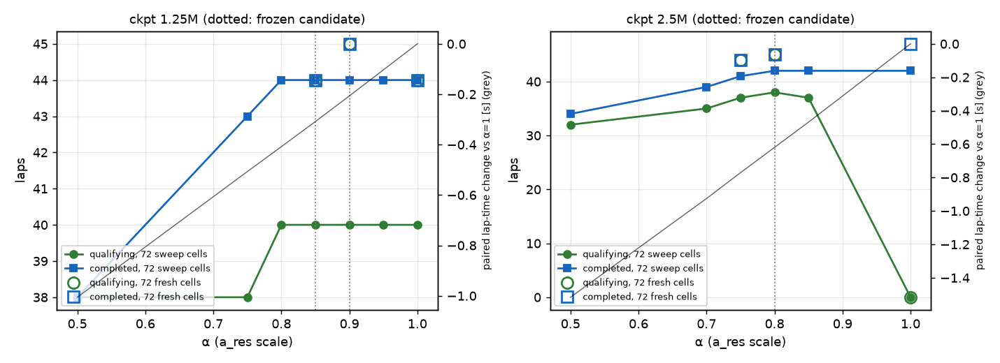

# Validating the acceleration-residual scale α

**Question:** does a fixed acceleration-residual scale improve on the published policy, and does it hold up on fresh cells?

**Setup:**
- **Policy:** frozen wall-aware dual-channel checkpoints `ckpt_1250000` (published) and `ckpt_2500000`.
- **Intervention:** the policy's acceleration residual is replaced by α · a_res. This uses the same lap loop as [`../ares_sweep`](../ares_sweep/REPORT.md) (`ablate.run_case`, variant `scale`).
- **Unchanged:** everything else.

**Commands** (from the repository root; the whole run takes about 3 min on 8 workers):

```bash
uv run python results/analysis/ares_validation/validate.py compare
uv run python results/analysis/ares_validation/validate.py fine
uv run python results/analysis/ares_validation/validate.py freeze
uv run python results/analysis/ares_validation/validate.py fresh
uv run python results/analysis/ares_validation/validate.py window
uv run python results/analysis/ares_validation/validate.py figure
```

| Step | Command | Output |
| --- | --- | --- |
| 1. 1.25M/α=1 vs 2.5M/α=0.75 | `compare` | `compare_cells.csv`, `compare_summary.csv` (from saved laps only) |
| 2. Finer α grid | `fine` | `fine_per_cell.csv` (504 laps), `fine_tradeoff.csv`, `fine_changed_cells.csv`, `fine_changed_cells_wide.csv` |
| 3a. Freeze | `freeze` | `freeze.json` (rule, timestamp, chosen α) |
| 3b. Fresh grid | `fresh` | `fresh_per_cell.csv` (576 laps), `fresh_tradeoff.csv`, `fresh_vs_baseline.csv`, `fresh_cells_vs_baseline.csv`, `fresh_by_track.csv`, `fresh_by_demand.csv` |
| 4. Windowed α | `window` | `window_diagnostic.csv` (65 laps) |
| Figure | `figure` | `fig_validation.png` |

**Margins:** reported as distance inside each qualifying limit; negative means the limit is missed.
- **Lap-time rule:** `ratio_margin = 1.05 − lap_time / plan_lap_time`.
- **Tracking limit:** `ey_margin = 0.5 m − max|e_y|`.

## 1. 1.25M / α=1 vs 2.5M / α=0.75 cell by cell (72 sweep cells)

**Outcome groups:**

| Group | Cells |
| --- | --- |
| Both qualify | 34 |
| Only 1.25M / α=1 qualifies | 6 |
| Only 2.5M / α=0.75 qualifies | 3 |
| Neither qualifies | 29 |

**Every cell that differs is a wall crash at one specific corner exit.** No outcome changes because of the 5% lap-time rule or the 0.5 m tracking limit.

| Lost by | Cells | Where it crashes |
| --- | --- | --- |
| 2.5M / α=0.75 | Silverstone a_lat 4 μ/μ₀ 0.6 (both starts), a_lat 6 μ/μ₀ 1.0 (both starts) | s ≈ 176 (one at 245) |
| 2.5M / α=0.75 | Spielberg a_lat 8 μ/μ₀ 1.0 (both starts) | s ≈ 42 |
| 1.25M / α=1 | Spielberg a_lat 4 μ/μ₀ 0.6 s 0, a_lat 6 μ/μ₀ 1.0 (both starts) | s ≈ 304 |

**The 29 cells where neither qualifies fail the same way for both:**
- 19: both hit the wall;
- 5: both spin;
- 4: both exceed the tracking limit;
- 1: one hits the wall and the other spins.

**Lap time, 2.5M/α=0.75 minus 1.25M/α=1:**
- On the 34 cells where both qualify: **+0.21 s** mean, range −0.13 to +0.41.
- On all 38 jointly completed cells: +0.23 s.

**What the 40 vs 37 totals hide:**
- The two settings are not ranked versions of one behaviour. Each crashes at corners where the other passes. 2.5M fixes Spielberg s ≈ 304 but adds crashes at Silverstone s ≈ 176 and Spielberg s ≈ 42.
- Where both finish, the scaled 2.5M policy is slower.
- So scaling recovers the late checkpoint's *qualification*, but does not give a better policy than 1.25M.

## 2. Finer fixed-scale sweep (72 sweep cells, 504 new laps)

**Lap-time change is measured against the same checkpoint at α = 1, on jointly completed cells.**

| ckpt | α | Qualifying | Completed | Original finishes kept | Needs-a_res finishes kept | Δ lap time (mean [range], n) | Mean ratio | Qualifying laps within 0.5 pt of 1.05 |
| --- | --- | --- | --- | --- | --- | --- | --- | --- |
| 1.25M | 0.75 | 38 | 43 | 43/44 | 9/10 | −0.51 s [−0.62, −0.35], 43 | 1.028 | 0 |
| | **0.80** | 40 | 44 | 44/44 | 10/10 | −0.41 s [−0.51, −0.28], 44 | 1.030 | 0 |
| | **0.85** | 40 | 44 | 44/44 | 10/10 | −0.31 s [−0.38, −0.21], 44 | 1.032 | 0 |
| | **0.90** | 40 | 44 | 44/44 | 10/10 | −0.21 s [−0.26, −0.14], 44 | 1.034 | 0 |
| | **0.95** | 40 | 44 | 44/44 | 10/10 | −0.10 s [−0.13, −0.07], 44 | 1.035 | 0 |
| | 1 | 40 | 44 | — | 10/10 | — | 1.037 | 0 |
| 2.5M | 0.70 | 35 | 39 | 39/42 | 14/17 | −0.93 s [−1.08, −0.72], 39 | 1.039 | 0 |
| | 0.75 | 37 | 41 | 41/42 | 16/17 | −0.77 s [−0.90, −0.60], 41 | 1.042 | 0 |
| | **0.80** | 38 | 42 | 42/42 | 17/17 | −0.62 s [−0.73, −0.49], 42 | 1.044 | **14** |
| | 0.85 | 37 | 42 | 42/42 | 17/17 | −0.47 s [−0.55, −0.37], 42 | 1.047 | **23** |
| | 1 | 0 | 42 | — | 17/17 | — | 1.055 | 0 |

### 1.25M: keeps all 40 qualifying laps for α between 0.80 and 0.95

- **Time gained:** 0.10 to 0.41 s per lap, with no qualifying lap or finish lost.
- **The limiting cell is Austin a_lat 8, μ/μ₀ 0.8** (both starts). Its tracking margin shrinks as α falls:

  | α | Tracking margin |
  | --- | --- |
  | 1 | 50 mm |
  | 0.9 | 28–31 mm |
  | 0.85 | 18 mm |
  | 0.8 | 5–6 mm |
  | 0.75 | −2 to −4 mm (fails the limit, as in the coarse sweep) |

  α = 0.80 therefore qualifies only barely.
- **Catalunya a_lat 6 μ/μ₀ 0.6 and a_lat 8 μ/μ₀ 0.8 fail the tracking limit at every α.** Their max |e_y| shrinks monotonically as α rises (0.98 → 0.70 m), but never reaches 0.5 m.

### 2.5M: 0.75–0.80 is the only usable band, and it is narrow

- **Qualifying peaks at 38 for α = 0.80**, against 37 at 0.75 and 0.85.
- **Most of the gain sits right at the 5% limit:**
  - 14 of 38 qualifying laps at α = 0.80 have a lap-time ratio above 1.045;
  - 23 of 37 do at 0.85;
  - none do at 0.75.
- **At α = 0.85 two Catalunya cells become too slow** (a_lat 6 μ/μ₀ 0.8 and a_lat 8 μ/μ₀ 0.8, start 200).
- **Below 0.75, corner-exit crashes return:**
  - Spielberg a_lat 6 μ/μ₀ 1.0 and a_lat 4 μ/μ₀ 0.6, s 0;
  - Austin a_lat 8 μ/μ₀ 0.8 at 0.5.
- **One cell is non-monotone:** Spielberg a_lat 4, μ/μ₀ 0.6, s 200 qualifies at 0.70, crashes at 0.75 and qualifies again at 0.80. The result can flip on a single α step.

## 3. Fresh validation grid

**Freeze (`freeze.json`, 2026-11-20 14:03, before any fresh lap was run).** The rule was applied programmatically to the 72 sweep cells:
1. most qualifying laps;
2. then most completed laps;
3. then the α nearest the middle of the run of α values within one qualifying lap of the best.

| Candidate | Chosen α | Range of α within one lap of the best |
| --- | --- | --- |
| 1.25M (rule) | **0.90** | 0.80–1.0 |
| 1.25M challenger (best α < 1) | **0.85** | — |
| 2.5M (rule) | **0.80** | 0.75–0.85 |

**Also run on the fresh grid as reference settings:**
- 1.25M / α=1 (the published baseline);
- 2.5M / α=0.75 (the earlier coarse pick);
- 2.5M / α=1;
- α=0 for both checkpoints, to count the finishes that need the residual.

**Fresh grid: 72 cells per setting.**
- 4 tracks × a_lat {4, 6, 8} × μ/μ₀ {1.0, 0.9, 0.7} × start s {100, 300}.
- **Not used anywhere before:**
  - the starts 100 and 300 in the sweep (sweep starts are 0 and 200);
  - μ/μ₀ 0.9 and 0.7 on any sweep cell.
- **Selection overlap avoided:** checkpoint selection used Austin a_lat 5/7, μ/μ₀ 1.0/0.7, s 100. Keeping a_lat at 4/6/8 means no fresh cell repeats a selection cell.
- **Demand mix:** routine cells (a_lat 4) and high-demand, low-grip cells (a_lat ≥ 6, μ/μ₀ ≤ 0.9).
- **Not out of distribution:** training covered a_lat 3–9, μ/μ₀ 0.6–1.0 and random starts. These cells are only unused for selection and for choosing α.

**Results against 1.25M / α=1:**

| Setting | Qualifying | Both / only candidate / only baseline / neither | Completed | Completed but missed a limit | Δ lap time vs baseline (mean [range], n) | Qualifying, a_lat ≥ 6 & μ/μ₀ ≤ 0.9 | Qualifying, a_lat 4 | Within 0.5 pt of 1.05 |
| --- | --- | --- | --- | --- | --- | --- | --- | --- |
| **1.25M / α=1 (baseline)** | **44** | — | 44 | 0 | — | 13 | 20 | 0 |
| **1.25M / α=0.90** | **45** | 44 / 1 / 0 / 27 | 45 | 0 | **−0.21 s** [−0.27, −0.14], 44 | 14 | 20 | 0 |
| 1.25M / α=0.85 | 44 | 43 / 1 / 1 / 27 | 44 | 0 | −0.31 s [−0.39, −0.22], 43 | 13 | 20 | 0 |
| 2.5M / α=0.80 | 45 | 39 / 6 / 5 / 22 | 45 | 0 | **+0.37 s** [+0.03, +0.57], 39 | 12 | 23 | **16** |
| 2.5M / α=0.75 | 44 | 38 / 6 / 6 / 22 | 44 | 0 | +0.22 s [−0.13, +0.42], 38 | 12 | 22 | 2 |
| 2.5M / α=1 | 0 | 0 / 0 / 44 / 28 | 47 | 47 (all too slow) | +1.01 s [+0.71, +1.21], 40 | 0 | 0 | 0 |

**On the fresh cells every completed lap at α < 1 also qualified,** so no lap completed while missing a limit. At 2.5M / α=0.80, 16 of the 45 qualifying laps are within 0.5 points of the 5% rule.

### 1.25M / α=0.90 holds up on fresh cells
- 45 against 44 qualifying, with no cell lost.
- −0.21 s per lap on all 44 jointly completed cells, the same gain as on the sweep cells.
- The one gained cell is Silverstone a_lat 6, μ/μ₀ 0.9, s 300, which the baseline crashes at s ≈ 177.
- α = 0.85 trades that cell for its other start pose (s 100). The net change is 0, so the gain at 0.90 is a single cell and could go either way.

### 2.5M repeats the sweep pattern
- **Fresh cells repeat the sweep result exactly.** 2.5M/α=0.8 qualifies 6 cells the baseline loses, all at Spielberg s ≈ 304. The baseline qualifies 5 cells it loses: 4 at Silverstone s ≈ 176 and 1 at Spielberg s ≈ 42.
- **It is 0.37 s per lap slower,** on every jointly completed cell (range +0.03 to +0.57 s).
- **It runs close to the 5% rule:** 16 of 45 qualifying laps are within 0.5 points of it.

## 4. Windowed-α diagnostic (2.5M, the five cells that qualify only at α = 0.75)

**Design:**
- **Window anchor:** at α = 0.5 each of the five cells hits the wall at a corner exit:
  - Austin a_lat 8, μ/μ₀ 0.8 at s ≈ 152;
  - Spielberg a_lat 6, μ/μ₀ 1.0 at s ≈ 42;
  - Spielberg a_lat 4, μ/μ₀ 0.6 at s ≈ 304.

  The windows were placed relative to that crash point f, as given in the coarse sweep, before any window run.

  | Window | Arc length |
  | --- | --- |
  | Entry | [f−35, f−15) |
  | Exit | [f−15, f+5) |
  | Corner | entry + exit |
  | Far control | [f−95, f−55) |

- **Prefix check:** each run uses one α inside the window and another outside. Before the window opens, the lap is identical to the uniform-α lap: 22,059 logged rows, max |Δ| in x, y, v = 0.

| Run (α outside → α inside window) | Qualifying (of 5) | Lap time vs uniform 0.75 |
| --- | --- | --- |
| Uniform 0.5 | 0 | — |
| Uniform 0.75 | 5 | — |
| 0.5 → 0.75 in **entry** | 0 | — |
| 0.5 → 1.0 in **entry** | 0 | — |
| 0.5 → 0.75 in **exit** | 4 | −0.50 to −0.56 s |
| 0.5 → 1.0 in **exit** | **5** | **−0.46 to −0.57 s** (ratio 1.029–1.035) |
| 0.5 → 0.75 / 1.0 in **corner** | 4 / 5 | −0.40 to −0.52 s |
| 0.5 → 0.75 in **far** control | 0 | — |
| 0.75 → 0.5 in **corner** | 0 | — |
| 0.75 → 0.5 in **far** control | 4 | ≈ −0.05 s |

**Observed:**
- **Only the last ~20 m into the crash point matters** ([f−15, f+5)).
  - **Exit window needed:** a stronger residual in the entry window alone, or anywhere else, does not save any of the five cells. Weakening it only in the corner breaks all five.
  - **Stronger residual is extra braking:** the applied a_res there is more negative.
  - **Lap-time gain:** with α = 0.5 everywhere else and 1.0 in that window, all five cells qualify, about 0.5 s faster than uniform 0.75.
- **Spielberg a_lat 4, μ/μ₀ 0.6, s 0 also depends on the approach.**
  - **Exit-only α:** 0.75 in the exit window is not enough; 1.0 is needed. Uniform 0.75 passes.
  - **Lowering it upstream:** lowering α only in the far window also makes it crash.
  - **Approach speed:** uniform 0.75 reaches the corner at 7.69 m/s, against 7.80 m/s at 0.5 upstream.
  - **Conclusion:** the speed carried into the corner, built up over the preceding 100 m, also matters for this cell.

**Limits of this diagnostic:**
- The windows are anchored at known crash points, which is oracle information.
- The result shows *where* a stronger residual is needed, not that a policy could find those places from its observations.

## Conclusion

**Baseline to keep: 1.25M.**
- **α = 0.90 is a small but real fixed-scale improvement:**
  - on the 72 sweep cells: 40 of 40 qualifying kept, −0.21 s per lap;
  - on 72 fresh cells: 45 vs 44 qualifying, no cell lost, −0.21 s per lap (n = 44).
- **That is about 0.4% of lap time and one cell,** so it is not a different policy.
- **Which number to cite:**
  - for a "best number": 1.25M / α=0.9, labelled as an evaluation-time scale chosen on the sweep cells and validated on fresh cells;
  - as the reference for future training changes: 1.25M / α=1.
- **α below 0.85 is not worth it for 1.25M:** the Austin a_lat 8 tracking margin falls to a few millimetres.

**The scaled 2.5M is not an improvement over 1.25M:**
- similar qualifying counts (45 vs 44 fresh, 38 vs 40 sweep);
- slower on every jointly completed fresh cell (+0.37 s);
- many laps right at the 5% rule;
- a narrow, partly non-monotone usable α band (0.75–0.80);
- its crashes move from Spielberg s ≈ 304 to Silverstone s ≈ 176 and Spielberg s ≈ 42.

**Evidence for a state-dependent scale:**
- **In favour:**
  - The residual matters only in short corner-exit stretches just before a wall pinch. Elsewhere it mainly costs time: 0.5 outside plus 1.0 in a 20 m exit window saves all five cells and gains ~0.5 s against uniform 0.75.
  - The 1.25M fixed-α results point the same way: the cells that set the lower bound on α are corner-exit or high-demand cells (Austin a_lat 8 μ/μ₀ 0.8 tracking margin, Spielberg s ≈ 42).
- **Against, or unresolved:**
  - The windows are oracle-placed.
  - One cell also depends on approach speed over ~100 m.
  - The two checkpoints crash at different corners, so a scale tuned to one policy's hotspots would not carry over.
  - Nothing here shows that a learned or rule-based scale could locate these stretches from the policy's observations. That is the next thing to test. The best candidate input is the wall-gap preview combined with planned lateral demand, which is high exactly at these corner exits.


