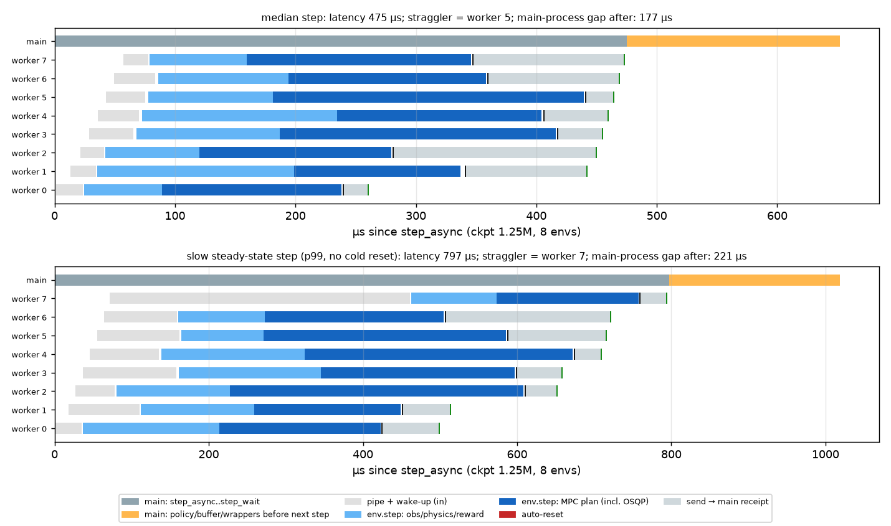
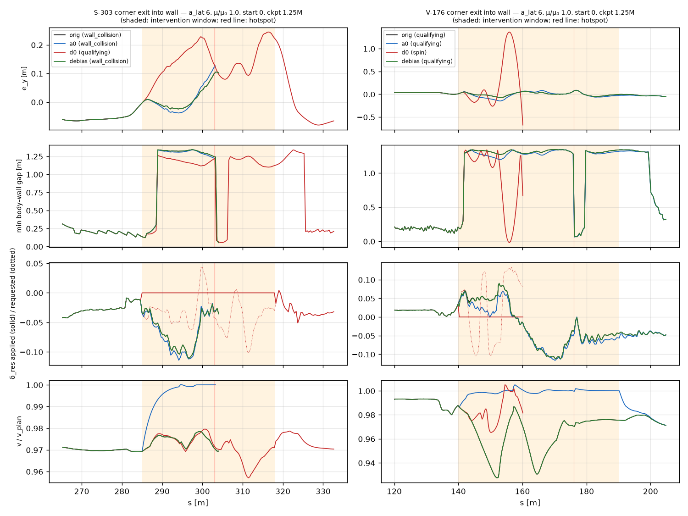

# Follow-up: PPO rollout bottlenecks and residual-policy behaviour

This follow-up uses the wall-aware dual-channel policy (`results_st_pacejka/residual_dual_wall/`) at two checkpoints:
- **`ckpt_1250000`** (the published one): 40 of 72 sweep laps qualify;
- **`ckpt_2500000`** (late): 0 of 72 qualify.

**Method:**
- No controller, reward or training code was changed.
- Timing comes from frozen-policy SB3 rollouts with a traced copy of SB3's `SubprocVecEnv` worker. Behaviour comes from deterministic closed-loop replays with interventions inside fixed windows.
- **Machine:** Apple M4 (4 performance + 6 efficiency cores). Background apps used 1.2–3.0 cores during the runs; every run records its load.
- **Commands and files:** [README.md](README.md).

---

## 1. Why PPO rollout throughput plateaus between 4 and 8 environments

**Setup:**
- SB3 PPO `learn` with `train` replaced by a no-op: stochastic actions, rollout buffer, VecMonitor and VecNormalize as in training.
- 3 rollouts of 1,024 steps per env; the first is warm-up.
- Worker seeds 1000+i, so the 4-env runs use the first 4 initial-condition streams of the 8-env runs.
- 3 repeats of every combination of checkpoint, env count and traced/untraced, interleaved.
- **Shared clock:** `perf_counter_ns` (`mach_absolute_time`, system-wide). In all 221,184 worker records the order dispatch < recv < send < receipt held.
- Raw data: `raw/rollout_trace.csv.gz`; per-step table: `raw/rollout_steps.csv.gz`.

### 1.1 Throughput and tracing overhead

Medians of 3 runs, steps/s, including the cold resets described below ([rollout/throughput.csv](rollout/throughput.csv)):

| Checkpoint | 4 envs untraced | 4 envs traced | 8 envs untraced | 8 envs traced | 4 → 8 (untraced) |
| --- | --- | --- | --- | --- | --- |
| 1.25M | 6,039 (5,808–6,291) | 6,392 | 8,592 (7,970–8,695) | 8,285 | **1.42×** |
| 2.5M | 6,790 (5,786–6,898) | 6,053 | 8,858 (8,748–8,947) | 6,984 (6,805–8,428) | **1.30×** |

**Tracing overhead is between +6% and −21%,** inside the ±10–20% run-to-run spread; three of the four comparisons are within ±11%. The 2.5M traced runs at 8 envs coincided with more preemption (see §1.3), so the −21% is not a clean overhead estimate. Overhead below ~10% cannot be resolved.

### 1.2 A short-run artifact: cold resets

- **Every speed level is expensive the first time.** On a reset, the first time a worker draws an a_lat level, `Track.plan` computes and caches the speed plan: 59 ms against 2.4 ms for a repeated level, measured single-process.
- **They dominate short runs.** In these 3-rollout runs most resets were first-time (median 25 ms in the traced rollouts). Under lockstep, the whole vectorised step waits for that worker, so cold resets are **24–29% of rollout time** and the entire p99 tail: p99 vectorised-step latency was 21–23 ms at 8 envs.
- **In a 3M-step training run each worker pays this 13 times** (≈ 0.3–0.8 s), which is negligible.

The steady-state numbers below therefore exclude vectorised steps whose critical path contains a cold reset (> 5 ms; 42–66 of 6,141 per configuration). [rollout/steady_critical_path.csv](rollout/steady_critical_path.csv) has both versions.

### 1.3 Steady-state critical path

The critical path runs from `step_async` to the end of `step_wait`, through the last worker to send its result. Its pieces sum exactly to the measured latency, and the main-process gap until the next `step_async` closes the cycle. **Unattributed time: 0 µs by construction.** The one piece that cannot be split is pipe transfer + worker wake-up, which is reported as one term.

| µs per vectorised step (ckpt 1.25M) | 4 envs | 8 envs | change |
| --- | --- | --- | --- |
| steps/s (steady) | 8,717 | 11,690 | **1.34×** |
| cycle (mean) | 459 | 684 | +225 |
| main process between steps (policy sample, buffer, wrappers) | 156 (34%) | 181 (26%) | +25 |
| dispatch to the straggler (sequential `send`) | 20 | 47 | +27 |
| pipe + wake-up into the straggler | 26 | 64 | +38 |
| straggler `env.step` | 224 (49%) | 343 (50%) | **+119** |
| … of which mean worker `env.step` | 191 | 265 | +75 (+39%) |
| … of which straggler minus mean (imbalance) | 33 | 78 | +45 |
| reset (warm) | 0.6 | 5 | +4 |
| worker post-step + send → main receipt | 31 | 41 | +10 |
| vectorised-step latency p50 / p95 / p99 | 276 / 443 / 517 | 476 / 667 / 899 | |
| worker utilisation (busy / (n × cycle)) | 0.42 | 0.39 | |

The 2.5M checkpoint shows the same structure: 7,072 → 9,613 steps/s (1.36×) and a cycle of 566 → 832 µs. Its `env.step` is 13–19% slower: it drives more slowly and its OSQP solves take longer (0.20 vs 0.17 ms in normal steps).

**Who finishes last:**
- **The straggler is one of the last three workers to be dispatched in 80% (8 envs) and 91% (4 envs) of steps.** Counts per worker, 8 envs: 33 / 50 / 133 / 428 / 601 / 1412 / 2337 / 1147. SB3 sends commands one after another (≈ 6 µs each) and receives results in order, so late-dispatched workers start late.
- **Some workers are consistently slower.** Mean `env.step` per worker spans 213–311 µs at 8 envs, against 184–199 µs at 4.
- **The slowdown is real execution, not waiting.** Worker CPU time ≈ wall time on average (258 vs 265 µs), so the +39% per-step cost is slower execution, not descheduling. *[plausible: placement on efficiency cores; core placement was not measured]*

**Slow steps** (top 5% of steady-state steps, 8 envs, 1.25M), against below-median steps:

| | pipe + wake-up in | straggler `env.step` | straggler preemption (wall − CPU) | straggler OSQP solve | send → receipt | warm reset on path |
| --- | --- | --- | --- | --- | --- | --- |
| slow steps | **203 µs** | 422 µs | 54 µs | 0.215 ms | 56 µs | 6.9% |
| normal steps | 42 µs | 313 µs | 5 µs | 0.200 ms | 35 µs | 0% |

- **In steady state, slow steps come from worker wake-up/pipe delays and slower execution,** with occasional warm resets. They do **not** come from OSQP: solve times are almost equal.
- **The 2.5M runs** show the same pattern, plus much more preemption (+491 µs), i.e. background interference during those runs.
- **OSQP iteration counts are not exposed** by the Rust kernel. The kernel's OSQP solve time is used instead; it correlated 0.99 with iterations in the Python MPC (earlier profile).

**Reading the timelines:**
- **Median step:** workers start 6–8 µs apart, and the straggler is a late-dispatched worker whose MPC plan was long.
- **Steady p99 step:** worker 7 woke up ~390 µs after its command was sent, with no extra computation.
- **Cold resets:** shown by the `slow_step_causes.csv` table; not drawn.

### 1.4 What this justifies

- **Worker count.** **Keep 8.** In steady state 8 envs give **+34%** over 4 (+42% untraced including cold resets), so 4 would lose throughput. Above 8 there is no headroom: per-step execution is already 39% slower and communication grows linearly with the env count.
- **Load balance.** **Only a moderate gain is available.** Imbalance costs ≈ 78 µs per step (11% of the cycle). Its two causes are partly structural: sequential dispatch order, and heterogeneous cores *(plausible)*. Randomising or rotating dispatch order cannot remove the max-of-8 effect.
- **IPC / vector-env design.** **This is where to test next.** Main-process work + communication is ≈ 49% of the cycle at 8 envs (181 + 155 µs), and the communication part doubles from 4 to 8 envs. A design that steps several envs per worker (fewer messages per sample), or an asynchronous/shared-memory vector env, targets that half.
  - **Upper bound, estimated:** halving communication and main-process work per sample would cut the cycle by ≈ 25%, i.e. ≈ 1.3× rollout throughput.
  - **Unmeasured:** how much per-env `env.step` time rises when a worker runs 2 envs sequentially on one core.

## 2. Paired closed-loop action ablations

**Variants:**
- `orig`: the policy as evaluated, bit-identical to `run_lap`;
- `a0`: acceleration residual forced to 0;
- `d0`: steering residual forced to 0;
- `debias`: the checkpoint's own mean steering residual on Austin's pre-defined straights (+0.015 rad at 1.25M, −0.006 rad at 2.5M) subtracted only inside pre-defined straight segments (|κ| < 0.01 over ≥ 15 m).

**Runs:**
- **Full laps:** all 72 sweep cells × 2 checkpoints.
- **Segment tests:** 5 pre-defined windows, from a branch point to an exit point, over the same cells.
  - The intervention is active only inside the window.
  - The prefix before the branch was **identical in all 1,080 segment runs** (e_y and v compared sample by sample), so simulator state, MPC warm start and policy history match at the branch.
- **Action logging:** requested and applied actions are logged; there was **no steering or acceleration clipping** in any segment window.

Files: [ablation/](ablation/).

### 2.1 Late checkpoints lose qualifying through slower completed laps, not more failures

| Checkpoint (orig) | completed | qualifying | too slow (5% rule) | wall | spin | lateral | lap-time ratio (completed) |
| --- | --- | --- | --- | --- | --- | --- | --- |
| 1.25M | 44 | 40 | 0 | 23 | 5 | 4 | 1.037 |
| 2.5M | 42 | **0** | **42** | 26 | 4 | 0 | 1.055 |

- **Most lost cells completed, just too slowly.** Of the 40 cells that qualify at 1.25M, 2.5M loses all 40: **34 complete but miss the 5% rule** and 6 fail.
- **Completion barely changes:** 44 → 42 laps.
- **Lap time:** +1.01 s on the 38 jointly completed laps.

([ablation/late_vs_early.json](ablation/late_vs_early.json))

### 2.2 The slowdown is concentrated in corners, not around risky wall sections

The table shows excess time over the plan on completed orig laps ([ablation/excess_time_by_segment.csv](ablation/excess_time_by_segment.csv)).
- **Tight-wall:** the reference line is < 0.4 m from a wall.

| Segment | share of distance | share of excess time 1.25M / 2.5M | excess, % of plan time, 1.25M / 2.5M |
| --- | --- | --- | --- |
| corners (|κ| > 0.05) | 41% | **68% / 65%** | **5.4% / 7.6%** |
| braking zones | 4% | 4% / 4% | 3.7% / 5.9% |
| open straights | 15% | 10% / 12% | 2.8% / 4.7% |
| tight-wall straights | 17–18% | 6% / 5% | **1.5% / 1.9%** |
| transitions | 22% | 12% / 14% | 2.3–2.4% / 4.0% |

- **The time goes in corners.** The policy loses time where grip is used. Tight-wall straights are where it loses the *least* time.
- **The late checkpoint is slower everywhere,** by +1.7 to +2.2 percentage points in every segment class except tight-wall straights (+0.4).

### 2.3 The acceleration residual: survival in a minority of cells, time cost in all of them

| Effect of removing a_res (full laps, paired) | 1.25M | 2.5M |
| --- | --- | --- |
| completed laps | 44 → 34 | 42 → 25 |
| qualifying laps | 40 → 34 | **0 → 25** |
| lap time on jointly completed laps | −1.90 s (34 laps) | −2.90 s (25 laps) |
| lap-time ratio | −0.032 | −0.050 |
| laps that complete *only* without a_res | 0 | 0 |
| min body–wall gap on tight-wall stretches (with − without a_res) | +0.8 cm mean (median +0.4) | +0.9 cm (median +1.0) |
| max \|β\| (with − without) | −0.012 rad | −0.013 rad |

- **Where it improves survival:** 27 cell × checkpoint cases.
  - Without the residual, those laps end in 24 wall collisions and 3 spins.
  - They are at a_lat 6–8, and at a_lat 4 only at μ/μ₀ 0.6–0.8 for 2.5M.
  - In the segment tests the clearest case is the **Spielberg s ≈ 303 corner exit at 2.5M:** 2 → 8 failures of 12 without a_res. Entry speed rises by 0.2–0.8 m/s without it.
- **Where it adds time without a clearance benefit:** on every jointly completed lap.
  - It costs 1.4–3.3 s per lap for at most about 1 cm of clearance and 0.01 rad of sideslip.
  - At 2.5M it is the *entire* reason for not qualifying: without it, 25 laps qualify.

### 2.4 The steering residual: essential, and sometimes toward the wall

**Removing δ_res:**
- **Full laps:** qualifying falls from 40 to 6 (1.25M), with 38 more failures (19 spins, 19 walls).
- **Segments ([ablation/segment_paired_summary.csv](ablation/segment_paired_summary.csv)):**

| Segment | failures in the window: orig / without δ_res (1.25M; 2.5M) | min gap change without δ_res | cases where δ_res puts the car > 2 cm closer to the wall |
| --- | --- | --- | --- |
| Austin T1, s ≈ 50 (control: RL passes) | 1 → **10** of 16; 1 → 8 | −4.0 / −0.9 cm | 0; 3 |
| Spielberg s ≈ 283, tight straight | 0 → 0 of 14; 0 → 0 of 12 | −1.3 / **+2.2 cm** | 0; **9 of 12** |
| Spielberg s ≈ 303, corner exit into a wall | 8 → 7 of 14; 2 → 7 of 12 | −1.2 / −2.6 cm | 1; 0 |
| Silverstone s ≈ 176, corner exit into a wall | 7 → **15** of 15; 11 → 15 of 15 | +4.7 / +4.0 cm | **9**; **6** |
| Silverstone s ≈ 218, tight curve | 0 → 0; 0 → 0 | −4.6 / +1.2 cm | 0; 0 |

**Observed:**
- **At Austin T1 and Silverstone s ≈ 176, δ_res is what keeps the car on the road:** without it the car spins or hits the wall upstream, at s ≈ 155 in the overlay. At s ≈ 176 it also runs the car several cm closer to the wall, a trade-off it needs to survive the corner.
- **At Spielberg s ≈ 303 (1.25M), δ_res does not prevent the failure:** 8 failures with it, 7 without. The overlay shows a strong right-steer residual (−0.1 rad) through the wall-free curve, but the car still arrives at e_y ≈ +0.12 m exactly where the wall resumes (s 303.1–304.7 m in every case, with or without the intervention). This is a geometric pinch the residual does not anticipate.
- **The late checkpoint's flipped bias moves the car toward the wall** on Spielberg's tight straight (9 of 12 cases, +2.2 cm gap without δ_res), with no collisions there in these cells.

### 2.5 Straight-line bias is not implicated for the wall-aware policy

Subtracting the pre-defined straight-line bias changed **no outcome** in any of the 144 paired full laps (both checkpoints, all 4 tracks): mean Δlap 0.004 s. In the segment windows it changed only clearance:
- **+6.4 cm** at Spielberg s ≈ 283 (1.25M);
- **−4.5 cm** at Austin T1, where the bias helps.

This differs from the non-wall δa policy (whose 0.033 rad bias caused its Spielberg and Silverstone failures; `docs/rl_analysis.md` §3.2). The wall-aware 1.25M policy's Austin bias is only 0.015 rad, and its failures are corner-exit pinches, not straights.

## 3. Feasibility checks

### 3.1 SlipMPC as an RL base

**Matched cells:** S-E vs the wall policy at 1.25M, same friction-ellipse plan, 72 sweep cells ([feasibility/](feasibility/)).
- 31 qualify with both.
- **S-E recovers 8 wall-policy failures, and they are exactly the two corner-exit hotspots** (all classified "corner exit, grip left"):
  - Spielberg s ≈ 304 (6 cells);
  - Silverstone s ≈ 176 (2 cells).
- **S-E loses 9 cells the policy completes:** Austin a_lat 6–8 at s ≈ 55, 151 and 286; Spielberg a_lat 8; Catalunya a_lat 8.

**Control-step cost:** `ResidualRacingEnv.step` with the base controller switched in memory; 3,000 steps, single process, Rust physics in both.

| Base | step median | p95 | p99 | CPU s per 1M env steps (1 core) |
| --- | --- | --- | --- | --- |
| kinematic MPC (as trained) | 165 µs | 179 µs | 206 µs | 215 s |
| SlipMPC (Python) | 1,544 µs | 1,730 µs | 4,516 µs | 1,613 s |

**Implied cost:**
- **7.5× CPU per million steps** (9.4× in median step time).
- With rollouts then compute-bound, and assuming the S-E lap-pool scaling measured earlier (2.7× at 8 workers), that is **≈ 10 min wall per 1M steps, ≈ 30 min per 3M-step run**, against ≈ 2 min per 1M now.

**Unmeasured:**
- SlipMPC's actual scaling inside `SubprocVecEnv`;
- whether PPO converges in 3M steps on this base;
- whether reward and observation (`d_mpc`, `a_mpc`) need changes;
- whether a residual adds anything at the two hotspots S-E already passes.

### 3.2 Friction inference from history (offline probe)

**Data:** frozen 1.25M policy, stochastic actions, training-distribution episodes. 126k steps: 200 Austin episodes and 80 Spielberg episodes (held-out track). μ/μ₀ ranges over 0.60–1.00.

**Probe:**
- **Target:** simulator μ/μ₀.
- **Inputs:** the policy observation + action, which reveal μ in no direct way, with 0 / 5 / 10 frames of history (frames and first differences).
- **Models:** ridge regression and a 2×64 MLP.
- **Evaluation:** episode-grouped 5-fold CV on Austin; trained on all Austin, tested on Spielberg.
- **Excitation:** measured |v·r|. Low (< 2 m/s²) is 39% of steps, high (> 4 m/s²) 27%.

| RMSE (constant predictor: 0.104 Austin, 0.085 Spielberg) | current obs | 5 frames | 10 frames |
| --- | --- | --- | --- |
| Austin CV, MLP, all | 0.104 (R² 0.01) | 0.096 (0.16) | 0.093 (**0.20**) |
| Austin CV, MLP, high excitation | 0.099 (0.09) | 0.075 (0.48) | **0.072 (0.52)** |
| Austin CV, MLP, low excitation | 0.105 (−0.02) | 0.105 (−0.02) | 0.103 (0.02) |
| Austin CV, ridge, any | ≈ constant (R² ≤ 0.01) | ≈ constant | ≈ constant |
| Spielberg (held-out), MLP / ridge, all | R² −0.53 / −0.05 | −0.27 / −0.05 | −0.33 / −0.06 |

**Results:**
- **The current observation contains no usable friction information.**
- **A short history makes μ partly inferable, nonlinearly, during high lateral excitation on the training track.** RMSE falls 31%; in low-excitation segments there is no gain.
- **It does not transfer to Spielberg.** The MLP probe is worse than the constant there, i.e. it fitted Austin-specific patterns.

**Unresolved:** whether multi-track data would give a transferable signal. Coverage here is one training track and one held-out track.

## 4. Conclusions

| # | Conclusion | Effect size | Cases | Unresolved |
| --- | --- | --- | --- | --- |
| 1 | Rollout throughput is limited by lockstep: the slowest worker's env step (~50% of the cycle) plus main-process + communication work (~49%), the latter growing with env count | 4 → 8 envs: +34% steady (+30–42% untraced), not 2× | 2 ckpts × 3 repeats × 6,141 steps | E-core placement not measured; true tracing overhead < 10% not resolvable |
| 2 | p99 latency in short runs is dominated by cold speed-plan computation on reset, which is negligible in full training | 24–29% of short-run rollout time; p99 21–23 ms → 0.9 ms steady | all runs | — |
| 3 | The late checkpoint loses qualifying through slower completed laps | 34 of 40 lost cells are "too slow"; +1.0 s per lap; completion 44 → 42 | 72 cells, all tracks | why training keeps slowing (reward, `docs/rl_analysis.md` §4) |
| 4 | The slowdown is in corners, not at wall pinches | corners: 41% of distance, 65–68% of excess time | completed laps of both ckpts | — |
| 5 | a_res buys survival in a minority of cells and costs time in all of them | 27 laps saved (24 walls, 3 spins); −1.9 / −2.9 s per lap and ≤ 1 cm clearance on the rest; 2.5M without a_res: 0 → 25 qualifying | 144 paired full laps | whether a smaller or state-dependent a_res would keep the survival benefit |
| 6 | δ_res is essential at corner entries but does not resolve the s ≈ 303 pinch; the late checkpoint's bias moves the car toward the wall on Spielberg's tight straight | Austin T1 failures 1 → 10 without δ_res; s ≈ 303 failures 8 vs 7 | 5 segments × 2 ckpts | how a pinch-aware observation would change s ≈ 303 |
| 7 | SlipMPC recovers exactly the corner-exit failures at 7.5× CPU per step | 8 recovered, 9 lost of 72 cells; 1.54 vs 0.165 ms per step | matched cells | training cost and benefit with RL on top |
| 8 | Friction is weakly inferable from short history, only under high excitation, on the training track | R² 0.52 (high excitation, Austin CV); ≤ 0 on Spielberg | 280 episodes | multi-track transfer |

## 5. What to do next

- **Training throughput:** prototype a vector env with **2 environments per worker process** (4 processes × 2 envs, stepped sequentially in the worker, one message per worker), and compare it against the current 8 × 1 with this tracer.
  - It attacks the measured communication + main-process half of the cycle. Upper bound ≈ 1.3× rollout throughput.
  - It also tests the core-heterogeneity hypothesis, because 4 processes fit on the 4 performance cores.
- **Policy behaviour:** retrain the wall-aware dual policy with the **acceleration residual bounded state-dependently or penalised relative to the 5% rule** (e.g. extend `a_lat_range` down to 1, or penalise speed below 0.96 × plan), with 3 seeds.
  - §2.3 shows a_res adds 2–3 s per lap for ≤ 1 cm clearance, and alone causes the late checkpoint's 0/72.
  - Prediction: later checkpoints stay above the 5% rule, and the 27 laps a_res saves stay saved.
