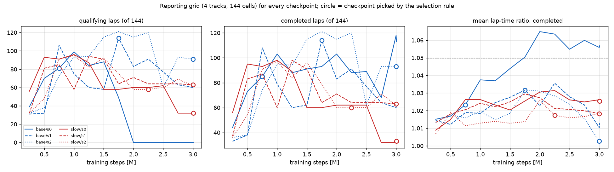

# Multi-seed study: new selection protocol and the speed-shortfall reward

**What changed** (the first three items below are the only code changes):
- **Selection and reporting protocol:** [`pilot/protocol.py`](../../../pilot/protocol.py). It sits alongside `pilot.eval_residual`; the qualifying rule itself is unchanged.
- **Reward term:** an opt-in speed-shortfall hinge `residual.reward.slow`:
  - formula: `− slow · max(slow_ratio − Δprogress / (v_plan·Ts), 0)` per control step;
  - setting: `slow = 3`, `slow_ratio = 0.96`;
  - lives in [`pilot/residual_env.py`](../../../pilot/residual_env.py); without the key the reward is unchanged.
- **Training options:** `--seed` and `--out` in `pilot.train_residual`.
- **Variant config:** [`configs/pilot_st_pacejka_residual_dual_wall_slow.yaml`](../../../configs/pilot_st_pacejka_residual_dual_wall_slow.yaml) is the wall-aware dual config plus the hinge, nothing else.

**Why 0.96:**

| Policy (12 Austin/Catalunya cells, a_lat 4–8) | Steps below 0.96 × plan |
| --- | --- |
| Base MPC with the acceleration residual zeroed | 1–12% |
| Published 1.25M checkpoint | 22–37% |
| 2.5M checkpoint | 51–83% |

## Protocol

**Fixed before any new training run:**

| Part | Definition |
| --- | --- |
| Selection grid (24 laps per checkpoint) | Austin × a_lat {3.5, 5, 7, 8.5} × μ/μ₀ {1.0, 0.85, 0.65} × start s {50, 250}. No reporting lap uses these cells. |
| Selection rule | Most qualifying → most completed → lowest mean lap-time ratio → earliest checkpoint. The old mean-progress tie-break is dropped. |
| Reporting grid (144 laps) | 4 tracks × a_lat {4, 6, 8} × (sweep cells μ/μ₀ {1, 0.8, 0.6} × s {0, 200} + fresh cells μ/μ₀ {1, 0.9, 0.7} × s {100, 300}). |
| Reported per lap | Status, margins to 1.05 and 0.5 m, failure location and crash hotspot. |
| Reported per variant | Median and range over 3 seeds. |
| Diagnostic only | Every checkpoint is also lapped on the reporting grid. Selection never sees this. |

**Runs:**
- **baseline, seed 0:** the existing `results_st_pacejka/residual_dual_wall`, published with `ckpt_1250000`.
- **baseline, seeds 1–2:** new runs in `results_st_pacejka/seeds/base/s{1,2}`.
- **slow (with the hinge), seeds 0–2:** new runs in `results_st_pacejka/seeds/slow/s{0,1,2}`.
- **Training settings:** all runs are 3M steps with otherwise identical settings.

**Commands:**

```bash
results/analysis/multiseed/run_seeds.sh   # trains the 5 new runs and runs the protocol on each (~65 min total)
uv run python -m pilot.protocol run --config configs/pilot_st_pacejka_residual_dual_wall.yaml --run-dir results_st_pacejka/residual_dual_wall --all-ckpts
uv run python -m pilot.protocol compare --out results/analysis/multiseed base/s0=results_st_pacejka/residual_dual_wall base/s1=results_st_pacejka/seeds/base/s1 base/s2=results_st_pacejka/seeds/base/s2 slow/s0=results_st_pacejka/seeds/slow/s0 slow/s1=results_st_pacejka/seeds/slow/s1 slow/s2=results_st_pacejka/seeds/slow/s2
uv run python results/analysis/multiseed/figure.py
```

**Files:**
- **Under each run folder:** `protocol_selection*.csv`, `protocol_selected.txt`, `protocol_report.csv`, `protocol_report_all_ckpts.csv`.
- **Here:**
  - `per_run.csv`, `per_variant.csv`;
  - `report_laps.csv`, `cell_qualifying_share.csv`;
  - `selection_curves.csv` (selection-grid and reporting-grid results per checkpoint);
  - `fig_checkpoints.png`.

## Results with the selected checkpoints (144 reporting laps each)

| Run | Selected | Qualifying | Austin (of 36) | Held-out (of 108) | Crashes | Too slow | Mean lap-time ratio (completed) |
| --- | --- | --- | --- | --- | --- | --- | --- |
| base / s0 | 750k | 81 | 28 | 53 | 59 | 0 | 1.023 |
| base / s1 | 1750k | **114** | 31 | 83 | 30 | 0 | 1.032 |
| base / s2 | 3000k | 91 | 28 | 63 | 51 | 0 | 1.003 |
| slow / s0 | final | 32 | 32 | **0** | 111 | 0 | 1.025 |
| slow / s1 | 3000k | 63 | 31 | 32 | 81 | 0 | 1.018 |
| slow / s2 | 2250k | 58 | 30 | 28 | 84 | 0 | 1.017 |
| **base, median [range]** | | **91 [81, 114]** | 28 [28, 31] | 63 [53, 83] | 51 | 0 | 1.023 |
| **slow, median [range]** | | **58 [32, 63]** | 31 [30, 32] | 28 [0, 32] | 84 | 0 | 1.018 |

**No selected lap misses a limit by a small margin:**
- no lap fails the 5% rule;
- at most 2 qualifying laps per run fail the 0.5 m limit;
- no qualifying lap is within 0.5 points of 1.05;
- one qualifying lap is within 2 cm of 0.5 m.

**Held-out qualifying by track (mean over seeds, of 36):**

| Variant | Catalunya | Silverstone | Spielberg |
| --- | --- | --- | --- |
| base | 30 | 18 | 18 |
| slow | 20 | 0 | 0 |

**slow crashes all over the held-out tracks, not at the four known hotspots:**
- Silverstone s ≈ 200–220, 0–20, 340–360;
- Spielberg s ≈ 0–20, 260–280, 100–120, 320–340.



## Findings

### 1. Seed-to-seed variation is larger than the effects we have been comparing (observed)

- **Same config, three seeds:** 81, 114 and 91 qualifying laps for the selected checkpoints.
- **Every checkpoint from 0.75M on:** results range from 32 to 121 qualifying laps (out of 144), leaving out seed 0's too-slow checkpoints, which score 0–49.
- **The late slowdown happened in only one of three baseline seeds.**
  - In seed 0, checkpoints from 1.75M on fail the 5% rule on 43–118 of 144 laps.
  - Seeds 1 and 2 never produce a lap that fails the 5% rule at any checkpoint. Their late checkpoints run at mean ratios of 1.00–1.04.
  - So the "late checkpoints get slower" diagnosis from the earlier analysis describes seed 0, not the method.
- **Every earlier single-run comparison is within this seed spread.** That includes δa vs δa+wall, wall vs S-E, and 1.25M vs 2.5M.

### 2. The Austin selection grid does not predict the reporting grid (observed)

- **Selection scores barely move after 0.75M:** 16–21 of 24 in every run except seed 0's slowdown.
- **Reporting scores move a lot:** 32–121 of 144 over the same checkpoints.
- **Correlation between the two across checkpoints:**
  - baseline: 0.66 / 0.77 / 0.96 (seeds 1, 2, 0), but in seed 0 almost all of that comes from the slowdown collapse;
  - slow: −0.08 / 0.47 / 0.53.
- **The rule's pick against the run's best checkpoint on the reporting grid** (that best is an oracle, for reference only):
  - baseline: 81 vs 99, 114 vs 114, 91 vs 121;
  - slow: 32 vs 96, 63 vs 94, 58 vs 95.
- **Nearly all of the variation is held-out-track generalisation, which an Austin-only grid cannot see.** A selection grid on a fifth track is the missing piece. Only the four benchmark tracks are on disk.

### 3. The speed-shortfall hinge removes the slowdown but hurts held-out tracks late in training

**Observed:**
- **No slow checkpoint at any step fails the 5% rule.** Mean lap-time ratios are 1.01–1.03.
- **Up to ~1.25M the two variants are indistinguishable.** At 750k–1.25M, held-out qualifying averages 50–61 per checkpoint for slow and 51–59 for base. The best reporting-grid checkpoints are also similar: slow 94–96, base 99–121.
- **From ~1.5–2M on, slow loses the held-out tracks while Austin stays at 30–32 of 36.**
  - At 2–3M, held-out qualifying is 21–34 per checkpoint for slow.
  - For base it is 45 and 59 in seeds 1–2; seed 0 is 0 because of its slowdown.
- **The rule therefore picks late, Austin-specialised slow checkpoints.** Their slightly better Austin scores win on the selection grid. Silverstone and Spielberg then fall to 0 qualifying for every seed.

**Mechanism (hypothesis, not tested):**
- The hinge makes uniform caution expensive.
- Late in training the policy keeps speed and tunes its corrections to Austin's corners.
- The global braking the baseline keeps happens to protect unseen corners on other tracks.
- The mean |a_res| is not lower in slow (0.44–0.57 m/s² late, against 0.44–0.57 for base seeds 1–2). So it is *where* the residual is used that changes, not how much.

**Verdict:** do not adopt the hinge.
- On the problem it targets it is neutral at best: the slowdown occurs in 1 of 3 baseline seeds.
- Under the protocol it is clearly worse: median 58 vs 91 qualifying, and 0 of 3 seeds keep the Silverstone/Spielberg cells.

## Conclusions and what to do next

- **Baseline status:**
  - The published policy (`ckpt_1250000`, seed 0) scores 84/144 on the reporting grid, inside the baseline seed range.
  - The protocol's own seed-0 pick (750k) scores 81.
  - The best seed (s1 at 1750k) reaches 114.

  Any claimed improvement needs to exceed this spread across three or more seeds.
- **The protocol works as a measurement tool, but its selection step has a known gap.** Fixes, in order:
  1. Add a held-out *selection* track. This needs either a fifth map (downloading one from the same F1TENTH racetrack release the simulator uses) or giving up one of the three test tracks for selection.
  2. Until then, report every checkpoint's reporting-grid curve (as here) next to the selected one, so selection regret stays visible.
- **The slowdown is not the main problem; generalisation off the training track is.** Late in training, held-out results swing far more than Austin results in every run of both variants. That points to the next step in the earlier list: training on more than one track geometry.
- **Not done here:**
  - other hinge weights or thresholds (a single setting was tested);
  - the `a_lat_range` extension;
  - more than 3 seeds;
  - any change to the published results or the old `eval_residual` selection.
